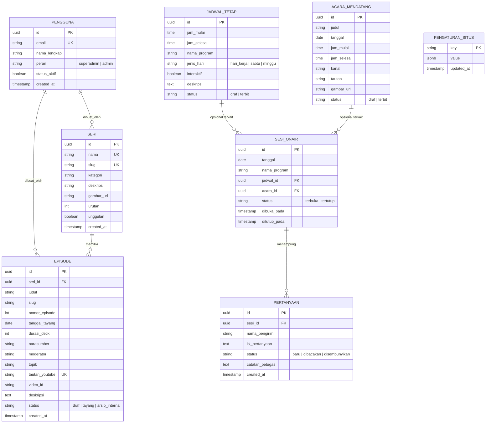
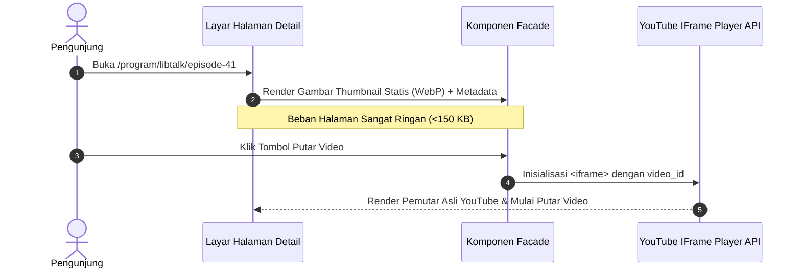
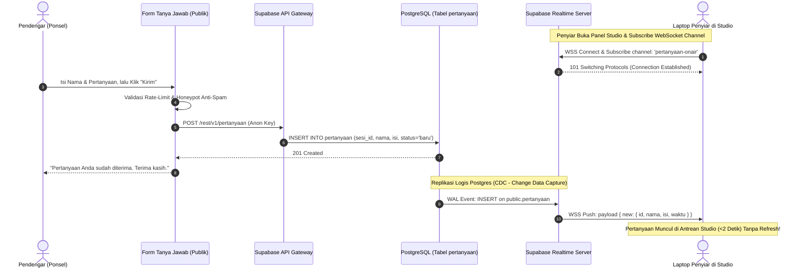

# Arsitektur dan Kebutuhan Teknis
## Website Radio & Siniar WBS Perpusnas

> **Catatan Tahap 11:** Contoh DDL dan RLS di dokumen ini masih memakai tabel `sesi_onair`/`pertanyaan`. Sumber kebenaran terkini adalah `supabase/schema.sql` dan `supabase/migrations/006-tahap11-chat.sql`, yang memakai `sesi_chat` dan `chat_pesan`.

| Keterangan | Isi |
|---|---|
| **Nomor Dokumen** | 06 |
| **Nama Dokumen** | Arsitektur dan Kebutuhan Teknis (*System Architecture & Technical Specifications*) |
| **Nama Situs** | Radio & Siniar WBS Perpusnas |
| **Versi** | 1.0 — Final |
| **Tanggal** | 17 November 2026 |
| **Status** | Final — Menjadi cetak biru teknis bagi tim pengembang dan administrator sistem |
| **Penyusun** | Gusti Ahmad Muttahid Bilhaq (Mahasiswa Magang Teknik Informatika di PUJASINTARA) |
| **Pembaca Utama** | Pengembang Perangkat Lunak, Administrator Sistem, dan Tim TI Perpustakaan Nasional RI |
| **Acuan** | Dokumen `01` versi 2.2, dokumen `02` versi 1.2, dokumen `03` versi 1.2, dokumen `04` versi 1.1, dan dokumen `05` versi 1.0 |
| **Sifat Dokumen** | Dokumen Teknis & Implementasi; perubahan arsitektur wajib melalui persetujuan bersama dan dicatat pada riwayat revisi |

---

## 0. Cara Membaca Dokumen Ini

Dokumen ini adalah **cetak biru rekayasa perangkat lunak (*software engineering blueprint*)** untuk website Radio & Siniar WBS Perpusnas. Dokumen ini menerjemahkan 53 kebutuhan fungsional pada Dokumen `05` (`FR-01` s.d. `FR-53`) menjadi arsitektur perangkat lunak konkret, tumpukan teknologi (*technology stack*), skema komunikasi data, konfigurasi integrasi pihak ketiga, strategi keamanan, dan alur otomatisasi *deployment*.

Dokumen ini ditujukan bagi **pengembang web dan tim TI Perpusnas**. Berbeda dengan dokumen Gelombang 1 yang bebas kode, dokumen ini memuat diagram arsitektur (Mermaid), spesifikasi protokol jaringan, konfigurasi *Continuous Integration / Continuous Deployment* (CI/CD), skema otorisasi *Row Level Security* (RLS), dan penanganan teknis khusus seperti *Mixed Content* audio streaming.

| Bagian | Isi Pokok | Sasaran Pembaca |
|---|---|---|
| **Bagian 1** | Topologi global sistem & diagram arsitektur tingkat tinggi | Arsitek Perangkat Lunak, Tim TI |
| **Bagian 2** | Arsitektur Frontend, SPA Routing, dan Hosting GitHub Pages | Frontend Developer |
| **Bagian 3** | Arsitektur Backend, PostgreSQL, dan Supabase BaaS | Backend & Database Developer |
| **Bagian 4** | Penanganan Aliran Audio Icecast & Solusi *Mixed Content* HTTPS | DevOps & Teknisi Studio |
| **Bagian 5** | Arsitektur Katalog Video & Integrasi YouTube IFrame API | Frontend Developer |
| **Bagian 6** | Arsitektur Sesi Tanya Jawab *Real-Time* via WebSockets | Fullstack Developer |
| **Bagian 7** | Integrasi Google Analytics 4 (GA4) & Arsitektur Privasi | Pengembang & Data Analyst |
| **Bagian 8** | Keamanan Sistem, Otentikasi Supabase Auth & Aturan RLS | Security Engineer |
| **Bagian 9** | Struktur Repositori, Standar Kode & *Pipeline* CI/CD GitHub Actions | DevOps / Developer |
| **Bagian 10** | Kebutuhan Non-Fungsional (Performa, Aksesibilitas, Kompatibilitas) | QA Engineer & Frontend |
| **Bagian 11** | Pencadangan Data, Pemulihan Bencana, dan Batasan Sistem | Administrator Sistem |
| **Bagian 12** | Matriks Pemetaan Teknologi terhadap Kebutuhan Fungsional (`FR`) | Pengembang & Auditor |
| **Bagian 13** | Penutup & Langkah Menuju Dokumen 07 (Model & Kamus Data) | Tim Pengembang |

---

## 1. Ringkasan Arsitektur Sistem & Topologi Global

Website Radio & Siniar WBS Perpusnas dirancang menggunakan **arsitektur Jamstack modern tanpa peladen mandiri (*serverless & stateless client-side architecture*)** yang memadukan keandalan hosting statis, fleksibilitas basis data terkelola, dan konsumsi media pihak ketiga.

### 1.1 Tiga Pilar Topologi Sistem
1. **Frontend Layer (GitHub Pages + Custom Domain):**
   Aplikasi klien dibangun sebagai *Single-Page Application* (SPA) berbasis framework modern (**React 18+ / TypeScript + Vite**) yang di-*bundle* menjadi aset statis (HTML, CSS, JS, WebP) dan di-hosting di **GitHub Pages** dengan domain terpisah (`M-01`, `M-02`). Lapisan ini menyajikan antarmuka pengunjung, pemutar audio persisten, dan panel administrasi staf.
2. **Backend & Data Layer (Supabase BaaS - Free Tier):**
   Seluruh kebutuhan operasional dinamis ditangani oleh **Supabase** (layanan *Backend-as-a-Service* berbasis PostgreSQL sumber terbuka) (`DR-09`). Supabase menyediakan:
   - **PostgreSQL Database:** Menyimpan data jadwal 24 jam, metadata katalog 331 video, sesi On-Air, arsip pertanyaan, acara mendatang, dan halaman statis.
   - **Supabase Auth:** Otentikasi berbasis JWT untuk Superadmin dan Admin dengan proteksi *brute-force*.
   - **Row Level Security (RLS):** Otorisasi langsung di tingkat kernel basis data untuk membatasi hak baca/tulis tanpa perlu menulis server API mandiri.
   - **Realtime Service (WebSockets):** Transmisi data seketika untuk mengalirkan pertanyaan pendengar masuk langsung ke layar laptop penyiar di studio.
   - **Supabase Storage:** *Bucket* penyimpanan objek (S3-compatible CDN) untuk menampung gambar sampul seri dan poster acara.
3. **External Media & Streaming Layer:**
   - **Icecast Audio Stream Studio WBS:** Aliran audio siaran radio 24 jam dipancarkan dari studio WBS (dikendalikan via **Jazler RadioStar 2**), dialirkan melalui protokol HTTPS ke elemen audio peramban pengunjung (`K-5`, `M-17`).
   - **YouTube Official WBS Radio Perpusnas:** Seluruh konten video (435 rekaman live & 72 video terunggah) disematkan (*embedded*) langsung dari kanal resmi menggunakan *YouTube IFrame Player API* (`K-2`, `M-04`).

### 1.2 Diagram Arsitektur Tingkat Tinggi (System Architecture Diagram)

```mermaid
flowchart TD
    subgraph Pengguna ["Pengguna Layanan"]
        Pendengar["Pendengar Radio & Pemustaka\n(Peramban Ponsel & Desktop)"]
        Petugas["Pengelola Layanan & Penyiar WBS\n(Superadmin & Admin)"]
    end

    subgraph Hosting ["Frontend Hosting: GitHub Pages (Custom Domain)"]
        SPA["Single-Page Application (SPA)\nReact 18 + Vite + TypeScript + Tailwind CSS"]
        StateAudio["Global Audio Context\n(State Pemutar Persisten)"]
        RouterSPA["Client-Side Router (SPA Fallback)\n(Deep Linking /jadwal, /program, /cari)"]
    end

    subgraph BaaS ["Backend-as-a-Service: Supabase (Free Tier)"]
        Auth["Supabase Auth\n(JWT, Bcrypt, Session)"]
        DB[(PostgreSQL 15+\nRow Level Security - RLS)]
        Realtime["Realtime Engine\n(WebSockets Elixir/Phoenix)"]
        Storage["Storage CDN Bucket\n(Cover Image Seri & Acara)"]
    end

    subgraph MediaStudio ["Infrastruktur Media Eksternal"]
        IcecastProxy["Icecast SSL Reverse Proxy\n(HTTPS://stream-wbs.perpusnas.go.id)"]
        StudioJazler["Studio Radio WBS Perpusnas\n(Jazler RadioStar 2 Playout)"]
        YouTube["Kanal YouTube Resmi WBS\n(331 Video Publik Tersemat)"]
        GA4["Google Analytics 4 (GA4)\n(IP Teranonimasi)"]
    end

    Pendengar -->|HTTPS Request| SPA
    Petugas -->|HTTPS Login Admin| SPA
    
    SPA --> StateAudio
    SPA --> RouterSPA
    
    StateAudio -->|Aliran Audio HTTPS| IcecastProxy
    IcecastProxy -.->|Aliran Audio Sumber| StudioJazler
    
    SPA -->|Embed IFrame API| YouTube
    SPA -->|Pelacakan Peristiwa Agregat| GA4
    
    SPA -->|Otentikasi Kredensial| Auth
    SPA -->|Kueri Data Publik (REST/PostgREST)| DB
    SPA -->|Unduh Berkas Gambar| Storage
    Petugas -->|Mutasi Data Jadwal & Konten (RLS)| DB
    Petugas -->|Unggah Sampul Program| Storage
    
    SPA -.->|Kirim Pertanyaan (Anonim)| DB
    DB -->|CDC / Push Event| Realtime
    Realtime -->|WebSocket Push (<2 detik)| Petugas
```

---

## 2. Arsitektur Frontend & Hosting (GitHub Pages)

### 2.1 Pemilihan Framework & Tumpukan Teknologi Frontend
Aplikasi klien dibangun menggunakan ekosistem modern yang menjamin performa cepat, ukuran bundel ringkas, dan kompatibilitas penuh dengan lingkungan hosting statis GitHub Pages:

| Komponen | Teknologi Terpilih | Justifikasi Teknis |
|---|---|---|
| **Core Framework** | **React 18+ dengan TypeScript** | Menjamin tipe data yang ketat (*type safety*), performa tinggi dengan *concurrent rendering*, dan ekosistem komponen yang luas. |
| **Build Tool & Bundler** | **Vite 5+** | Kecepatan *hot module replacement* (HMR), waktu build sangat cepat, dan menghasilkan bundel produksi optimal dengan *tree-shaking* agresif. |
| **CSS Framework** | **Tailwind CSS 3+** | Desain responsif berbasis *utility-first*, bebas redundansi CSS, dan ukuran CSS produksi sangat kecil (<20 KB terkompresi). |
| **State Management** | **React Context + Zustand** | Penyimpanan status global yang sangat ringan untuk mengelola audio pemutar radio persisten dan sesi pengguna tanpa *overhead* seperti Redux. |
| **Client Routing** | **React Router v6+ (Data API)** | Penanganan navigasi sisi klien yang mulus tanpa memicu pemuatan ulang halaman (*no full-page reload*). |
| **Komponen Ikon** | **Lucide React** | Ikon SVG berbobot sangat ringan, ramah pohon modular, dan standar tampilan institusional yang bersih. |

### 2.2 Penanganan Routing SPA pada GitHub Pages (Deep Linking Fallback)
GitHub Pages secara alami adalah server file statis yang mengembalikan berkas `404.html` jika rute yang diminta (seperti `/jadwal` atau `/program/libtalk`) tidak berwujud direktori fisik di server.

Untuk mengatasi hal ini, arsitektur menerapkan teknik **SPA Single-Entry Redirect Pattern**:
1. Berkas build menghasilkan berkas `index.html` dan salinan skrip pengarah di `404.html`.
2. Saat pengunjung mengakses rute langsung (misal: `https://domain.com/program/libtalk`), server GitHub Pages menyajikan `404.html`.
3. Skrip di dalam `404.html` mengonversi path URL menjadi parameter query (misal: `/?p=/program/libtalk`) dan mengarahkan kembali peramban ke `index.html`.
4. Skrip inisialisasi di `index.html` membaca parameter query tersebut dan memerintahkan *React Router* untuk me-render rute yang sesuai tanpa terlihat kedipan (*flash*) oleh pengguna.
5. Dengan cara ini, seluruh rute publik ([Dokumen 04 Bagian 1.1](04-rancangan-halaman-pengunjung.md)) dapat di-*bookmark* dan dibagikan secara sah (*deep-linking support*).

### 2.3 Arsitektur Pemutar Audio Persisten (Persistent Audio State Engine)
Salah satu persyaratan utama website adalah siaran radio **tidak boleh mati** saat pendengar berpindah antar-halaman (`PR-01`, `PR-44`, `FR-01`).

```mermaid
sequenceDiagram
    autonumber
    actor Pengunjung
    participant Header as Komponen Halaman
    participant Router as React Router
    participant AudioContext as Global Audio Provider
    participant HTMLAudio as Objek Audio HTML5
    participant Icecast as Server Aliran Icecast

    Pengunjung->>Header: Klik "Dengarkan Sekarang"
    Header->>AudioContext: dispatch({ type: 'PLAY' })
    AudioContext->>HTMLAudio: audio.src = streamUrl; audio.play()
    HTMLAudio->>Icecast: GET /live (HTTPS)
    Icecast-->>HTMLAudio: 200 OK (Audio Chunk Stream)
    HTMLAudio-->>Pengunjung: Siaran Radio Berbunyi

    Note over Pengunjung, Header: Pengunjung Berpindah Halaman
    Pengunjung->>Header: Klik Menu "Jadwal Siaran" (/jadwal)
    Header->>Router: navigate('/jadwal')
    Router->>Router: Render Komponen Jadwal
    Note over AudioContext, HTMLAudio: AudioContext Berada di Luar <Outlet /> Router<br/>sehingga Audio Tetap Berjalan Tanpa Henti!
    HTMLAudio-->>Pengunjung: Siaran Audio Berlanjut Tanpa Jeda
```

**Struktur Hirarki Pohon Komponen DOM:**
```jsx
// Hirarki Provider Menjamin Audio Menempati Root Aplikasi
<QueryClientProvider client={queryClient}>
  <AuthProvider>
    <AudioPlayerProvider>  {/* <- Menampung elemen <audio> dan state */}
      <BrowserRouter>
        <AppLayout>          {/* <- Header, Main, Footer */}
          <Routes>
            <Route path="/" element={<HomePage />} />
            <Route path="/jadwal" element={<SchedulePage />} />
            <Route path="/program" element={<ProgramPage />} />
            <Route path="/program/:slug" element={<SeriesDetailPage />} />
            <Route path="/program/:slug/:episodeSlug" element={<EpisodeDetailPage />} />
            <Route path="/cari" element={<SearchPage />} />
            <Route path="/tentang" element={<AboutPage />} />
            <Route path="/kontak" element={<ContactPage />} />
            <Route path="/kebijakan-privasi" element={<PrivacyPage />} />
            <Route path="/admin/*" element={<AdminRoute><AdminLayout /></AdminRoute>} />
            <Route path="*" element={<NotFoundPage />} />
          </Routes>
        </AppLayout>
        <PersistentBottomPlayer /> {/* <- Melekat di luar hirarki rute halaman */}
      </BrowserRouter>
    </AudioPlayerProvider>
  </AuthProvider>
</QueryClientProvider>
```

---

## 3. Arsitektur Backend & Database (Supabase BaaS)

### 3.1 Integrasi Supabase Client SDK
Aplikasi berkomunikasi langsung dengan Supabase menggunakan pustaka resmi `@supabase/supabase-js`. Komunikasi dilakukan secara asinkron memanfaatkan antarmuka aman berbasis HTTPS REST (*PostgREST*) dan WebSockets (*Realtime*).

Konfigurasi inisialisasi klien:
```typescript
import { createClient } from '@supabase/supabase-js';
import type { Database } from './types/supabase';

const supabaseUrl = import.meta.env.VITE_SUPABASE_URL;
const supabaseAnonKey = import.meta.env.VITE_SUPABASE_ANON_KEY;

if (!supabaseUrl || !supabaseAnonKey) {
  throw new Error('Konfigurasi Supabase URL atau Anon Key belum disetel pada environment.');
}

// Inisialisasi klien tunggal (Singleton)
export const supabase = createClient<Database>(supabaseUrl, supabaseAnonKey, {
  auth: {
    persistSession: true,
    autoRefreshToken: true,
    detectSessionInUrl: false,
    storage: window.localStorage,
  },
  realtime: {
    params: {
      eventsPerSecond: 10,
    },
  },
});
```

### 3.2 Desain Skema Entitas Relasional (PostgreSQL Schema Overview)
Seluruh data aplikasi diorganisasikan ke dalam 7 tabel utama di PostgreSQL dengan integritas referensial dan indeks pencarian:



---

## 4. Arsitektur Aliran Audio Icecast & Penanganan *Mixed Content*

### 4.1 Tantangan Teknis *Mixed Content* (HTTP vs HTTPS)
Website dideploy di GitHub Pages dan disajikan secara wajib melalui protokol aman **HTTPS** (`https://domain-wbs.id`). Kebijakan keamanan peramban modern (*W3C Mixed Content Specification*) secara baku **memblokir pemutaran elemen audio tak terenkripsi (HTTP)** yang diminta dari halaman HTTPS:
$$\text{Halaman (HTTPS)} + \text{Aliran Audio (HTTP)} \longrightarrow \mathbf{BLOCKED\ (Mixed\ Content\ Error)}$$

Apabila server Icecast studio WBS di Perpusnas dipancarkan menggunakan protokol HTTP biasa (contoh: `http://103.xxx.xxx.xxx:8000/live`), audio siaran akan **gagal berbunyi sama sekali** di Google Chrome, Mozilla Firefox, Microsoft Edge, dan Safari iOS.

### 4.2 Solusi Arsitektur Penanganan Aliran Audio
Untuk memenuhi prasyarat `D-8`, `PR-01`, dan `R-10`, arsitektur menetapkan **dua jalur implementasi resmi**:

```mermaid
flowchart LR
    subgraph Klien ["Sisi Klien (Peramban Pengunjung)"]
        BrowserAudio["<audio> Player Element\n(Halaman HTTPS GitHub Pages)"]
    end

    subgraph Opsi1 ["Opsi Utama: Direct Native Icecast SSL"]
        Certbot["Certbot / Let's Encrypt\n(SSL Certificate di Server Icecast)"]
        IcecastSSL["Icecast 2 Server Native HTTPS\n(Port 8443 / 443)\nhttps://radio-stream.perpusnas.go.id/live"]
    end

    subgraph Opsi2 ["Opsi Alternatif: SSL Reverse Proxy"]
        NginxProxy["Nginx SSL Reverse Proxy\natau Cloudflare Stream Proxy\n(Terminasi SSL di Port 443)"]
        IcecastHTTP["Icecast Studio WBS (HTTP)\n(Port 8000)\nhttp://studio-ip:8000/live"]
    end

    BrowserAudio -->|Akses Audio HTTPS Valid| IcecastSSL
    IcecastSSL --- Certbot
    
    BrowserAudio -.->|Bila Native SSL Belum Ada| NginxProxy
    NginxProxy -.->|Tarik Aliran Lokal (HTTP)| IcecastHTTP
```

#### Spesifikasi Konfigurasi Teknis:
1. **Opsi Utama (Direkomendasikan): Native HTTPS pada Icecast Studio**
   - Tim TI Perpusnas memasang sertifikat SSL (Let's Encrypt atau SSL Institusi) pada konfigurasi `icecast.xml`:
     ```xml
     <listen-socket>
         <port>8443</port>
         <ssl>1</ssl>
     </listen-socket>
     <paths>
         <ssl-certificate>/etc/icecast2/bundle.pem</ssl-certificate>
     </paths>
     ```
2. **Opsi Alternatif: Reverse Proxy Nginx dengan Terminasi SSL**
   - Jika server Icecast studio tidak dapat diutak-atik langsung, lalu lintas audio dilewatkan melalui Nginx reverse proxy yang memiliki sertifikat SSL:
     ```nginx
     server {
         listen 443 ssl http2;
         server_name stream-wbs.perpusnas.go.id;

         ssl_certificate /etc/letsencrypt/live/stream-wbs.perpusnas.go.id/fullchain.pem;
         ssl_certificate_key /etc/letsencrypt/live/stream-wbs.perpusnas.go.id/privkey.pem;

         location /live {
             proxy_pass http://103.xxx.xxx.xxx:8000/live;
             proxy_set_header Host $host;
             proxy_buffering off;
             proxy_read_timeout 86400s;
             proxy_send_timeout 86400s;
         }
     }
     ```

### 4.3 Logika Penanganan Putus Sambung (*Auto-Reconnect & Resilience*)
Pada peramban pengunjung, objek audio dikontrol dengan algoritma *Exponential Backoff* untuk menangani fluktuasi jaringan seluler:
```typescript
class IcecastStreamEngine {
  private audio: HTMLAudioElement;
  private streamUrl: string;
  private retryAttempts: number = 0;
  private maxRetries: number = 3;
  private backoffDelays: number[] = [1000, 3000, 6000]; // milidetik

  constructor(url: string) {
    this.audio = new Audio();
    this.streamUrl = url;
    this.setupListeners();
  }

  private setupListeners() {
    this.audio.addEventListener('error', () => this.handleStreamFailure());
    this.audio.addEventListener('stalled', () => this.handleStreamFailure());
  }

  private handleStreamFailure() {
    if (this.retryAttempts < this.maxRetries) {
      const delay = this.backoffDelays[this.retryAttempts] || 5000;
      this.retryAttempts++;
      setTimeout(() => {
        // Beri stempel timestamp acak untuk mencegah browser menyajikan audio beku dari cache
        this.audio.src = `${this.streamUrl}?t=${Date.now()}`;
        this.audio.play().catch(() => {});
      }, delay);
    } else {
      // Picu notifikasi UI status siaran gangguan (FR-07)
      window.dispatchEvent(new CustomEvent('wbs:stream-offline'));
    }
  }
}
```

---

## 5. Arsitektur Katalog Video & Integrasi YouTube

### 5.1 Mekanisme Penyematan IFrame (*Facade Embed Pattern*)
Memuat 331 pemutar iframe YouTube sekaligus di halaman web akan membebani memori peramban secara ekstrem dan menurunkan skor kinerja Google Lighthouse secara drastis (setiap IFrame memuat >500 KB skrip eksternal).

Arsitektur menerapkan pola **Facade Embed (Pemuatan Malas / Lazy Evaluation)**:
1. Saat kartu katalog dirender, sistem **hanya menampilkan gambar thumbnail WebP** yang diambil dari cache CDN atau YouTube (`https://i.ytimg.com/vi/{video_id}/hqdefault.jpg`) dengan tombol putar tiruan.
2. IFrame YouTube asli **baru disuntikkan ke DOM setelah pengunjung secara sadar menekan tombol putar**.
3. Dengan pola ini:
   - Skor *Performance* Core Web Vitals tetap optimal (LCP $\le 2.0$ detik, TBT $\approx 0$ ms).
   - Video YouTube **tidak berputar otomatis (*no autoplay*)**, sehingga tidak pernah bertabrakan dengan audio radio persisten yang sedang aktif (`FR-11`).



### 5.2 Penanganan Tautan Rusak & Ketahanan Data Katalog
Sesuai prinsip etalase mandiri (`P-6`, `K-2`, `FR-12`), data katalog disimpan permanen pada tabel `episode` Supabase. Website **tidak bergantung pada panggilan dinamis YouTube Data API v3 saat runtime publik**:
- Informasi judul baku, seri, nomor episode, narasumber, moderator, durasi, dan topik disimpan di Supabase.
- Apabila video di YouTube dihapus atau diubah menjadi privat oleh pihak luar, peramban mendeteksi galat pemutar YouTube:
  ```javascript
  function onPlayerError(event) {
    // Kode galat YouTube: 100 (tidak ditemukan), 101/150 (tidak diizinkan embed)
    if ([100, 101, 150].includes(event.data)) {
      setVideoAvailable(false);
      // Tampilkan kontainer pesan ramah tanpa merusak tampilan metadata
    }
  }
  ```
- Tampilan metadata kegiatan dan dokumentasi literasi tetap utuh, menegakkan integritas arsip institusi (`IK-8`).


---

## 6. Arsitektur Sesi Tanya Jawab Real-Time via WebSockets

Interaksi tanya jawab On-Air antara pendengar dan penyiar radio di studio membutuhkan transmisi data yang seketika tanpa jeda pemungutan suara berulang (*no HTTP polling*) (`FR-19` s.d. `FR-26`, `K-3`, `M-06`–`M-09`).

### 6.1 Topologi Komunikasi Real-Time Supabase
Supabase memanfaatkan mesin *Realtime* (berbasis kluster Elixir/Phoenix) yang mendengarkan log replikasi logis (*Write-Ahead Logging / WAL*) basis data PostgreSQL:



### 6.2 Kode Implementasi Langganan Realtime pada Panel Admin
Pada antarmuka pengelola di studio, komponen mendengarkan mutasi data secara otomatis:
```typescript
import { useEffect, useState } from 'react';
import { supabase } from '../lib/supabase';
import type { Pertanyaan } from '../types';

export function useLiveQuestions(sesiId: string) {
  const [questions, setQuestions] = useState<Pertanyaan[]>([]);

  useEffect(() => {
    // 1. Muat pertanyaan yang sudah ada pada sesi aktif
    const fetchInitialQuestions = async () => {
      const { data } = await supabase
        .from('pertanyaan')
        .select('*')
        .eq('sesi_id', sesiId)
        .order('created_at', { ascending: false });
      if (data) setQuestions(data);
    };

    fetchInitialQuestions();

    // 2. Buat saluran WebSocket Realtime untuk mendengarkan penambahan data baru
    const channel = supabase
      .channel(`realtime:pertanyaan:${sesiId}`)
      .on(
        'postgres_changes',
        {
          event: 'INSERT',
          schema: 'public',
          table: 'pertanyaan',
          filter: `sesi_id=eq.${sesiId}`,
        },
        (payload) => {
          // Tambahkan pertanyaan baru ke urutan teratas seketika
          setQuestions((prev) => [payload.new as Pertanyaan, ...prev]);
          // Putar nada notifikasi audio lembut di studio (opsional)
          new Audio('/assets/sounds/notification.mp3').play().catch(() => {});
        }
      )
      .on(
        'postgres_changes',
        {
          event: 'UPDATE',
          schema: 'public',
          table: 'pertanyaan',
          filter: `sesi_id=eq.${sesiId}`,
        },
        (payload) => {
          // Perbarui status jika ditandai Dibacakan / Disembunyikan
          setQuestions((prev) =>
            prev.map((q) => (q.id === payload.new.id ? (payload.new as Pertanyaan) : q))
          );
        }
      )
      .subscribe();

    return () => {
      supabase.removeChannel(channel);
    };
  }, [sesiId]);

  return { questions, setQuestions };
}
```

### 6.3 Mekanisme Anti-Spam & Keamanan Formulir Pengunjung
Untuk melindungi basis data dari pembanjiran data otomatis (*bot submission*), formulir mengombinasikan 3 lapisan proteksi:
1. **Bidang Jebakan (*Honeypot Field*):** Satu kolom tersembunyi berlabel `website_url` yang disamarkan dengan CSS `display: none; position: absolute; left: -9999px;`. Peramban manusia tidak melihatnya, namun bot otomatis akan mengisinya. Permintaan yang menyertakan isian ini langsung dibatalkan secara diam-diam (*silent discard*).
2. **Pembatasan Frekuensi Lokal (*Client-Side Token Bucket*):** Sesi peramban mencatat stempel waktu pengiriman di `localStorage`. Kiriman ke-4 dalam rentang 10 menit diblokir sebelum menyentuh jaringan.
3. **Penyaringan Tautan (*Link Stripping*):** Validasi ekspresi reguler melarang adanya protokol web (`http://`, `https://`, `www.`, ekstensi `.com`, `.id`, dll.) pada kolom pertanyaan guna mencegah promosi tautan judi/iklan ilegal.

---

## 7. Integrasi Google Analytics 4 (GA4) & Arsitektur Privasi

Website mengintegrasikan GA4 untuk mendukung pelaporan statistik kinerja layanan dan sebaran wilayah pengunjung bagi pimpinan Perpusnas (`M-14`, `PR-49`, `FR-49` s.d. `FR-53`).

### 7.1 Skema Pelacakan Patuh Privasi (*Privacy-First Telemetry*)
Sesuai ketetapan Dokumen `01` dan `04`, aplikasi memegang teguh prinsip pelindungan data pribadi pemustaka:
- **IP Teranonimasi Penuh (*IP Anonymization*):** GA4 dikonfigurasi dengan penyembunyian oktet terakhir alamat IP sebelum data dicatat di server analitik.
- **Nol Perekaman IP di Database Lokal:** Tabel basis data Supabase (termasuk tabel `pertanyaan`) **sama sekali tidak memiliki kolom alamat IP atau penanda perangkat**.
- **Kondisi Aktivasi Berpagar:** Skrip pelacak GA4 **hanya diinjeksi ke DOM** bila sakelar `aktifkan_analitik` di Pengaturan Situs bernilai `true` dan halaman Kebijakan Privasi telah berstatus Terbit (`PR-15`, `PR-49`).

### 7.2 Spesifikasi Peristiwa Kustom (*Custom Events Schema*)
Pelacakan interaksi penting diimplementasikan menggunakan skrip terpusat:

```typescript
// src/lib/analytics.ts
export const trackEvent = (
  eventName: 'radio_play' | 'radio_pause' | 'question_submit' | 'episode_view' | 'search_query',
  params: Record<string, string | number | boolean> = {}
) => {
  if (typeof window !== 'undefined' && (window as any).gtag) {
    (window as any).gtag('event', eventName, {
      ...params,
      send_to: import.meta.env.VITE_GA_MEASUREMENT_ID,
    });
  }
};
```

| Nama Peristiwa | Pemicu (*Trigger*) | Parameter yang Dikirim | Nilai Manfaat bagi Pimpinan |
|---|---|---|---|
| `radio_play` | Pengunjung menekan tombol putar siaran radio | `program_name`: Nama program aktif<br>`day_type`: Hari Kerja / Akhir Pekan | Mengukur program siaran radio mana yang paling banyak didengarkan masyarakat. |
| `radio_pause` | Pengunjung menjeda audio | `duration_listened_sec`: Durasi dengar | Menghitung rata-rata waktu keterlibatan (*average listening time*). |
| `question_submit` | Pengunjung berhasil mengirim pertanyaan | `program_name`: Program siaran<br>`is_anonymous`: boolean | Mengukur tingkat keaktifan masyarakat berdialog dengan narasumber. |
| `episode_view` | Pengunjung membuka halaman detail episode | `series_name`: Nama seri<br>`episode_id`: UUID episode | Mengetahui episode siniar yang paling diminati untuk perencanaan tema berikutnya. |
| `search_query` | Pengunjung mengeksekusi pencarian kata kunci | `keyword`: Kata kunci pencarian | Mengetahui tren topik literasi yang paling banyak dicari pemustaka. |

---

## 8. Keamanan Sistem, Otentikasi & Otorisasi (*Row Level Security*)

### 8.1 Arsitektur Otentikasi Pengelola (Supabase Auth)
Otentikasi staf pengelola menggunakan *Supabase GoTrue Auth Service*:
- **Penyimpanan Kredensial:** Kata sandi di-hash menggunakan algoritma aman **Argon2id** / **Bcrypt** dengan *salt* acak di server Supabase.
- **Siklus Hidup Token JWT:**
  - *Access Token:* Berumur pendek (1 jam) berisi klaim `user_id` dan `role`.
  - *Refresh Token:* Disimpan di penyimpanan aman sisi klien dengan rotasi otomatis.
  - Sesi otomatis dibatalkan jika pengguna tidak aktif selama 30 menit atau mencapai batas maksimal 8 jam (`FR-44`).

### 8.2 Matriks Kebijakan Otorisasi Basis Data (*Row Level Security - RLS*)
Keamanan data tidak disandarkan pada kode frontend, melainkan ditegakkan secara absolut di tingkat kernel PostgreSQL menggunakan kebijakan **Row Level Security (RLS)**. Siapa pun yang memiliki kunci anonim (*Anon Key*) hanya dapat mengeksekusi operasi yang secara eksplisit diizinkan oleh kebijakan RLS:

```sql
-- Aktifkan RLS pada seluruh tabel
ALTER TABLE pengguna ENABLE ROW LEVEL SECURITY;
ALTER TABLE seri ENABLE ROW LEVEL SECURITY;
ALTER TABLE episode ENABLE ROW LEVEL SECURITY;
ALTER TABLE jadwal_tetap ENABLE ROW LEVEL SECURITY;
ALTER TABLE sesi_onair ENABLE ROW LEVEL SECURITY;
ALTER TABLE pertanyaan ENABLE ROW LEVEL SECURITY;
ALTER TABLE acara_mendatang ENABLE ROW LEVEL SECURITY;
ALTER TABLE pengaturan_situs ENABLE ROW LEVEL SECURITY;

-- 1. KEBIJAKAN PADA TABEL EPISODE
-- Publik hanya dapat membaca episode berstatus 'tayang'
CREATE POLICY "Publik dapat membaca episode tayang" 
ON episode FOR SELECT 
TO anon, authenticated 
USING (status = 'tayang');

-- Admin dan Superadmin dapat membaca seluruh episode (termasuk draf dan arsip internal)
CREATE POLICY "Staf dapat membaca seluruh episode" 
ON episode FOR SELECT 
TO authenticated 
USING (true);

-- Admin dan Superadmin dapat menambah dan menyunting episode
CREATE POLICY "Staf dapat memanipulasi episode" 
ON episode FOR ALL 
TO authenticated 
USING (true) 
WITH CHECK (true);

-- 2. KEBIJAKAN PADA TABEL PERTANYAAN (KRUSIAL UNTUK PRIVASI)
-- Publik HANYA boleh INSERT pertanyaan jika sesi berstatus 'terbuka'
CREATE POLICY "Publik dapat mengirim pertanyaan saat sesi terbuka" 
ON pertanyaan FOR INSERT 
TO anon, authenticated 
WITH CHECK (
  EXISTS (
    SELECT 1 FROM sesi_onair 
    WHERE sesi_onair.id = pertanyaan.sesi_id 
    AND sesi_onair.status = 'terbuka'
  )
);

-- Publik DILARANG KERAS membaca (SELECT) pertanyaan pendengar lain
-- Hanya akun staf yang diizinkan SELECT, UPDATE status, dan DELETE
CREATE POLICY "Hanya staf yang dapat membaca dan mengurasi pertanyaan" 
ON pertanyaan FOR ALL 
TO authenticated 
USING (true) 
WITH CHECK (true);

-- 3. KEBIJAKAN PADA TABEL PENGATURAN SITUS & PENGGUNA
-- Publik dan Admin dapat membaca pengaturan umum
CREATE POLICY "Semua dapat membaca pengaturan umum" 
ON pengaturan_situs FOR SELECT 
TO anon, authenticated 
USING (true);

-- Hanya Superadmin yang boleh mengubah pengaturan situs
CREATE POLICY "Hanya Superadmin yang boleh mengubah pengaturan" 
ON pengaturan_situs FOR UPDATE 
TO authenticated 
USING (
  EXISTS (
    SELECT 1 FROM pengguna 
    WHERE pengguna.id = auth.uid() 
    AND pengguna.peran = 'superadmin'
  )
);
```

### 8.3 Header Keamanan (*Security Headers*)
Mengingat aplikasi di-*serve* dari GitHub Pages, keamanan peramban diperkuat melalui tag meta `<meta http-equiv="...">` dan aturan CSP pada `index.html`:
- **Content-Security-Policy (CSP):**
  - `default-src 'self';`
  - `script-src 'self' https://www.googletagmanager.com;`
  - `media-src 'self' https://* blob:;` (Membuka izin aliran audio HTTPS Icecast studio)
  - `frame-src https://www.youtube.com https://www.youtube-nocookie.com;` (Mengizinkan embed pemutar YouTube)
  - `connect-src 'self' https://*.supabase.co wss://*.supabase.co https://www.google-analytics.com;` (Mengizinkan API & WebSocket Supabase serta GA4)
  - `img-src 'self' data: https://*.supabase.co https://i.ytimg.com https://img.youtube.com;`
- **Referrer-Policy:** `strict-origin-when-cross-origin`
- **X-Content-Type-Options:** `nosniff`

---

## 9. Struktur Repositori, Standar Kode & *Pipeline* CI/CD GitHub Actions

### 9.1 Pohon Direktori Proyek (*Project Directory Structure*)
Struktur proyek ditata dengan arsitektur modular yang memisahkan urusan logika bisnis, tata letak antarmuka, dan komunikasi data:

```
radio-wbs/
├── .github/
│   └── workflows/
│       └── deploy.yml              # Build & deploy otomatis ke GitHub Pages
├── docs/                           # Dokumen perencanaan 01–12, panduan, dan roadmap
├── public/                         # Aset statis: logo SVG, favicon, sitemap, 404 fallback
├── scripts/                        # Skrip migrasi katalog & helper lokal
│   ├── data/
│   │   └── metadata_youtube.csv    # Sumber data untuk menghasilkan ulang SQL katalog
│   ├── migrate_catalog.py
│   ├── pasang-resend.ps1
│   └── start-server.bat
├── src/
│   ├── components/                 # Komponen antarmuka modular per fitur
│   │   ├── admin/                  # AdminLayout, AdminRoute, StatCard, formulir admin
│   │   ├── artikel/                # Editor kaya, tampilan & pratinjau artikel
│   │   ├── catalog/                # SeriCard, EpisodeCard, CategoryFilter, YouTubeFacade
│   │   ├── common/                 # Header, Footer, Breadcrumbs, StateBox, Toast
│   │   ├── home/                   # HeroOnAir, ProgramUnggulan, VideoTerbaru, dll.
│   │   ├── interaction/            # ChatModal
│   │   └── player/                 # PersistentPlayer (audio lintas halaman)
│   ├── context/                    # AudioContext, AuthContext, NotifikasiContext
│   ├── hooks/                      # useOnAirProgram, useRealtimeChat, useSesiChatAktif, dll.
│   ├── pages/                      # Halaman publik & modul admin (/admin/*)
│   ├── services/                   # Klien Supabase, katalog, artikel, chat, GA4
│   ├── types/                      # Definisi tipe database, chat, dan laporan
│   ├── utils/                      # WIB, sanitasi HTML, formatter, CSV
│   ├── App.tsx                     # Rute utama & susunan layout
│   ├── index.css                   # Direktif Tailwind & token resmi Perpusnas
│   └── main.tsx                    # Titik masuk React DOM
├── supabase/
│   ├── schema.sql                  # Skema lengkap untuk instalasi baru
│   ├── migrations/                 # Migrasi bertahap 001–007
│   ├── functions/                  # Edge Function Supabase
│   └── config.toml
├── .env.example
├── AGENTS.md                       # Instruksi operasional & guardrails proyek
├── CLAUDE.md                       # Penunjuk singkat ke AGENTS.md
├── README.md
├── index.html                      # Template dokumen HTML root
├── package.json                    # Konfigurasi dependensi Node.js
├── postcss.config.js
├── tailwind.config.js              # Konfigurasi token warna Perpusnas
├── tsconfig.json                   # Konfigurasi kompilasi TypeScript
├── vite.config.ts                  # Konfigurasi bundler Vite
└── vercel.json                     # Rewrite SPA & base path untuk Vercel
```

### 9.2 Alur Otomatisasi CI/CD (*GitHub Actions Workflow*)
Setiap pembaruan kode yang di-*push* ke cabang utama (`main`) akan diuji, dikompilasi, dan di-deploy secara otomatis ke GitHub Pages:

```yaml
# .github/workflows/deploy.yml
name: Deploy Website Radio WBS ke GitHub Pages

on:
  push:
    branches:
      - main
  workflow_dispatch:

permissions:
  contents: read
  pages: write
  id-token: write

concurrency:
  group: 'pages'
  cancel-in-progress: true

jobs:
  build-and-deploy:
    environment:
      name: github-pages
      url: ${{ steps.deployment.outputs.page_url }}
    runs-on: ubuntu-latest

    steps:
      - name: 1. Checkout Kode Sumber
        uses: actions/checkout@v4

      - name: 2. Persiapkan Lingkungan Node.js
        uses: actions/setup-node@v4
        with:
          node-version: 20
          cache: 'npm'

      - name: 3. Pasang Dependensi
        run: npm ci

      - name: 4. Pemeriksaan Kualitas & Tipe Kode (Linter & Typecheck)
        run: |
          npm run typecheck
          npm run lint

      - name: 5. Kompilasi Aset Statis Produksi (Vite Build)
        env:
          VITE_SUPABASE_URL: ${{ secrets.VITE_SUPABASE_URL }}
          VITE_SUPABASE_ANON_KEY: ${{ secrets.VITE_SUPABASE_ANON_KEY }}
          VITE_GA_MEASUREMENT_ID: ${{ secrets.VITE_GA_MEASUREMENT_ID }}
        run: npm run build

      - name: 6. Salin 404 Fallback untuk Routing SPA
        run: cp dist/index.html dist/404.html

      - name: 7. Unggah Artefak GitHub Pages
        uses: actions/upload-pages-artifact@v3
        with:
          path: './dist'

      - name: 8. Luncurkan ke GitHub Pages
        id: deployment
        uses: actions/deploy-pages@v4
```

---

## 10. Kebutuhan Non-Fungsional Teknis (Performa, Aksesibilitas, Kompatibilitas)

### 10.1 Sasaran Kinerja (*Core Web Vitals*)
Sesuai indikator `IK-6`, situs harus dapat dimuat dalam waktu $\le 3$ detik pada jaringan seluler standar:

| Metrik Kinerja | Target Ambang Batas | Strategi Pemenuhan Teknis |
|---|---|---|
| **Largest Contentful Paint (LCP)** | $\le 2.0$ detik | Gambar hero dan thumbnail di-convert ke format WebP terkompresi; penundaan pemuatan IFrame YouTube (*Facade Pattern*); aset statis di-cache via GitHub CDN. |
| **First Input Delay (FID) / INP** | $\le 100$ ms | Meminimalkan beban eksekusi JavaScript berat di thread utama; pemisahan kode (*code splitting*) berbasis rute via `React.lazy()`. |
| **Cumulative Layout Shift (CLS)** | $\le 0.05$ | Seluruh kontainer gambar dan wadah video YouTube wajib memiliki rasio aspek baku (`aspect-video` / `aspect-[16/9]`) agar tidak terjadi pergeseran tata letak saat gambar selesai diunduh. |
| **Total Blocking Time (TBT)** | $\le 150$ ms | Skrip eksternal (GA4) dimuat secara asinkron (`async/defer`). |

### 10.2 Aksesibilitas & Ramah Disabilitas (WCAG 2.1 Level AA)
Sebagai portal layanan publik Perpusnas, sistem wajib memenuhi standar aksesibilitas dasar (`PR-34`, Dokumen 04 Bagian 15):
- **Kontras Warna:** Rasio kontras teks terhadap latar belakang minimal **4.5:1** untuk teks normal dan **3.0:1** untuk teks besar.
- **Navigasi Papan Tunas (*Keyboard Accessibility*):** Seluruh elemen interaktif (tombol putar, menu navigasi, kartu program, kolom formulir) dapat dijangkau dan dioperasikan menggunakan tombol `Tab`, `Enter`, dan `Space` dengan indikator fokus visual yang tegas (*focus ring visible*).
- **Pembaca Layar (*Screen Reader ARIA*):** Pemutar audio radio menyediakan atribut `aria-live="polite"` untuk mengumumkan perubahan status siaran ("Siaran diputar", "Siaran dijeda", "Siaran terputus") kepada pengguna tunanetra. Gambar wajib memuat teks alternatif (`alt`).

### 10.3 Matriks Kompatibilitas Lintas Peramban & Perangkat
Sistem diuji dan dijamin berjalan stabil pada versi peramban modern rilis 2 tahun terakhir (`PR-38`):

| Platform | Peramban yang Didukung Penuh | Catatan Pengujian Khusus |
|---|---|---|
| **Ponsel Android** | Google Chrome, Samsung Internet, Firefox Mobile | Pengujian persistensi audio saat layar dikunci (*background audio playback*). |
| **Ponsel iOS (iPhone)** | Safari iOS (v15+), Chrome for iOS | Pengujian kebijakan Safari iOS terkait *user interaction requirement* sebelum audio diizinkan berbunyi. |
| **Komputer Desktop** | Google Chrome, Microsoft Edge, Mozilla Firefox, Apple Safari | Pengujian tata letak responsif pada resolusi 1280px, 1440px, dan 1920px. |

---

## 11. Strategi Pencadangan, Pemulihan Bencana & Batasan Lingkungan

### 11.1 Strategi Pencadangan Data (*Backup & Disaster Recovery*)
Mengantisipasi risiko kehilangan dokumentasi berharga (`P-6`, `R-1`, `PR-36`):
1. **Pencadangan Otomatis Tingkat Cloud:** Layanan Supabase menjalankan pencadangan basis data harian otomatis (*daily database snapshots*) dengan retensi data 7 hari pada tier gratis.
2. **Pencadangan Manual Mandiri (Format JSON):**
   - Superadmin dapat mengunduh berkas arsip lengkap seluruh tabel kapan saja melalui modul Pengaturan Situs (`FR-48`).
   - Berkas JSON ini memuat seluruh struktur 331 episode, 21 seri, jadwal 24 jam, dan halaman statis yang siap diimpor ulang (*restore*) ke proyek Supabase baru dalam hitungan menit jika terjadi insiden darurat.
3. **Recovery Time Objective (RTO) & Recovery Point Objective (RPO):**
   - **RTO (Waktu Pemulihan):** $\le 2$ jam untuk menghubungkan GitHub Pages ke proyek cadangan baru.
   - **RPO (Titik Kehilangan Data):** $\le 24$ jam (maksimal perubahan hari terakhir).

### 11.2 Batasan Lingkungan Layanan Gratis (*Free-Tier Constraints Monitoring*)
Untuk menjamin biaya pemeliharaan website tetap **Rp 0** selamanya, arsitektur menjaga batas konsumsi sumber daya Supabase Free-Tier:

| Sumber Daya Supabase | Batas Tier Gratis | Estimasi Beban Radio WBS Perpusnas | Status Keamanan |
|---|---|---|---|
| **Ukuran Database PostgreSQL** | 500 MB | $\approx 25$ MB (331 episode + riwayat jadwal 1 tahun) | **Sangat Aman (5% kuota)** |
| **Penyimpanan Berkas (Storage)** | 1 GB | $\approx 120$ MB (21 sampul seri + poster acara WebP) | **Sangat Aman (12% kuota)** |
| **Bandwidth Keluar (Egress)** | 5 GB / bulan | Hanya untuk query JSON data teks; aset gambar dicache CDN peramban | **Aman (<2 GB / bulan)** |
| **Pengguna Aktif Bulanan (MAU Auth)** | 50.000 MAU | Hanya untuk 2 akun staf pengelola (Superadmin & Admin) | **Sangat Aman (<0.01%)** |
| **Koneksi Realtime Simultan** | 200 koneksi | Hanya dibuka pada panel admin studio saat siaran On-Air | **Sangat Aman (<5 koneksi)** |

---

## 12. Matriks Pemetaan Teknologi terhadap Kebutuhan Fungsional (FR)

Tabel berikut menunjukkan bagaimana setiap kebutuhan fungsional Dokumen `05` (`FR-01` s.d. `FR-53`) dieksekusi oleh tumpukan teknologi pada arsitektur sistem:

| Kelompok Kebutuhan Fungsional | Komponen Teknologi Eksekutor | Lapisan Arsitektur |
|---|---|---|
| **FR-01 s.d. FR-03** (Pemutar Persisten & Program Aktif) | HTML5 Audio API + Global Audio Context + Icecast HTTPS Proxy | Frontend Core & Studio Stream |
| **FR-04, FR-05** (Jadwal 24 Jam & Manajemen Jadwal) | React Component + Supabase PostgreSQL (`jadwal_tetap`) | Frontend & Supabase DB |
| **FR-06 s.d. FR-08** (Status Icecast & Pengaturan Audio) | Fetch HEAD Request + Supabase PostgreSQL (`pengaturan_situs`) | Frontend & Supabase DB |
| **FR-09 s.d. FR-13** (Penjelajahan Seri, Episode & Pemutar) | React Route + YouTube Facade IFrame API + Supabase DB (`seri`, `episode`) | Frontend & YouTube Media |
| **FR-14 s.d. FR-18** (Manajemen Seri, Episode & Normalisasi) | Supabase Client SDK + Supabase Storage Bucket (`covers`) | Frontend Admin & Supabase |
| **FR-19 s.d. FR-22** (Sesi On-Air & Ingesti Realtime) | Supabase PostgREST (Insert) + Supabase Realtime WebSocket (Push CDC) | Fullstack Realtime Engine |
| **FR-23 s.d. FR-26** (Kurasi, Arsip, Anti-Spam & Ekspor CSV) | Supabase RLS + Client Rate-Limiting + Blob CSV Generator | Frontend Admin & Database |
| **FR-27 s.d. FR-32** (Hero Beranda & Acara Mendatang) | React Component + Supabase PostgreSQL (`acara_mendatang`) | Frontend & Supabase DB |
| **FR-33 s.d. FR-36** (Pencarian Kata Kunci & Breadcrumb) | Client-Side In-Memory Search Index + Semantic Schema Breadcrumbs | Frontend Client Engine |
| **FR-37 s.d. FR-42** (Halaman Statis & Kanal Pengaduan) | React Markdown Renderer + Supabase PostgreSQL (`halaman_statis`) | Frontend & Supabase DB |
| **FR-43 s.d. FR-46** (Otentikasi Staf, Proteksi Brute-force & RBAC) | Supabase GoTrue Auth (JWT, Argon2) + PostgreSQL Row Level Security (RLS) | Security & Identity Layer |
| **FR-47, FR-48** (Validasi Unggahan & Unduh Cadangan JSON) | Client MIME Validator + Supabase Storage + JSON Snapshot Exporter | Storage & Backup Engine |
| **FR-49 s.d. FR-53** (Integrasi GA4 & Privasi Tanpa IP Mentah) | Google gtag.js (`anonymize_ip: true`) + Privacy-Compliant Event Bus | Analytics & Privacy Layer |

---

## 13. Penutup & Langkah Menuju Dokumen 07

Dokumen Arsitektur dan Kebutuhan Teknis (`06-arsitektur-dan-kebutuhan-teknis.md` — v1.0 Final) ini telah menetapkan landasan rekayasa perangkat lunak yang kokoh, terukur, dan sepenuhnya realistis untuk dibangun. 

### Poin Kunci yang Telah Ditetapkan:
1. **Biaya Pemeliharaan Nol Rupiah (Rp 0):** Memanfaatkan kombinasi hosting statis **GitHub Pages** dan **Supabase BaaS Free-Tier**, tanpa membutuhkan server sewaan bulanan.
2. **Solusi Definitif *Mixed Content*:** Menjamin siaran radio audio Icecast studio dapat didengarkan di seluruh peramban modern melalui keharusan protokol HTTPS native atau reverse proxy SSL.
3. **Performa Tinggi & Hemat Kuota:** Penerapan pola *Facade Embed* untuk 331 video YouTube memastikan waktu pemuatan awal halaman tetap di bawah 2 detik.
4. **Keamanan Data Absolut:** Perlindungan data arsip dan tanya jawab ditegakkan di tingkat kernel basis data melalui *Supabase Row Level Security* (RLS).

### Langkah Berikutnya:
Dengan tuntasnya arsitektur teknis pada Dokumen `06`, langkah berikutnya adalah menyusun **Dokumen 07: Model Data dan Kamus Data (`07-model-data-dan-kamus-data.md`)** yang akan menjabarkan:
- Skrip DDL SQL lengkap (*Data Definition Language*) untuk membuat seluruh tabel di PostgreSQL Supabase.
- Kamus data rinci setiap kolom (tipe data, batasan *nullability*, nilai bawaan, dan indeks).
- Kebijakan keamanan SQL RLS terperinci untuk setiap operasi CRUD.
- Skrip migrasi data awal untuk memasukkan 21 seri resmi dan 331 episode publik hasil ekstraksi YouTube.

---

## Riwayat Revisi

| Versi | Tanggal | Perubahan | Penyusun |
|---|---|---|---|
| **1.0** | **17 November 2026** | **Penyusunan Cetak Biru Arsitektur Teknis Final (Gelombang 2):** (1) Penetapan topologi Jamstack modern memadukan GitHub Pages (SPA) dan Supabase BaaS; (2) Perumusan solusi teknis penanganan *Mixed Content* audio streaming Icecast HTTPS; (3) Desain arsitektur sesi tanya jawab *real-time* berbasis WebSockets CDC; (4) Perumusan diagram arsitektur sistem dan sequence diagram; (5) Spesifikasi alur CI/CD GitHub Actions dan pohon struktur repositori kode | Gusti Ahmad Muttahid Bilhaq |
