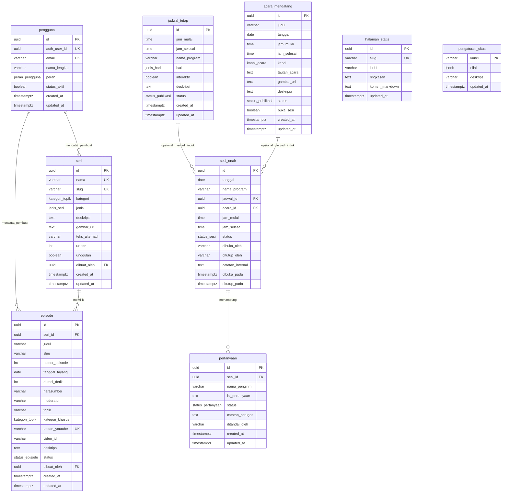

# Model Data dan Kamus Data
## Website Radio & Siniar WBS Perpusnas

> **Catatan Tahap 11 — sumber kebenaran terkini:** ERD, DDL, kamus data, dan kebijakan RLS di bawah ini masih menggambarkan model Tanya Jawab lama (`sesi_onair`, `pertanyaan`). Model yang berlaku sekarang adalah **Chat live**: `sesi_chat` dan `chat_pesan`. Lihat `supabase-schema.sql` (fresh install), `supabase-tahap11-chat.sql` (migrasi), dan `src/types/database.types.ts` sebelum mengubah skema. Rincian alasan perubahan ada di `ROADMAP-IMPLEMENTASI.md` bab Tahap 11.

| Keterangan | Isi |
|---|---|
| **Nomor Dokumen** | 07 |
| **Nama Dokumen** | Model Data dan Kamus Data (*Data Models & Data Dictionary*) |
| **Nama Situs** | Radio & Siniar WBS Perpusnas |
| **Versi** | 1.0 — Final |
| **Tanggal** | 17 November 2026 |
| **Status** | Final — Menjadi acuan perancangan skema basis data PostgreSQL Supabase dan migrasi data |
| **Penyusun** | Gusti Ahmad Muttahid Bilhaq (Mahasiswa Magang Teknik Informatika di PUJASINTARA) |
| **Pembaca Utama** | Pengembang Basis Data, Pengembang Backend/Frontend, dan Administrator Sistem |
| **Acuan** | Dokumen `01` versi 2.2, dokumen `02` versi 1.2, dokumen `03` versi 1.2, dokumen `04` versi 1.1, dokumen `05` versi 1.0, dan dokumen `06` versi 1.0 |
| **Sifat Dokumen** | Dokumen Teknis Basis Data; eksekusi skrip SQL wajib mengacu pada spesifikasi dokumen ini |

---

## 0. Cara Membaca Dokumen Ini

Dokumen ini adalah **spesifikasi teknis basis data (*database specification*)** resmi untuk sistem Radio & Siniar WBS Perpusnas yang diimplementasikan pada **PostgreSQL 15+ terkelola di Supabase BaaS** (`M-02`, `DR-09`). Dokumen ini memuat skrip SQL *Data Definition Language* (DDL), kamus data terperinci per kolom, kebijakan keamanan *Row Level Security* (RLS), strategi pengindeksan performa tinggi, serta skrip benih (*seed data*) untuk 21 seri resmi dan jadwal tetap 24 jam.

Dokumen ini dirancang **siap dieksekusi langsung (*executable scripts*)** melalui *SQL Editor* pada konsol Supabase:
1. Seluruh pengenal tabel dan kolom menggunakan konvensi huruf kecil bersambung garis bawah (**`snake_case`**).
2. Kunci utama (*Primary Key*) menggunakan format **`UUID v4`** acak guna mencegah enumerasi data dan mendukung integritas terdistribusi.
3. Seluruh stempel waktu bertipe **`TIMESTAMPTZ`** (disimpan dalam format UTC dan disajikan dalam Waktu Indonesia Barat / WIB, UTC+7).
4. Tidak ada penyimpanan data pribadi yang melanggar hukum (bebas dari penyimpanan alamat IP mentah atau nomor kontak pengunjung).

| Bagian | Isi Pokok | Sasaran Pembaca |
|---|---|---|
| **Bagian 1** | Diagram Relasi Entitas (ERD) & Konvensi Desain | Database Architect, Pengembang |
| **Bagian 2** | Definisi Tipe Kustom & ENUM PostgreSQL | Database Developer |
| **Bagian 3** | Skrip DDL Lengkap PostgreSQL (Supabase DDL) | Database Administrator, Pengembang |
| **Bagian 4** | Kamus Data Rinci (*Data Dictionary*) Setiap Tabel | Pengembang Backend & Frontend |
| **Bagian 5** | Strategi Pengindeksan & Optimasi Kueri | Performance / DBA |
| **Bagian 6** | Kebijakan Keamanan Akses (*Row Level Security - RLS*) | Security Engineer / Pengembang |
| **Bagian 7** | Skrip Benih Data Awal (*Seed Data* 21 Seri, Jadwal 24 Jam, Pengaturan) | Data Engineer / Pengembang |
| **Bagian 8** | Skrip & Alur Migrasi Data dari CSV YouTube (337 baris $\rightarrow$ 331 video) | Data Migration Specialist |
| **Bagian 9** | Matriks Ketertelusuran Model Data terhadap Kebutuhan Fungsional (`FR`) | Penguji & Analis |
| **Bagian 10** | Penutup & Kesiapan Menuju Gelombang 3 | Tim Proyek |

---

## 1. Ringkasan Desain Basis Data & Diagram Relasi Entitas (ERD)

Basis data Radio & Siniar WBS Perpusnas tersusun atas **9 tabel relasional** yang mencakup pengelolaan dua wajah layanan (`K-4`):
1. **Entitas Siaran Radio:** `jadwal_tetap`, `sesi_onair`, dan `pertanyaan`.
2. **Entitas Katalog Video & Siniar:** `seri` dan `episode`.
3. **Entitas Pendukung Layanan:** `acara_mendatang`, `halaman_statis`, `pengaturan_situs`, dan `pengguna`.

### 1.1 Diagram Relasi Entitas (Entity-Relationship Diagram / ERD)



---

## 2. Definisi Tipe Kustom & ENUM PostgreSQL

Untuk menjamin konsistensi data dan mencegah anomali masukan (*data integrity*), basis data mendefinisikan tipe enumerasi (ENUM) khusus:

```sql
-- 1. Ekstensi UUID dan Kriptografi
CREATE EXTENSION IF NOT EXISTS "uuid-ossp";
CREATE EXTENSION IF NOT EXISTS "pgcrypto";

-- 2. Tipe Peran Pengguna Sistem (Hanya 2 Peran Resmi: M-09, M-15)
CREATE TYPE peran_pengguna AS ENUM (
    'superadmin',
    'admin'
);

-- 3. Tipe Empat Kategori Topik Resmi (Dokumen 02 Bagian 4)
CREATE TYPE kategori_topik AS ENUM (
    'layanan_perpustakaan',      -- Layanan Perpustakaan & Profesi Pustakawan
    'naskah_nusantara',          -- Naskah Nusantara & Warisan Budaya
    'literasi_keluarga',         -- Literasi, Minat Baca & Keluarga
    'sejarah_kebudayaan',        -- Sejarah, Kebudayaan & Diskusi Publik
    'semua_kategori'             -- Khusus penanda keranjang 'Lainnya'
);

-- 4. Tipe Klasifikasi Seri
CREATE TYPE jenis_seri AS ENUM (
    'resmi',                     -- 21 Seri Baku Terdaftar
    'keranjang'                  -- Khusus Penampung 'Lainnya' (82 Video Unik)
);

-- 5. Tipe Status Episode Katalog (M-04, M-16)
CREATE TYPE status_episode AS ENUM (
    'draf',                      -- Belum dipublikasikan
    'tayang',                    -- Terbit publik di katalog
    'arsip_internal'             -- Dokumentasi kepegawaian / klip <1 mnt (tidak tampil publik)
);

-- 6. Tipe Siklus Hari Jadwal Siaran (Bagian 2.3 PRD 01)
CREATE TYPE jenis_hari AS ENUM (
    'hari_kerja',                -- Senin s.d. Jumat
    'sabtu',                     -- Khusus Sabtu
    'minggu'                     -- Khusus Minggu
);

-- 7. Tipe Status Publikasi Umum
CREATE TYPE status_publikasi AS ENUM (
    'draf',
    'terbit'
);

-- 8. Tipe Status Sesi Tanya Jawab On-Air (K-3, M-07)
CREATE TYPE status_sesi AS ENUM (
    'terbuka',
    'tertutup'
);

-- 9. Tipe Status Pertanyaan Masuk (M-07, FR-22)
CREATE TYPE status_pertanyaan AS ENUM (
    'baru',
    'dibacakan',
    'disembunyikan'
);

-- 10. Tipe Kanal Acara Mendatang (M-10)
CREATE TYPE kanal_acara AS ENUM (
    'youtube',
    'zoom',
    'instagram',
    'tatap_muka',
    'lainnya'
);
```

---

## 3. Skrip DDL Lengkap PostgreSQL (Supabase DDL)

Skrip DDL berikut siap dieksekusi secara berurutan pada Supabase SQL Editor untuk membentuk seluruh struktur tabel, relasi kunci asing, nilai bawaan, dan pemicu stempel waktu otomatis (*auto-update timestamp trigger*).

```sql
-- ============================================================================
-- FUNGSI PEMICU PEMBARUAN OTOMATIS UPDATED_AT
-- ============================================================================
CREATE OR REPLACE FUNCTION trigger_set_timestamp()
RETURNS TRIGGER AS $$
BEGIN
  NEW.updated_at = NOW();
  RETURN NEW;
END;
$$ LANGUAGE plpgsql;

-- ============================================================================
-- 1. TABEL PENGGUNA (Profil Staf Pengelola)
-- Menghubungkan akun otentikasi auth.users dengan profil internal aplikasi
-- ============================================================================
CREATE TABLE IF NOT EXISTS pengguna (
    id UUID PRIMARY KEY DEFAULT uuid_generate_v4(),
    auth_user_id UUID UNIQUE REFERENCES auth.users(id) ON DELETE CASCADE,
    email VARCHAR(255) NOT NULL UNIQUE,
    nama_lengkap VARCHAR(150) NOT NULL,
    peran peran_pengguna NOT NULL DEFAULT 'admin',
    status_aktif BOOLEAN NOT NULL DEFAULT true,
    created_at TIMESTAMPTZ NOT NULL DEFAULT NOW(),
    updated_at TIMESTAMPTZ NOT NULL DEFAULT NOW()
);

CREATE TRIGGER set_timestamp_pengguna
BEFORE UPDATE ON pengguna
FOR EACH ROW EXECUTE FUNCTION trigger_set_timestamp();

-- ============================================================================
-- 2. TABEL SERI (21 Seri Resmi + 1 Keranjang Lainnya)
-- ============================================================================
CREATE TABLE IF NOT EXISTS seri (
    id UUID PRIMARY KEY DEFAULT uuid_generate_v4(),
    nama VARCHAR(100) NOT NULL UNIQUE,
    slug VARCHAR(120) NOT NULL UNIQUE,
    kategori kategori_topik NOT NULL,
    jenis jenis_seri NOT NULL DEFAULT 'resmi',
    deskripsi TEXT NOT NULL,
    gambar_url TEXT,
    teks_alternatif VARCHAR(255),
    urutan INT NOT NULL DEFAULT 99,
    unggulan BOOLEAN NOT NULL DEFAULT false,
    dibuat_oleh UUID REFERENCES pengguna(id) ON DELETE SET NULL,
    created_at TIMESTAMPTZ NOT NULL DEFAULT NOW(),
    updated_at TIMESTAMPTZ NOT NULL DEFAULT NOW(),
    CONSTRAINT ck_seri_deskripsi CHECK (char_length(deskripsi) >= 10)
);

CREATE TRIGGER set_timestamp_seri
BEFORE UPDATE ON seri
FOR EACH ROW EXECUTE FUNCTION trigger_set_timestamp();

-- ============================================================================
-- 3. TABEL EPISODE (331 Video Unik Publik)
-- ============================================================================
CREATE TABLE IF NOT EXISTS episode (
    id UUID PRIMARY KEY DEFAULT uuid_generate_v4(),
    seri_id UUID NOT NULL REFERENCES seri(id) ON DELETE RESTRICT,
    judul VARCHAR(255) NOT NULL,
    slug VARCHAR(280) NOT NULL,
    nomor_episode INT,
    tanggal_tayang DATE NOT NULL,
    durasi_detik INT NOT NULL DEFAULT 0,
    narasumber VARCHAR(255) NOT NULL DEFAULT 'Belum tercatat',
    moderator VARCHAR(255) NOT NULL DEFAULT 'Belum tercatat',
    topik VARCHAR(255) NOT NULL,
    kategori_khusus kategori_topik,
    tautan_youtube VARCHAR(255) NOT NULL UNIQUE,
    video_id VARCHAR(20) NOT NULL,
    deskripsi TEXT,
    status status_episode NOT NULL DEFAULT 'tayang',
    dibuat_oleh UUID REFERENCES pengguna(id) ON DELETE SET NULL,
    created_at TIMESTAMPTZ NOT NULL DEFAULT NOW(),
    updated_at TIMESTAMPTZ NOT NULL DEFAULT NOW(),
    CONSTRAINT uq_seri_slug UNIQUE (seri_id, slug),
    CONSTRAINT ck_episode_durasi CHECK (durasi_detik >= 0)
);

CREATE TRIGGER set_timestamp_episode
BEFORE UPDATE ON episode
FOR EACH ROW EXECUTE FUNCTION trigger_set_timestamp();

-- ============================================================================
-- 4. TABEL JADWAL TETAP (Jadwal 24 Jam Siaran Radio)
-- ============================================================================
CREATE TABLE IF NOT EXISTS jadwal_tetap (
    id UUID PRIMARY KEY DEFAULT uuid_generate_v4(),
    jam_mulai TIME NOT NULL,
    jam_selesai TIME NOT NULL,
    nama_program VARCHAR(150) NOT NULL,
    hari jenis_hari NOT NULL,
    interaktif BOOLEAN NOT NULL DEFAULT false,
    deskripsi TEXT,
    status status_publikasi NOT NULL DEFAULT 'terbit',
    created_at TIMESTAMPTZ NOT NULL DEFAULT NOW(),
    updated_at TIMESTAMPTZ NOT NULL DEFAULT NOW(),
    CONSTRAINT ck_jadwal_jam CHECK (jam_mulai != jam_selesai)
);

CREATE TRIGGER set_timestamp_jadwal
BEFORE UPDATE ON jadwal_tetap
FOR EACH ROW EXECUTE FUNCTION trigger_set_timestamp();

-- ============================================================================
-- 5. TABEL ACARA MENDATANG (Pengumuman Acara Khusus / Live YouTube)
-- ============================================================================
CREATE TABLE IF NOT EXISTS acara_mendatang (
    id UUID PRIMARY KEY DEFAULT uuid_generate_v4(),
    judul VARCHAR(200) NOT NULL,
    tanggal DATE NOT NULL,
    jam_mulai TIME NOT NULL,
    jam_selesai TIME,
    kanal kanal_acara NOT NULL DEFAULT 'youtube',
    tautan_acara TEXT,
    gambar_url TEXT,
    deskripsi TEXT,
    status status_publikasi NOT NULL DEFAULT 'terbit',
    buka_sesi BOOLEAN NOT NULL DEFAULT false,
    created_at TIMESTAMPTZ NOT NULL DEFAULT NOW(),
    updated_at TIMESTAMPTZ NOT NULL DEFAULT NOW()
);

CREATE TRIGGER set_timestamp_acara
BEFORE UPDATE ON acara_mendatang
FOR EACH ROW EXECUTE FUNCTION trigger_set_timestamp();

-- ============================================================================
-- 6. TABEL SESI ON-AIR (Sesi Tanya Jawab Interaktif)
-- ============================================================================
CREATE TABLE IF NOT EXISTS sesi_onair (
    id UUID PRIMARY KEY DEFAULT uuid_generate_v4(),
    tanggal DATE NOT NULL DEFAULT CURRENT_DATE,
    nama_program VARCHAR(150) NOT NULL,
    jadwal_id UUID REFERENCES jadwal_tetap(id) ON DELETE SET NULL,
    acara_id UUID REFERENCES acara_mendatang(id) ON DELETE SET NULL,
    jam_mulai TIME NOT NULL,
    jam_selesai TIME NOT NULL,
    status status_sesi NOT NULL DEFAULT 'terbuka',
    dibuka_oleh VARCHAR(150),
    ditutup_oleh VARCHAR(150),
    catatan_internal TEXT,
    dibuka_pada TIMESTAMPTZ NOT NULL DEFAULT NOW(),
    ditutup_pada TIMESTAMPTZ,
    CONSTRAINT ck_sesi_sumber CHECK (jadwal_id IS NOT NULL OR acara_id IS NOT NULL)
);

-- ============================================================================
-- 7. TABEL PERTANYAAN (Pertanyaan Masuk dari Pendengar)
-- ============================================================================
CREATE TABLE IF NOT EXISTS pertanyaan (
    id UUID PRIMARY KEY DEFAULT uuid_generate_v4(),
    sesi_id UUID NOT NULL REFERENCES sesi_onair(id) ON DELETE CASCADE,
    nama_pengirim VARCHAR(100) NOT NULL DEFAULT 'Anonim',
    isi_pertanyaan TEXT NOT NULL,
    status status_pertanyaan NOT NULL DEFAULT 'baru',
    catatan_petugas TEXT,
    ditandai_oleh VARCHAR(150),
    created_at TIMESTAMPTZ NOT NULL DEFAULT NOW(),
    updated_at TIMESTAMPTZ NOT NULL DEFAULT NOW(),
    CONSTRAINT ck_panjang_pertanyaan CHECK (char_length(isi_pertanyaan) >= 10 AND char_length(isi_pertanyaan) <= 500),
    CONSTRAINT ck_panjang_nama CHECK (char_length(nama_pengirim) >= 2 AND char_length(nama_pengirim) <= 100)
);

CREATE TRIGGER set_timestamp_pertanyaan
BEFORE UPDATE ON pertanyaan
FOR EACH ROW EXECUTE FUNCTION trigger_set_timestamp();

-- ============================================================================
-- 8. TABEL HALAMAN STATIS (Tentang, Kontak, Kebijakan Privasi)
-- ============================================================================
CREATE TABLE IF NOT EXISTS halaman_statis (
    id UUID PRIMARY KEY DEFAULT uuid_generate_v4(),
    slug VARCHAR(100) NOT NULL UNIQUE,
    judul VARCHAR(200) NOT NULL,
    ringkasan TEXT,
    konten_markdown TEXT NOT NULL,
    updated_at TIMESTAMPTZ NOT NULL DEFAULT NOW()
);

CREATE TRIGGER set_timestamp_halaman
BEFORE UPDATE ON halaman_statis
FOR EACH ROW EXECUTE FUNCTION trigger_set_timestamp();

-- ============================================================================
-- 9. TABEL PENGATURAN SITUS (Konfigurasi Key-Value JSONB)
-- ============================================================================
CREATE TABLE IF NOT EXISTS pengaturan_situs (
    kunci VARCHAR(100) PRIMARY KEY,
    nilai JSONB NOT NULL,
    deskripsi VARCHAR(255),
    updated_at TIMESTAMPTZ NOT NULL DEFAULT NOW()
);

CREATE TRIGGER set_timestamp_pengaturan
BEFORE UPDATE ON pengaturan_situs
FOR EACH ROW EXECUTE FUNCTION trigger_set_timestamp();
```

---

## 4. Kamus Data Rinci (*Data Dictionary*) Setiap Tabel

Berikut adalah spesifikasi mendalam untuk setiap kolom pada struktur tabel basis data.

### 4.1 Tabel: `pengguna`
Menyimpan data profil akun staf pengelola yang terhubung dengan layanan `auth.users` Supabase.

| Nama Kolom | Tipe Data | Nullable | Bawaan (*Default*) | Relasi (*Foreign Key*) | Deskripsi & Aturan Bisnis |
|---|---|---|---|---|---|
| `id` | `UUID` | No | `uuid_generate_v4()` | - | Kunci utama unik profil internal. |
| `auth_user_id` | `UUID` | No | - | `auth.users(id)` | Tautan relasi 1:1 ke tabel otentikasi inti Supabase. Hapus berjenjang (*CASCADE*). |
| `email` | `VARCHAR(255)` | No | - | - | Alamat surel resmi petugas; wajib unik. |
| `nama_lengkap` | `VARCHAR(150)` | No | - | - | Nama lengkap petugas / penyiar / pimpinan. |
| `peran` | `peran_pengguna` | No | `'admin'` | - | Hak otorisasi: `'superadmin'` atau `'admin'`. |
| `status_aktif` | `BOOLEAN` | No | `true` | - | Status izin login; jika `false`, akses panel ditolak. |
| `created_at` | `TIMESTAMPTZ` | No | `NOW()` | - | Waktu pendaftaran akun. |
| `updated_at` | `TIMESTAMPTZ` | No | `NOW()` | - | Waktu terakhir data profil diperbarui. |

### 4.2 Tabel: `seri`
Menyimpan taksonomi resmi 21 seri program video/siniar serta 1 keranjang penampung "Lainnya" (`M-03`).

| Nama Kolom | Tipe Data | Nullable | Bawaan (*Default*) | Relasi (*Foreign Key*) | Deskripsi & Aturan Bisnis |
|---|---|---|---|---|---|
| `id` | `UUID` | No | `uuid_generate_v4()` | - | Kunci utama seri. |
| `nama` | `VARCHAR(100)` | No | - | - | Nama resmi seri baku; unik; contoh: `"LibTalk"`. |
| `slug` | `VARCHAR(120)` | No | - | - | Pengenal alamat URL; huruf kecil, tanda hubung; contoh: `"libtalk"`. |
| `kategori` | `kategori_topik` | No | - | - | Satu dari 4 kategori topik resmi atau `semua_kategori` untuk Lainnya. |
| `jenis` | `jenis_seri` | No | `'resmi'` | - | `'resmi'` (21 seri) atau `'keranjang'` (Lainnya). |
| `deskripsi` | `TEXT` | No | - | - | Penjelasan profil seri 2–3 kalimat (minimal 10 karakter). |
| `gambar_url` | `TEXT` | Yes | `NULL` | - | URL publik berkas gambar sampul di Supabase Storage (16:9). |
| `teks_alternatif` | `VARCHAR(255)` | Yes | `NULL` | - | Deskripsi aksesibilitas gambar untuk pembaca layar (`alt`). |
| `urutan` | `INT` | No | `99` | - | Angka integer pembobotan urutan tampil di etalase. |
| `unggulan` | `BOOLEAN` | No | `false` | - | Sakelar penampil di Beranda (`PR-45`, maksimal 6 bernilai `true`). |
| `dibuat_oleh` | `UUID` | Yes | `NULL` | `pengguna(id)` | ID staf yang mendaftarkan seri; set null bila akun dihapus. |
| `created_at` | `TIMESTAMPTZ` | No | `NOW()` | - | Waktu pembuatan seri. |
| `updated_at` | `TIMESTAMPTZ` | No | `NOW()` | - | Waktu perubahan terakhir data seri. |

### 4.3 Tabel: `episode`
Menyimpan metadata lengkap 331 video publik mandiri hasil kurasi dari kanal YouTube resmi (`M-04`).

| Nama Kolom | Tipe Data | Nullable | Bawaan (*Default*) | Relasi (*Foreign Key*) | Deskripsi & Aturan Bisnis |
|---|---|---|---|---|---|
| `id` | `UUID` | No | `uuid_generate_v4()` | - | Kunci utama rekaman episode. |
| `seri_id` | `UUID` | No | - | `seri(id)` | ID seri payung episode. Dilarang hapus berjenjang (*RESTRICT*). |
| `judul` | `VARCHAR(255)` | No | - | - | Judul baku bersih tanpa merek seri atau emoji. |
| `slug` | `VARCHAR(280)` | No | - | - | Alamat URL ramah SEO di bawah seri; unik per seri. |
| `nomor_episode` | `INT` | Yes | `NULL` | - | Nomor urut numerik episode dalam seri; kosong untuk "Lainnya". |
| `tanggal_tayang` | `DATE` | No | - | - | Tanggal publikasi siaran/kegiatan. |
| `durasi_detik` | `INT` | No | `0` | - | Total durasi video dalam satuan detik (disajikan j m di UI). |
| `narasumber` | `VARCHAR(255)` | No | `'Belum tercatat'` | - | Nama narasumber (beberapa nama dipisah titik koma `;`). |
| `moderator` | `VARCHAR(255)` | No | `'Belum tercatat'` | - | Nama pemandu acara / moderator. |
| `topik` | `VARCHAR(255)` | No | - | - | Kata kunci topik bahasan yang dipisahkan koma. |
| `kategori_khusus`| `kategori_topik`| Yes | `NULL` | - | Khusus untuk video keranjang "Lainnya" agar dapat difilter kategori. |
| `tautan_youtube`| `VARCHAR(255)` | No | - | - | Tautan URL penuh video YouTube; wajib unik. |
| `video_id` | `VARCHAR(20)` | No | - | - | 11 karakter ID video YouTube (contoh: `dQw4w9WgXcQ`). |
| `deskripsi` | `TEXT` | Yes | `NULL` | - | Ringkasan materi 2–4 paragraf pendek. |
| `status` | `status_episode`| No | `'tayang'` | - | `'draf'`, `'tayang'`, atau `'arsip_internal'` (`M-16`). |
| `dibuat_oleh` | `UUID` | Yes | `NULL` | `pengguna(id)` | ID staf yang menginput episode. |
| `created_at` | `TIMESTAMPTZ` | No | `NOW()` | - | Waktu data dimasukkan ke sistem. |
| `updated_at` | `TIMESTAMPTZ` | No | `NOW()` | - | Waktu terakhir metadata disunting. |

### 4.4 Tabel: `jadwal_tetap`
Menyimpan 72 baris jadwal tetap penyiaran radio 24 jam (24 jam $\times$ 3 kelompok hari) (`K-4`, `M-18`).

| Nama Kolom | Tipe Data | Nullable | Bawaan (*Default*) | Relasi (*Foreign Key*) | Deskripsi & Aturan Bisnis |
|---|---|---|---|---|---|
| `id` | `UUID` | No | `uuid_generate_v4()` | - | Kunci utama baris jadwal siaran. |
| `jam_mulai` | `TIME` | No | - | - | Jam dimulainya program dalam format WIB (contoh: `09:00:00`). |
| `jam_selesai` | `TIME` | No | - | - | Jam berakhirnya program dalam format WIB (contoh: `10:00:00`). |
| `nama_program` | `VARCHAR(150)` | No | - | - | Nama payung program baku (wajib `"Ruang Literasi"`, dilarang singkatan). |
| `hari` | `jenis_hari` | No | - | - | Kelompok hari: `'hari_kerja'`, `'sabtu'`, atau `'minggu'`. |
| `interaktif` | `BOOLEAN` | No | `false` | - | Penanda apakah program membuka sesi tanya jawab (`M-19`). |
| `deskripsi` | `TEXT` | Yes | `NULL` | - | Deskripsi ringkas isi siaran program (1-2 kalimat). |
| `status` | `status_publikasi`| No | `'terbit'` | - | Status penayangan di papan jadwal (`'draf'` atau `'terbit'`). |
| `created_at` | `TIMESTAMPTZ` | No | `NOW()` | - | Waktu jadwal ditambahkan. |
| `updated_at` | `TIMESTAMPTZ` | No | `NOW()` | - | Waktu terakhir jadwal diperbarui oleh pengelola. |

### 4.5 Tabel: `acara_mendatang`
Menyimpan pengumuman agenda acara khusus, webinar, dan siaran langsung YouTube terdekat (`M-10`).

| Nama Kolom | Tipe Data | Nullable | Bawaan (*Default*) | Relasi (*Foreign Key*) | Deskripsi & Aturan Bisnis |
|---|---|---|---|---|---|
| `id` | `UUID` | No | `uuid_generate_v4()` | - | Kunci utama agenda acara. |
| `judul` | `VARCHAR(200)` | No | - | - | Judul acara / kegiatan penyiaran khusus. |
| `tanggal` | `DATE` | No | - | - | Tanggal pelaksanaan acara. |
| `jam_mulai` | `TIME` | No | - | - | Jam mulai kegiatan dalam WIB. |
| `jam_selesai` | `TIME` | Yes | `NULL` | - | Jam berakhir kegiatan dalam WIB (opsional). |
| `kanal` | `kanal_acara` | No | `'youtube'` | - | Platform siaran: `'youtube'`, `'zoom'`, `'instagram'`, `'tatap_muka'`. |
| `tautan_acara` | `TEXT` | Yes | `NULL` | - | Tautan URL kegiatan (wajib bila kanal daring). |
| `gambar_url` | `TEXT` | Yes | `NULL` | - | Poster / banner promosi rasio 16:9 di Supabase Storage. |
| `deskripsi` | `TEXT` | Yes | `NULL` | - | Ringkasan materi acara (maksimal 2 baris di kartu beranda). |
| `status` | `status_publikasi`| No | `'terbit'` | - | Status `'draf'` atau `'terbit'`. |
| `buka_sesi` | `BOOLEAN` | No | `false` | - | Menandai apakah acara membuka sesi tanya jawab khusus (`M-19`). |
| `created_at` | `TIMESTAMPTZ` | No | `NOW()` | - | Waktu pembuatan pengumuman acara. |
| `updated_at` | `TIMESTAMPTZ` | No | `NOW()` | - | Waktu pembaruan pengumuman. |


### 4.6 Tabel: `sesi_onair`
Menyimpan data sesi tanya jawab langsung yang dibuka oleh pengelola untuk program interaktif radio maupun siaran langsung khusus YouTube (`M-09`, `M-19`, `FR-19`).

| Nama Kolom | Tipe Data | Nullable | Bawaan (*Default*) | Relasi (*Foreign Key*) | Deskripsi & Aturan Bisnis |
|---|---|---|---|---|---|
| `id` | `UUID` | No | `uuid_generate_v4()` | - | Kunci utama sesi On-Air. |
| `tanggal` | `DATE` | No | `CURRENT_DATE` | - | Tanggal sesi siaran interaktif berlangsung. |
| `nama_program` | `VARCHAR(150)` | No | - | - | Nama program radio atau judul acara khusus terkait. |
| `jadwal_id` | `UUID` | Yes | `NULL` | `jadwal_tetap(id)` | Tautan ke baris jadwal tetap jika program siaran radio reguler. |
| `acara_id` | `UUID` | Yes | `NULL` | `acara_mendatang(id)` | Tautan ke acara khusus jika sesi dibuka untuk YouTube Live (`M-19`). |
| `jam_mulai` | `TIME` | No | - | - | Jam mulai sesi interaktif dibuka. |
| `jam_selesai` | `TIME` | No | - | - | Jam selesai sesi ditutup (penutupan otomatis jam + 15 mnt, `DR-04`). |
| `status` | `status_sesi` | No | `'terbuka'` | - | Status ketersediaan formulir: `'terbuka'` atau `'tertutup'`. |
| `dibuka_oleh` | `VARCHAR(150)` | Yes | `NULL` | - | Nama akun petugas/penyiar yang membuka sesi. |
| `ditutup_oleh` | `VARCHAR(150)` | Yes | `NULL` | - | Nama petugas yang menutup sesi (atau `'Sistem'` bila otomatis). |
| `catatan_internal`| `TEXT` | Yes | `NULL` | - | Catatan khusus petugas studio (tidak tampil ke publik). |
| `dibuka_pada` | `TIMESTAMPTZ` | No | `NOW()` | - | Waktu pasti pembukaan sesi di server. |
| `ditutup_pada` | `TIMESTAMPTZ` | Yes | `NULL` | - | Waktu penutupan sesi di server. |

### 4.7 Tabel: `pertanyaan`
Menyimpan pertanyaan dari pendengar yang masuk ke layar studio penyiar saat sesi interaktif aktif (`M-06`, `M-07`, `M-08`, `FR-20`–`FR-23`).

| Nama Kolom | Tipe Data | Nullable | Bawaan (*Default*) | Relasi (*Foreign Key*) | Deskripsi & Aturan Bisnis |
|---|---|---|---|---|---|
| `id` | `UUID` | No | `uuid_generate_v4()` | - | Kunci utama rekaman pertanyaan masuk. |
| `sesi_id` | `UUID` | No | - | `sesi_onair(id)` | Relasi ke sesi aktif. Hapus berjenjang (*CASCADE*). |
| `nama_pengirim` | `VARCHAR(100)` | No | `'Anonim'` | - | Nama pendengar; wajib (2–100 karakter), boleh "Anonim" (`M-06`). |
| `isi_pertanyaan`| `TEXT` | No | - | - | Teks pertanyaan (10–500 karakter, teks biasa tanpa URL). |
| `status` | `status_pertanyaan`| No | `'baru'` | - | Status kurasi: `'baru'`, `'dibacakan'`, `'disembunyikan'`. |
| `catatan_petugas`| `TEXT` | Yes | `NULL` | - | Catatan penyiar studio (contoh: *"Dibacakan pukul 09.25 WIB"*). |
| `ditandai_oleh` | `VARCHAR(150)` | Yes | `NULL` | - | Nama penyiar yang mengubah status pertanyaan terakhir kali. |
| `created_at` | `TIMESTAMPTZ` | No | `NOW()` | - | Waktu pengiriman pesan (WIB) untuk antrean real-time. |
| `updated_at` | `TIMESTAMPTZ` | No | `NOW()` | - | Waktu terakhir status dikurasi. |

### 4.8 Tabel: `halaman_statis`
Menyimpan konten teks informatif dan hukum kelembagaan (`PR-13`, `PR-14`, `PR-15`, `FR-37`, `FR-38`, `FR-40`).

| Nama Kolom | Tipe Data | Nullable | Bawaan (*Default*) | Relasi (*Foreign Key*) | Deskripsi & Aturan Bisnis |
|---|---|---|---|---|---|
| `id` | `UUID` | No | `uuid_generate_v4()` | - | Kunci utama halaman statis. |
| `slug` | `VARCHAR(100)` | No | - | - | Pengenal halaman unik: `'tentang'`, `'kontak'`, `'kebijakan-privasi'`. |
| `judul` | `VARCHAR(200)` | No | - | - | Judul utama halaman (contoh: "Tentang WBS Perpusnas"). |
| `ringkasan` | `TEXT` | Yes | `NULL` | - | Paragraf pengantar / sub-judul ringkas. |
| `konten_markdown`| `TEXT` | No | - | - | Isi lengkap halaman dalam format Markdown murni. |
| `updated_at` | `TIMESTAMPTZ` | No | `NOW()` | - | Waktu terakhir artikel disunting oleh admin. |

### 4.9 Tabel: `pengaturan_situs`
Menyimpan konfigurasi operasional global sistem dalam format JSONB fleksibel (`PR-26`, `FR-08`, `FR-49`).

| Nama Kolom | Tipe Data | Nullable | Bawaan (*Default*) | Relasi (*Foreign Key*) | Deskripsi & Aturan Bisnis |
|---|---|---|---|---|---|
| `kunci` | `VARCHAR(100)` | No | - | - | Kunci unik konfigurasi (Kunci Utama). |
| `nilai` | `JSONB` | No | - | - | Objek JSON nilai konfigurasi terstruktur. |
| `deskripsi` | `VARCHAR(255)` | Yes | `NULL` | - | Keterangan fungsi pengaturan bagi Superadmin. |
| `updated_at` | `TIMESTAMPTZ` | No | `NOW()` | - | Waktu perubahan konfigurasi terakhir. |

---

## 5. Strategi Pengindeksan & Optimasi Kueri

Untuk menjamin waktu respons kueri tetap instan ($\le 50$ ms) pada lingkungan hosting statis dan mematuhi batas *Core Web Vitals* (`FR-01` s.d. `FR-53`), skrip basis data menerapkan strategi pengindeksan spesifik:

```sql
-- ============================================================================
-- 1. INDEKS KUNCI ASING (FOREIGN KEY INDEXING)
-- Mencegah table scan saat operasi join relasional
-- ============================================================================
CREATE INDEX IF NOT EXISTS idx_episode_seri_id ON episode(seri_id);
CREATE INDEX IF NOT EXISTS idx_episode_dibuat_oleh ON episode(dibuat_oleh);
CREATE INDEX IF NOT EXISTS idx_seri_dibuat_oleh ON seri(dibuat_oleh);
CREATE INDEX IF NOT EXISTS idx_pertanyaan_sesi_id ON pertanyaan(sesi_id);
CREATE INDEX IF NOT EXISTS idx_sesi_jadwal_id ON sesi_onair(jadwal_id);
CREATE INDEX IF NOT EXISTS idx_sesi_acara_id ON sesi_onair(acara_id);

-- ============================================================================
-- 2. INDEKS PENELUSURAN & PENYARINGAN KINERJA TINGGI (PARTIAL INDEXES)
-- Mempercepat kueri halaman publik yang hanya mengambil konten 'tayang' / 'terbit'
-- ============================================================================
-- Kueri katalog publik hanya mencari episode 'tayang'
CREATE INDEX IF NOT EXISTS idx_episode_publik_terbaru 
ON episode(tanggal_tayang DESC, created_at DESC) 
WHERE status = 'tayang';

-- Kueri seri unggulan di Beranda (PR-45, FR-30)
CREATE INDEX IF NOT EXISTS idx_seri_unggulan 
ON seri(urutan ASC) 
WHERE unggulan = true;

-- Kueri acara mendatang yang belum lewat
CREATE INDEX IF NOT EXISTS idx_acara_aktif 
ON acara_mendatang(tanggal ASC, jam_mulai ASC) 
WHERE status = 'terbit';

-- Kueri perhitungan jadwal siaran harian (FR-02, FR-04)
CREATE INDEX IF NOT EXISTS idx_jadwal_harian 
ON jadwal_tetap(hari, jam_mulai ASC) 
WHERE status = 'terbit';

-- ============================================================================
-- 3. INDEKS PENCARIAN TEKS LENGKAP (FULL-TEXT SEARCH GIN INDEX)
-- Mendukung pencarian kata kunci global di header (FR-33, FR-34)
-- ============================================================================
-- Membuat kolom vektor pencarian otomatis pada tabel episode
ALTER TABLE episode ADD COLUMN IF NOT EXISTS search_vector tsvector
GENERATED ALWAYS AS (
  setweight(to_tsvector('indonesian', coalesce(judul, '')), 'A') ||
  setweight(to_tsvector('indonesian', coalesce(topik, '')), 'B') ||
  setweight(to_tsvector('indonesian', coalesce(narasumber, '')), 'C') ||
  setweight(to_tsvector('indonesian', coalesce(deskripsi, '')), 'D')
) STORED;

CREATE INDEX IF NOT EXISTS idx_episode_fts ON episode USING GIN(search_vector);

-- Indeks pencarian teks pada nama dan deskripsi seri
ALTER TABLE seri ADD COLUMN IF NOT EXISTS search_vector tsvector
GENERATED ALWAYS AS (
  setweight(to_tsvector('indonesian', coalesce(nama, '')), 'A') ||
  setweight(to_tsvector('indonesian', coalesce(deskripsi, '')), 'B')
) STORED;

CREATE INDEX IF NOT EXISTS idx_seri_fts ON seri USING GIN(search_vector);
```

---

## 6. Kebijakan Keamanan Akses Data (*Row Level Security - RLS*)

Skrip SQL berikut menegakkan pemisahan kewenangan mutlak antara publik (pengunjung umum), Admin (penyiar/pustakawan), dan Superadmin (`FR-43`, `FR-45`, `M-09`, `M-15`):

```sql
-- ============================================================================
-- PENGAKTIFAN ROW LEVEL SECURITY (RLS) PADA SEMUA TABEL
-- ============================================================================
ALTER TABLE pengguna ENABLE ROW LEVEL SECURITY;
ALTER TABLE seri ENABLE ROW LEVEL SECURITY;
ALTER TABLE episode ENABLE ROW LEVEL SECURITY;
ALTER TABLE jadwal_tetap ENABLE ROW LEVEL SECURITY;
ALTER TABLE acara_mendatang ENABLE ROW LEVEL SECURITY;
ALTER TABLE sesi_onair ENABLE ROW LEVEL SECURITY;
ALTER TABLE pertanyaan ENABLE ROW LEVEL SECURITY;
ALTER TABLE halaman_statis ENABLE ROW LEVEL SECURITY;
ALTER TABLE pengaturan_situs ENABLE ROW LEVEL SECURITY;

-- ============================================================================
-- FUNGSI BANTU PENGECEKAN PERAN PENGGUNA (HELPER FUNCTIONS)
-- ============================================================================
CREATE OR REPLACE FUNCTION auth_is_superadmin()
RETURNS BOOLEAN AS $$
BEGIN
  RETURN EXISTS (
    SELECT 1 FROM pengguna
    WHERE auth_user_id = auth.uid()
    AND peran = 'superadmin'
    AND status_aktif = true
  );
END;
$$ LANGUAGE plpgsql SECURITY DEFINER;

CREATE OR REPLACE FUNCTION auth_is_staf()
RETURNS BOOLEAN AS $$
BEGIN
  RETURN EXISTS (
    SELECT 1 FROM pengguna
    WHERE auth_user_id = auth.uid()
    AND status_aktif = true
  );
END;
$$ LANGUAGE plpgsql SECURITY DEFINER;

-- ============================================================================
-- 1. KEBIJAKAN TABEL PENGGUNA
-- ============================================================================
CREATE POLICY "Staf dapat melihat profil sendiri"
ON pengguna FOR SELECT TO authenticated
USING (auth_user_id = auth.uid() OR auth_is_superadmin());

CREATE POLICY "Hanya Superadmin yang boleh mengelola akun pengguna"
ON pengguna FOR ALL TO authenticated
USING (auth_is_superadmin())
WITH CHECK (auth_is_superadmin());

-- ============================================================================
-- 2. KEBIJAKAN TABEL SERI
-- ============================================================================
CREATE POLICY "Publik dapat membaca seluruh seri"
ON seri FOR SELECT TO anon, authenticated
USING (true);

CREATE POLICY "Staf dapat memperbarui data seri"
ON seri FOR UPDATE TO authenticated
USING (auth_is_staf())
WITH CHECK (auth_is_staf());

CREATE POLICY "Hanya Superadmin yang boleh menambah atau menghapus seri"
ON seri FOR INSERT TO authenticated
WITH CHECK (auth_is_superadmin());

CREATE POLICY "Hanya Superadmin yang boleh menghapus seri"
ON seri FOR DELETE TO authenticated
USING (auth_is_superadmin());

-- ============================================================================
-- 3. KEBIJAKAN TABEL EPISODE
-- ============================================================================
CREATE POLICY "Publik hanya dapat membaca episode berstatus tayang"
ON episode FOR SELECT TO anon
USING (status = 'tayang');

CREATE POLICY "Staf dapat membaca semua episode termasuk draf dan arsip"
ON episode FOR SELECT TO authenticated
USING (auth_is_staf());

CREATE POLICY "Staf dapat menambah dan menyunting episode"
ON episode FOR INSERT TO authenticated
WITH CHECK (auth_is_staf());

CREATE POLICY "Staf dapat menyunting episode"
ON episode FOR UPDATE TO authenticated
USING (auth_is_staf())
WITH CHECK (auth_is_staf());

CREATE POLICY "Hanya Superadmin yang boleh menghapus permanen episode draf"
ON episode FOR DELETE TO authenticated
USING (auth_is_superadmin() AND status = 'draf');

-- ============================================================================
-- 4. KEBIJAKAN TABEL JADWAL TETAP
-- ============================================================================
CREATE POLICY "Publik dapat membaca jadwal siaran terbit"
ON jadwal_tetap FOR SELECT TO anon, authenticated
USING (status = 'terbit');

CREATE POLICY "Staf dapat mengelola jadwal siaran"
ON jadwal_tetap FOR ALL TO authenticated
USING (auth_is_staf())
WITH CHECK (auth_is_staf());

-- ============================================================================
-- 5. KEBIJAKAN TABEL ACARA MENDATANG
-- ============================================================================
CREATE POLICY "Publik dapat membaca acara berstatus terbit"
ON acara_mendatang FOR SELECT TO anon
USING (status = 'terbit');

CREATE POLICY "Staf dapat membaca dan mengelola semua pengumuman acara"
ON acara_mendatang FOR ALL TO authenticated
USING (auth_is_staf())
WITH CHECK (auth_is_staf());

-- ============================================================================
-- 6. KEBIJAKAN TABEL SESI ON-AIR
-- ============================================================================
CREATE POLICY "Publik dapat membaca status sesi On-Air aktif"
ON sesi_onair FOR SELECT TO anon, authenticated
USING (true);

CREATE POLICY "Staf (Superadmin & Admin) dapat membuka dan menutup sesi"
ON sesi_onair FOR ALL TO authenticated
USING (auth_is_staf())
WITH CHECK (auth_is_staf());

-- ============================================================================
-- 7. KEBIJAKAN TABEL PERTANYAAN (KRUSIAL UNTUK PRIVASI PENDENGAR)
-- ============================================================================
-- Pengunjung publik HANYA diizinkan INSERT bila sesi terkait berstatus 'terbuka'
CREATE POLICY "Pengunjung dapat mengirim pertanyaan saat sesi terbuka"
ON pertanyaan FOR INSERT TO anon, authenticated
WITH CHECK (
  EXISTS (
    SELECT 1 FROM sesi_onair
    WHERE sesi_onair.id = pertanyaan.sesi_id
    AND sesi_onair.status = 'terbuka'
  )
);

-- Pengunjung publik DILARANG KERAS membaca (SELECT) pertanyaan orang lain
-- Hanya staf login yang berhak membaca, mengubah status, dan menghapus
CREATE POLICY "Hanya staf yang dapat membaca pertanyaan pendengar"
ON pertanyaan FOR SELECT TO authenticated
USING (auth_is_staf());

CREATE POLICY "Staf dapat mengurasi dan menandai pertanyaan"
ON pertanyaan FOR UPDATE TO authenticated
USING (auth_is_staf())
WITH CHECK (auth_is_staf());

CREATE POLICY "Staf dapat menghapus pertanyaan atau arsip sesi"
ON pertanyaan FOR DELETE TO authenticated
USING (auth_is_staf());

-- ============================================================================
-- 8. KEBIJAKAN TABEL HALAMAN STATIS
-- ============================================================================
CREATE POLICY "Publik dapat membaca halaman statis"
ON halaman_statis FOR SELECT TO anon, authenticated
USING (true);

CREATE POLICY "Staf dapat memperbarui isi halaman statis"
ON halaman_statis FOR UPDATE TO authenticated
USING (auth_is_staf())
WITH CHECK (auth_is_staf());

-- ============================================================================
-- 9. KEBIJAKAN TABEL PENGATURAN SITUS
-- ============================================================================
CREATE POLICY "Semua dapat membaca pengaturan umum website"
ON pengaturan_situs FOR SELECT TO anon, authenticated
USING (true);

CREATE POLICY "Hanya Superadmin yang berwenang mengubah pengaturan situs"
ON pengaturan_situs FOR UPDATE TO authenticated
USING (auth_is_superadmin())
WITH CHECK (auth_is_superadmin());
```

---

## 7. Skrip Benih Data Awal (*Seed Data*)

Skrip SQL berikut memasukkan data awal baku institusi, mencakup 21 seri resmi + keranjang "Lainnya" (Dokumen `02`), jadwal siaran 24 jam resmi (Dokumen `01`), dan pengaturan bawaan situs:

```sql
-- ============================================================================
-- SEED DATA 1: 21 SERI RESMI & 1 KERANJANG LAINNYA (DOKUMEN 02)
-- ============================================================================
INSERT INTO seri (nama, slug, kategori, jenis, urutan, unggulan, deskripsi) VALUES
-- Kategori: Layanan Perpustakaan & Profesi Pustakawan (10 Seri)
('LibTalk', 'libtalk', 'layanan_perpustakaan', 'resmi', 1, true, 'Bincang inspiratif seputar inovasi layanan perpustakaan dan pengembangan kepustakawanan nasional.'),
('SUPER MORNING', 'super-morning', 'layanan_perpustakaan', 'resmi', 2, true, 'Program pagi pembangkit semangat menyajikan obrolan literasi terkini bersama praktisi perpustakaan.'),
('Bimbingan Pemustaka & Literasi Informasi', 'bimbingan-pemustaka-literasi-informasi', 'layanan_perpustakaan', 'resmi', 3, true, 'Panduan praktis pemanfaatan koleksi, pangkalan data ilmiah, dan layanan penelusuran Perpusnas.'),
('Sosialisasi Program & Layanan Perpusnas', 'sosialisasi-program-layanan-perpusnas', 'layanan_perpustakaan', 'resmi', 4, false, 'Diseminasi kebijakan penyerahan karya cetak/karya rekam, ISBN, dan fasilitasi perpustakaan daerah.'),
('LibTalk Reference Series', 'libtalk-reference-series', 'layanan_perpustakaan', 'resmi', 5, false, 'Pembahasan mendalam seputar layanan referensi, kajian bibliografi, dan rujukan naskah nusantara.'),
('Kunjungan Virtual ke Perpusnas', 'kunjungan-virtual-ke-perpusnas', 'layanan_perpustakaan', 'resmi', 6, false, 'Jelajah fasilitas gedung layanan perpustakaan tertinggi di dunia dan museum naskah secara daring.'),
('AP PASTI Menyapa', 'ap-pasti-menyapa', 'layanan_perpustakaan', 'resmi', 7, false, 'Forum silaturahmi dan dialog terbuka penguatan jejaring asosiasi pustakawan di seluruh Indonesia.'),
('SUDUT INSPIRASI', 'sudut-inspirasi', 'layanan_perpustakaan', 'resmi', 8, false, 'Ulasan kisah sukses, inovasi kepustakawanan daerah, dan dedikasi penggerak literasi akar rumput.'),
('DP on Podcast', 'dp-on-podcast', 'layanan_perpustakaan', 'resmi', 9, false, 'Bincang santai dan dialog aktual bersama pimpinan Dewan Pengawas dan Pejabat Perpusnas RI.'),
('Seri Pengantar Teori Ilmu Perpustakaan, Arsip, dan Museum', 'pengantar-teori-ilmu-perpustakaan-arsip-museum', 'layanan_perpustakaan', 'resmi', 10, false, 'Kajian akademik dan pengantar konseptual pengelolaan memori kolektif bangsa dalam GLAM.'),

-- Kategori: Naskah Nusantara & Warisan Budaya (6 Seri)
('Diskusi Naskah Nusantara', 'diskusi-naskah-nusantara', 'naskah_nusantara', 'resmi', 11, true, 'Kajian filologi, kodikologi, dan nilai luhur peradaban bangsa yang termaktub dalam naskah kuno nusantara.'),
('FGD IKON', 'fgd-ikon', 'naskah_nusantara', 'resmi', 12, true, 'Diskusi kelompok terpumpun pelestarian, transliterasi, dan digitalisasi Naskah Kuno Nusantara (IKON).'),
('Penggalian Potensi Naskah Kuno Nusantara', 'penggalian-potensi-naskah-kuno-nusantara', 'naskah_nusantara', 'resmi', 13, false, 'Eksplorasi kearifan lokal nusantara di berbagai pelosok daerah untuk riset dan identitas bangsa.'),
('Kelas Literasi Naskah Nusantara', 'kelas-literasi-naskah-nusantara', 'naskah_nusantara', 'resmi', 14, false, 'Pelatihan pengenalan aksara kuno nusantara, perawatan fisik naskah daluang, dan sastra klasik.'),
('PESONA NUSANTARA', 'pesona-nusantara', 'naskah_nusantara', 'resmi', 15, false, 'Ragam khazanah kebudayaan tradisional, adat istiadat, dan warisan dokumenter adiluhung nusantara.'),
('Naskah Kuno Indonesia Menuju Ingatan Dunia', 'naskah-kuno-indonesia-menuju-ingatan-dunia', 'naskah_nusantara', 'resmi', 16, false, 'Advokasi dan sosialisasi pendaftaran manuskrip nusantara sebagai Warisan Ingatan Dunia (UNESCO MoW).'),

-- Kategori: Literasi, Minat Baca & Keluarga (3 Seri)
('Kelas Literasi Siniar', 'kelas-literasi-siniar', 'literasi_keluarga', 'resmi', 17, true, 'Edukasi produksi konten audio siniar literasi, teknik siaran suara, dan diseminasi informasi digital.'),
('CERITA BUKI', 'cerita-buki', 'literasi_keluarga', 'resmi', 18, false, 'Mendongeng dan pembacaan cerita anak edukatif nusantara bersama maskot BUKI Perpusnas RI.'),
('NGOPI SENSASI', 'ngopi-sensasi', 'literasi_keluarga', 'resmi', 19, false, 'Ngobrol Pintar Seputar Naskah dan Literasi dengan suasana santai penuh wawasan keluarga.'),

-- Kategori: Sejarah, Kebudayaan & Diskusi Publik (2 Seri)
('Diskusi JASMERAH', 'diskusi-jasmerah', 'sejarah_kebudayaan', 'resmi', 20, false, 'Dialog sejarah penelusuran arsip dan naskah tokoh pahlawan pergerakan kemerdekaan Indonesia.'),
('Gelarwicara', 'gelarwicara', 'sejarah_kebudayaan', 'resmi', 21, false, 'Gelar wicara publik bersama tokoh sastrawan, sejarawan, dan akademisi kebudayaan terkemuka.'),

-- Keranjang Penampung "Lainnya" (82 Video Unik)
('Lainnya', 'lainnya', 'semua_kategori', 'keranjang', 999, false, 'Dokumentasi kegiatan webinar tunggal, liputan seremonial, dan rekaman kegiatan lepasan WBS.')
ON CONFLICT (slug) DO NOTHING;

-- ============================================================================
-- SEED DATA 2: JADWAL TETAP 24 JAM RESMI (BAGIAN 2.3 PRD 01)
-- ============================================================================
-- A. HARI KERJA (SENIN - JUMAT)
INSERT INTO jadwal_tetap (jam_mulai, jam_selesai, nama_program, hari, interaktif, deskripsi) VALUES
('06:00:00', '07:00:00', 'Opening', 'hari_kerja', false, 'Pembukaan siaran radio harian, lagu kebangsaan, dan salam pagi pembuka.'),
('07:00:00', '08:00:00', 'Lagu', 'hari_kerja', false, 'Pemutaran lagu-lagu penyemangat pagi nusantara.'),
('08:00:00', '09:00:00', 'Lagu', 'hari_kerja', false, 'Lagu-lagu hits populer Indonesia pengiring aktivitas kerja.'),
('09:00:00', '10:00:00', 'Indonesia Pagi Ini', 'hari_kerja', true, 'Siaran interaktif informasi aktual, warta literasi, dan sapa pendengar nusantara.'),
('10:00:00', '11:00:00', 'Pesona Nusantara', 'hari_kerja', true, 'Kajian khazanah budaya daerah, naskah nusantara, dan dialog interaktif pemustaka.'),
('11:00:00', '12:00:00', 'Pesona Nusantara', 'hari_kerja', true, 'Lanjutan program dialog budaya nusantara dan ulasan kearifan lokal.'),
('12:00:00', '13:00:00', 'Audiobook', 'hari_kerja', false, 'Pembacaan buku audio pilihan koleksi Perpustakaan Nasional RI.'),
('13:00:00', '14:00:00', 'Ruang Literasi', 'hari_kerja', true, 'Diskusi interaktif seputar kepustakawanan, bedah buku, dan isu literasi nasional.'),
('14:00:00', '15:00:00', 'Ruang Literasi', 'hari_kerja', true, 'Lanjutan dialog ruang literasi bersama narasumber tamu dan pustakawan ahli.'),
('15:00:00', '16:00:00', 'Lagu', 'hari_kerja', false, 'Pemutaran lagu pop santai nusantara pengiring sore.'),
('16:00:00', '17:00:00', 'Lagu', 'hari_kerja', false, 'Koleksi lagu favorit pilihan pendengar WBS.'),
('17:00:00', '18:00:00', 'Religi', 'hari_kerja', false, 'Program siraman rohani dan lagu pengantar senja.'),
('18:00:00', '19:00:00', 'Tausiyah', 'hari_kerja', false, 'Kajian keagamaan dan pesan-pesan moral budi pekerti bangsa.'),
('19:00:00', '20:00:00', 'Lagu Bebas', 'hari_kerja', false, 'Musik akustik dan tembang kenangan pengiring istirahat malam.'),
('20:00:00', '21:00:00', 'Audiobook', 'hari_kerja', false, 'Pembacaan sandiwara audio dan karya sastra klasik nusantara.'),
('21:00:00', '22:00:00', 'Audiobook', 'hari_kerja', false, 'Lanjutan pembacaan novel audio dan biografi tokoh pahlawan.'),
('22:00:00', '23:00:00', 'Audiobook', 'hari_kerja', false, 'Audiobook segmen malam kisah inspiratif sejarah bangsa.'),
('23:00:00', '00:00:00', 'Audiobook', 'hari_kerja', false, 'Pembacaan karya naskah hikayat kuno nusantara.'),
('00:00:00', '01:00:00', 'Audiobook', 'hari_kerja', false, 'Audiobook peneman dini hari kisah sastra nusantara.'),
('01:00:00', '02:00:00', 'Audiobook', 'hari_kerja', false, 'Audiobook lanjutan cerita rakyat kepulauan Indonesia.'),
('02:00:00', '03:00:00', 'Audiobook', 'hari_kerja', false, 'Audiobook kajian sejarah dan dokumentasi masa lampau.'),
('03:00:00', '04:00:00', 'Audiobook', 'hari_kerja', false, 'Audiobook pembacaan babad dan serat kuno adiluhung.'),
('04:00:00', '05:00:00', 'Audiobook', 'hari_kerja', false, 'Audiobook segmen subuh sastra kebijaksanaan hidup.'),
('05:00:00', '06:00:00', 'Tausiyah + Lagu Religi', 'hari_kerja', false, 'Renungan pagi, kajian kebaikan, dan lagu religi penutup siklus siaran harian.');

-- B. AKHIR PEKAN (SABTU & MINGGU IDENTIK)
INSERT INTO jadwal_tetap (jam_mulai, jam_selesai, nama_program, hari, interaktif, deskripsi)
SELECT 
    jam_mulai, jam_selesai,
    CASE 
        WHEN jam_mulai IN ('10:00:00', '11:00:00') THEN 'Dongeng + Lagu Anak'
        WHEN jam_mulai = '15:00:00' THEN 'Lagu Daerah'
        WHEN jam_mulai >= '20:00:00' OR jam_mulai < '05:00:00' THEN 'Wayang'
        ELSE nama_program 
    END AS nama_program,
    'sabtu' AS hari,
    CASE WHEN jam_mulai IN ('09:00:00', '13:00:00', '14:00:00') THEN true ELSE false END AS interaktif,
    CASE 
        WHEN jam_mulai IN ('10:00:00', '11:00:00') THEN 'Dongeng anak edukatif dan pemutaran lagu anak-anak nusantara.'
        WHEN jam_mulai = '15:00:00' THEN 'Pemutaran khazanah musik dan tembang lagu daerah dari Sabang sampai Merauke.'
        WHEN jam_mulai >= '20:00:00' OR jam_mulai < '05:00:00' THEN 'Lakon sandiwara audio wayang kulit dan wayang golek klasik semalam suntuk.'
        ELSE deskripsi 
    END AS deskripsi
FROM jadwal_tetap WHERE hari = 'hari_kerja';

INSERT INTO jadwal_tetap (jam_mulai, jam_selesai, nama_program, hari, interaktif, deskripsi)
SELECT jam_mulai, jam_selesai, nama_program, 'minggu' AS hari, interaktif, deskripsi
FROM jadwal_tetap WHERE hari = 'sabtu';

-- ============================================================================
-- SEED DATA 3: PENGATURAN SITUS BAWAAN (PENGATURAN_SITUS)
-- ============================================================================
INSERT INTO pengaturan_situs (kunci, nilai, deskripsi) VALUES
('identitas', '{"nama_situs": "Radio & Siniar WBS Perpusnas", "tagline": "Menyuarakan Literasi, Merawat Peradaban Nusantara", "logo_url": "/assets/logo-perpusnas.png", "favicon_url": "/favicon.ico"}', 'Identitas visual dan nama resmi portal layanan'),
('audio_stream', '{"stream_url": "https://stream-wbs.perpusnas.go.id/live", "pesan_gangguan": "Siaran radio sedang mengalami pemeliharaan teknis. Silakan coba beberapa saat lagi.", "auto_reconnect": true}', 'Konfigurasi aliran audio Icecast studio HTTPS'),
('kontak', '{"alamat": "Gedung Fasilitas Layanan Perpustakaan Nasional RI, Jl. Medan Merdeka Selatan No. 11, Jakarta Pusat 10110", "surel": "wbsradio@perpusnas.go.id", "telepon": "(021) 3870070", "jam_layanan": "Senin - Minggu: 24 Jam Siaran Online", "tautan_pengaduan": "https://www.lapor.go.id"}', 'Direktori kontak resmi dan kanal pengaduan SP4N-LAPOR!'),
('media_sosial', '{"youtube": "https://www.youtube.com/@WBSRadioPerpusnas", "instagram": "https://www.instagram.com/perpusnas.go.id", "facebook": "https://www.facebook.com/ayokeperpusnas", "x": "https://twitter.com/perpusnas1", "whatsapp": "https://wa.me/628111977777"}', 'Tautan akun media sosial aktif institusi'),
('analitik', '{"ga_id": "G-XXXXXXXXXX", "aktifkan_analitik": false, "anonymize_ip": true}', 'Konfigurasi Google Analytics 4 patuh privasi'),
('operasional', '{"zona_waktu": "WIB", "rate_limit_pertanyaan_menit": 10, "max_pertanyaan_per_sesi": 3, "masa_tenggang_sesi_menit": 15}', 'Parameter operasional sistem dan pembatasan spam')
ON CONFLICT (kunci) DO NOTHING;

-- ============================================================================
-- SEED DATA 4: HALAMAN STATIS AWAL
-- ============================================================================
INSERT INTO halaman_statis (slug, judul, ringkasan, konten_markdown) VALUES
('tentang', 'Tentang Radio & Siniar WBS Perpusnas', 'Mengenal Layanan Radio dan Siniar Widya Bahana Swara Perpustakaan Nasional RI.', 'Radio **Widya Bahana Swara (WBS)** adalah layanan penyiaran resmi Perpustakaan Nasional RI yang dikelola di bawah Pusat Jasa Informasi dan Naskah Nusantara (PUJASINTARA). Mengudara selama 24 jam setiap hari, WBS hadir menyuarakan kekayaan literasi, kajian naskah kuno nusantara, sejarah bangsa, dan pengembangan profesi pustakawan Indonesia.'),
('kontak', 'Kontak Layanan WBS', 'Alamat resmi, surel, telepon, dan kanal pengaduan resmi Perpustakaan Nasional RI.', 'Layanan Radio dan Siniar Widya Bahana Swara berlokasi di Gedung Fasilitas Layanan Perpustakaan Nasional RI, Jl. Medan Merdeka Selatan No. 11, Jakarta Pusat. Untuk saran, kritik, dan koordinasi siaran, hubungi kami melalui surel resmi wbsradio@perpusnas.go.id.'),
('kebijakan-privasi', 'Kebijakan Privasi Layanan', 'Transparansi pelindungan data pribadi pemustaka dan pengelolaan pertanyaan On-Air.', 'Layanan Radio & Siniar WBS Perpusnas berkomitmen melindungi privasi pengunjung. Formulir pertanyaan On-Air mengizinkan penggunaan nama samaran atau "Anonim". Sistem kami tidak pernah merekam alamat IP mentah pengunjung ke dalam database aplikasi. Analitik kunjungan Google Analytics 4 dioperasikan dengan penyamaran IP (anonymized IP) murni untuk statistik agregat evaluasi layanan bagi pimpinan.')
ON CONFLICT (slug) DO NOTHING;
```

---

## 8. Skrip & Alur Migrasi Data dari CSV YouTube

Sesuai ketetapan `M-04` dan `M-05`, proses migrasi data dari berkas mentah `metadata_youtube.csv` (507 baris) menyaring hanya **337 baris publik**. Setelah rekonsiliasi penggabungan 6 baris ganda dari 3 video unik, diperoleh tepat **331 video unik** yang siap diimpor ke tabel `episode`.

### 8.1 Pemetaan Skema Kolom CSV ke PostgreSQL
Tabel pemetaan transformasi data dari CSV YouTube ke kolom tabel `episode`:

| Kolom Sumber (`metadata_youtube.csv`) | Kolom Target (`episode`) | Tipe Target | Logika Transformasi Data |
|---|---|---|---|
| `Title` | `judul` | `VARCHAR(255)` | Dibersihkan dari awalan nama seri, nomor episode (misal: `#24`), emoji, dan simbol pemisah liar (`02` Bagian 8). |
| `Title` | `slug` | `VARCHAR(280)` | Dihasilkan otomatis dengan *slugify* judul baku (huruf kecil, ganti spasi dengan tanda hubung). |
| `Title` | `nomor_episode` | `INT` | Diekstrak secara otomatis dari nomor episode seri kronologis (`PR-29`); bernilai `NULL` bila masuk keranjang Lainnya. |
| `Publish Date` | `tanggal_tayang` | `DATE` | Dikonversi dari format stempel ISO 8601 ke format tanggal standar `YYYY-MM-DD`. |
| `Duration` | `durasi_detik` | `INT` | Dikonversi dari format durasi ISO 8601 (contoh: `PT1H42M10S`) menjadi total bilangan bulat detik (`6130`). |
| `Video ID` | `video_id` | `VARCHAR(20)` | String 11 karakter ID video YouTube resmi (contoh: `c174375d-5e`). |
| `Video URL` | `tautan_youtube` | `VARCHAR(255)` | URL kanonis: `https://www.youtube.com/watch?v={video_id}`. |
| `Description` | `deskripsi` | `TEXT` | Dibersihkan dari tautan Zoom kedaluwarsa dan footer promosi; diambil intisari 2–4 paragraf ringkas. |
| - | `narasumber` | `VARCHAR(255)` | Diisi nama narasumber yang tertera; jika belum ada, diisi `'Belum tercatat'` (`DR-02`). |
| - | `moderator` | `VARCHAR(255)` | Diisi nama pemandu acara; jika belum ada, diisi `'Belum tercatat'`. |
| `Tags` | `topik` | `VARCHAR(255)` | Diambil 3–5 kata kunci topik bahasan paling relevan yang dipisahkan koma. |
| - | `seri_id` | `UUID` | Dicocokkan (*Foreign Key Lookup*) ke tabel `seri` berdasarkan aturan klasifikasi Dokumen `02`. |
| - | `status` | `status_episode`| Set `'tayang'` untuk seluruh 331 video publik (`M-05`). |

### 8.2 Catatan Rekonsiliasi 6 Baris Ganda (3 Video Berlebih)
Tiga video berikut tercatat berulang pada data mentah YouTube karena sempat diunggah ulang atau mengalami duplikasi metadata streaming:
1. **DP on Podcast:** Tercatat 4 baris data pada berkas CSV mentah, namun secara fisik hanya ada **1 video unik**. Pada tabel `episode`, video ini dicatat sebagai **1 baris rekaman** saja.
2. **Diskusi Naskah Nusantara:** Tercatat 28 baris data pada berkas CSV mentah, namun terdapat 3 rekaman siaran langsung yang tercatat ganda, sehingga menghasilkan tepat **25 video unik**.
3. **Hasil Akhir Rekonsiliasi:**
   $$\text{Total Baris Publik (337)} - \text{Duplikasi Ganda (6)} = \mathbf{331\ Video\ Unik\ Tersimpan}$$

---

## 9. Matriks Ketertelusuran Model Data terhadap Kebutuhan Fungsional (FR)

Tabel berikut membuktikan bahwa seluruh tabel dan kolom pada Dokumen `07` ini menopang kebutuhan fungsional Dokumen `05` (`FR-01` s.d. `FR-53`):

| Tabel Basis Data | Kolom & Fitur Basis Data Kunci | Kebutuhan Fungsional yang Didukung |
|---|---|---|
| `jadwal_tetap` | `jam_mulai`, `jam_selesai`, `hari`, `interaktif`, `nama_program` | `FR-02` (Sedang Mengudara), `FR-03` (Berikutnya), `FR-04` (Tabel 24 Jam), `FR-05` (Manajemen Jadwal) |
| `pengaturan_situs` | `audio_stream.stream_url`, `pesan_gangguan` | `FR-01` (Pemutar Audio Persisten), `FR-07` (Pesan Gangguan), `FR-08` (Pengaturan URL Audio) |
| `seri` | `nama`, `slug`, `kategori`, `urutan`, `unggulan` | `FR-09` (Katalog Seri), `FR-14` (Manajemen Seri), `FR-30` (Program Unggulan Beranda) |
| `episode` | `judul`, `slug`, `nomor_episode`, `tanggal_tayang`, `video_id`, `narasumber`, `status` | `FR-10` (Detail Seri), `FR-11` (Embed Video), `FR-12` (Ketahanan Data), `FR-15`–`FR-17` (CRUD & Penomoran Otomatis), `FR-29` (Episode Terbaru) |
| `episode.search_vector` | Indeks GIN Full-Text Search pada judul, narasumber, dan topik | `FR-33` (Pencarian Global), `FR-34` (Hasil Pencarian Terpilah), `FR-35` (Pencarian Kosong) |
| `sesi_onair` | `tanggal`, `jam_mulai`, `jam_selesai`, `status`, `jadwal_id`, `acara_id` | `FR-19` (Buka/Tutup Sesi), `FR-20` (Form Tanya Jawab), `FR-26` (Adaptasi Acara Khusus) |
| `pertanyaan` | `sesi_id`, `nama_pengirim`, `isi_pertanyaan`, `status`, `catatan_petugas` | `FR-20` (Kirim Pertanyaan), `FR-21` (Ingesti Realtime), `FR-22` (Kurasi Status), `FR-23` (Arsip), `FR-24` (Ekspor CSV) |
| `acara_mendatang` | `judul`, `tanggal`, `jam_mulai`, `kanal`, `tautan_acara`, `buka_sesi` | `FR-28` (Blok Acara Beranda), `FR-31` (Kelola Acara), `FR-32` (Pembersihan Acara Lewat) |
| `halaman_statis` | `slug`, `judul`, `konten_markdown` | `FR-37` (Tentang), `FR-38` (Kontak), `FR-40` (Kebijakan Privasi), `FR-42` (Manajemen Halaman) |
| `pengguna` & RLS | `peran` (`superadmin`, `admin`), `auth_user_id`, aturan Row Level Security | `FR-43` (Supabase Auth), `FR-44` (Batas Sesi), `FR-45` (RBAC & RLS), `FR-46` (Kelola Pengguna) |
| `pengaturan_situs` | `analitik.ga_id`, `anonymize_ip` | `FR-49` (Integrasi GA4), `FR-53` (Privasi Analitik Tanpa IP) |

---

## 10. Penutup & Kesiapan Menuju Gelombang 3

Dokumen Model Data dan Kamus Data (`07-model-data-dan-kamus-data.md` — v1.0 Final) ini secara resmi **menuntaskan seluruh rangkaian dokumen perencanaan teknis Gelombang 2 (`05`–`07`)**.

### Pencapaian Utama Dokumen Ini:
1. **Skrip SQL Siap Eksekusi (*Production-Ready DDL*):** Skema 9 tabel, tipe ENUM, kunci asing terproteksi, indeks B-Tree, dan indeks GIN pencarian teks telah selesai disusun.
2. **Keamanan RLS Absolut:** Seluruh hak akses otorisasi antara publik, Admin, dan Superadmin telah dikunci di tingkat kernel basis data Supabase, menjamin keamanan privasi pertanyaan pendengar tanpa kompromi.
3. **Kesiapan Benih Data (*Seed Ready*):** 21 seri resmi, keranjang "Lainnya", dan 72 baris jadwal tetap 24 jam telah dipersiapkan dalam bentuk query `INSERT` yang siap dijalankan.
4. **Penyelarasan Total:** Konsisten 100% terhadap Dokumen `01` s.d. `06` tanpa istilah terlarang, tanpa asumsi server sewaan berbayar, dan ramah terhadap batas *Free-Tier* Supabase.

### Langkah Berikutnya:
Dengan lengkapnya dokumen Gelombang 1 (`01`–`04`) dan Gelombang 2 (`05`–`07`), tahapan proyek siap melangkah ke **Gelombang 3 (Persiapan Operasional & Pengujian)** atau **langsung memulai inisialisasi basis data dan penulisan kode aplikasi**:
- `08-rencana-migrasi-dan-operasional.md`
- `09-rencana-pengujian-dan-evaluasi.md`
- `10-glosarium-dan-log-keputusan.md`

---

## Riwayat Revisi

| Versi | Tanggal | Perubahan | Penyusun |
|---|---|---|---|
| **1.0** | **17 November 2026** | **Penyusunan Model Data dan Kamus Data Final (Gelombang 2):** (1) Perumusan diagram ERD dan DDL lengkap 9 tabel PostgreSQL di Supabase; (2) Penyusunan kamus data terperinci per kolom; (3) Spesifikasi aturan keamanan *Row Level Security* (RLS) granular; (4) Penyusunan *seed data* SQL untuk 21 seri resmi dan jadwal 24 jam; (5) Formulasi skema migrasi dan rekonsiliasi data dari `metadata_youtube.csv` (337 baris $\rightarrow$ 331 episode unik) | Gusti Ahmad Muttahid Bilhaq |
