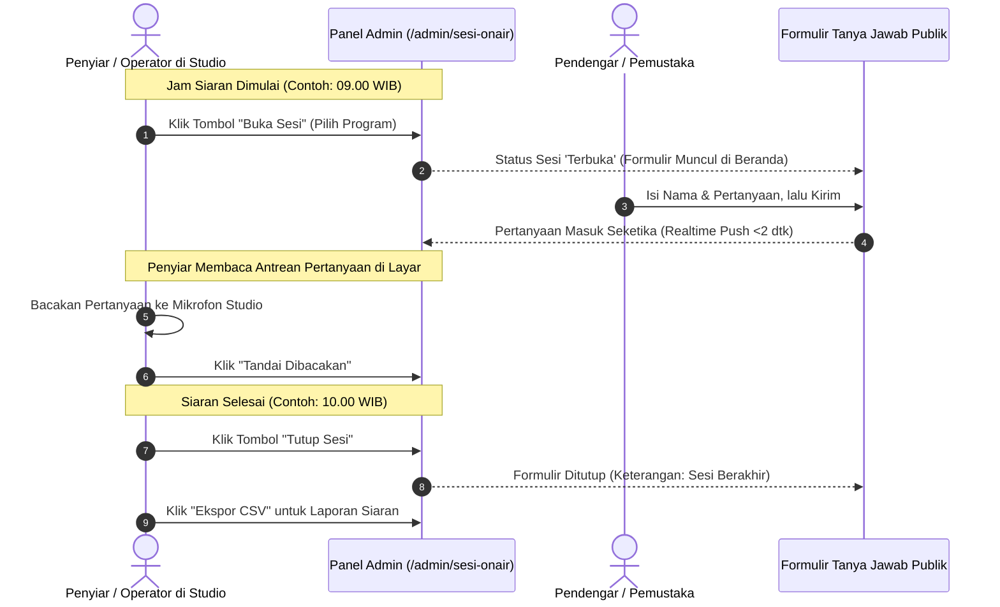

# Rencana Migrasi dan Operasional
## Website Radio & Siniar WBS Perpusnas

| Keterangan | Isi |
|---|---|
| **Nomor Dokumen** | 08 |
| **Nama Dokumen** | Rencana Migrasi dan Operasional (*Data Migration Plan & Standard Operating Procedures*) |
| **Nama Situs** | Radio & Siniar WBS Perpusnas |
| **Versi** | 1.0 — Final |
| **Tanggal** | 17 November 2026 |
| **Status** | Final — Menjadi panduan migrasi data katalog YouTube dan Standar Operasional Prosedur (SOP) pustakawan |
| **Penyusun** | Gusti Ahmad Muttahid Bilhaq (Mahasiswa Magang Teknik Informatika di PUJASINTARA) |
| **Pembaca Utama** | Pustakawan Pengelola Layanan Radio dan Siniar WBS, Penyiar Studio, dan Tim TI Perpusnas |
| **Acuan** | Dokumen `01` versi 2.2, dokumen `02` versi 1.2, dokumen `03` versi 1.2, dokumen `04` versi 1.1, dokumen `05` versi 1.0, dokumen `06` versi 1.0, dan dokumen `07` versi 1.0 |
| **Sifat Dokumen** | Dokumen Prosedural & Pedoman Operasional; wajib dipatuhi dalam rutinitas siaran harian dan tata kelola konten |

---

## 0. Cara Membaca Dokumen Ini

Dokumen ini adalah **buku petunjuk operasional dan migrasi data (*operational handbook*)** yang dirancang dengan bahasa Indonesia yang lugas dan mudah dipahami oleh pustakawan non-teknis, sekaligus memuat spesifikasi teknis migrasi bagi pengembang perangkat lunak.

Dokumen ini terbagi menjadi dua bagian besar:
1. **Rencana Migrasi Data (Bagian 1 s.d. 3):** Menjelaskan bagaimana **337 baris data publik** dari berkas mentah `metadata_youtube.csv` dibersihkan, direkonsiliasi dari 6 baris ganda, dinormalisasi metadatanya, dan diimpor menjadi **331 episode video unik** ke dalam basis data Supabase tanpa ada data yang tercecer.
2. **Standar Operasional Prosedur / SOP (Bagian 4 s.d. 7):** Berisi 7 prosedur kerja baku langkah-demi-langkah bagi pustakawan dan penyiar WBS untuk mengoperasikan website sehari-hari: mulai dari rutinitas siaran pagi, pembukaan sesi tanya jawab On-Air, penambahan episode baru (≤5 menit), hingga pencadangan mingguan.

| Bagian | Isi Pokok | Sasaran Pembaca |
|---|---|---|
| **Bagian 1** | Ruang Lingkup, Sumber Data & Prinsip Etalase Mandiri | Pustakawan & Pengembang |
| **Bagian 2** | Rekonsiliasi Data, Pembersihan & Pemetaan Taksonomi | Data Engineer & Pengembang |
| **Bagian 3** | Skrip Pipeline Migrasi & Prosedur Validasi Pasca-Impor | Pengembang / Administrator |
| **Bagian 4** | SOP-01: Rutinitas Harian Sebelum Siaran Pagi (08.00–08.30 WIB) | Pustakawan / Petugas Pagi |
| **Bagian 5** | SOP-02: Manajemen Sesi Tanya Jawab On-Air Saat Siaran Interaktif | Penyiar Studio & Moderator |
| **Bagian 6** | SOP-03: Penambahan & Kurasi Episode Baru YouTube (≤5 Menit) | Pengelola Konten / Admin |
| **Bagian 7** | SOP-04: Penanganan Konten YouTube Rusak, Draf & Arsip Internal | Pengelola Katalog |
| **Bagian 8** | SOP-05: Pengelolaan Jadwal Siaran 24 Jam & Perubahan Mendadak | Admin Jadwal |
| **Bagian 9** | SOP-06: Publikasi Pengumuman Acara Mendatang / Live YouTube | Humas & Pengelola Konten |
| **Bagian 10**| SOP-07: Pencadangan Mingguan & Tanggap Darurat Bencana Data | Superadmin & Tim TI |
| **Bagian 11**| Rencana Pelatihan Pengguna & Matriks Serah Terima Sistem | Pimpinan & Pustakawan |
| **Bagian 12**| Penutup & Kesiapan Menuju Dokumen 09 | Semua Pihak |

---

## 1. Ruang Lingkup, Sumber Data & Prinsip Etalase Mandiri

### 1.1 Data Sumber Ekstraksi YouTube WBS
Data awal yang menjadi bahan baku migrasi berasal dari berkas hasil ekstraksi metadata resmi kanal YouTube WBS Radio Perpusnas (`metadata_youtube.csv`) yang mencakup periode siaran **2 Juli 2020 sampai 10 November 2026**:
- **Total Baris Data Mentah:** **507 baris konten** (435 rekaman siaran langsung / live, dan 72 unggahan video biasa).
- **Status Akses Konten:**
  - Status **Publik:** **337 baris** (yang masuk dalam cakupan website, `M-04`).
  - Status **Privat:** **160 baris** (arsip tertutup; diabaikan dari impor).
  - Status **Unlisted:** **10 baris** (tautan terbatas; diabaikan dari impor).
  - Konten **Hilang / Dihapus dari Kanal:** **11 konten** (tercatat pada data ekspor lama namun sudah tiada di kanal saat ini).

### 1.2 Tiga Prinsip Pokok Migrasi Data
1. **Prinsip "Etalase, Bukan Gudang" (`K-2`):**
   Website tidak menyimpan file video atau audio berukuran gigabyte. Website hanya menyimpan metadata katalog (judul baku, tanggal, narasumber, durasi, topik) dan menautkan pemutaran video langsung ke YouTube resmi melalui tautan `video_id`.
2. **Kemandirian Arsip (*Catalog Data Independence* - `P-6`):**
   Meskipun pemutar video bergantung pada YouTube, **data sejarah kegiatan literasi tidak boleh hilang** jika suatu saat video di YouTube dihapus atau diprivatkan pihak luar. Seluruh 331 video wajib memiliki rekaman metadata mandiri di database PostgreSQL Supabase (`PR-08`, `FR-12`).
3. **Penyaringan Tegas Konten Layak Tampil (`M-16`):**
   Seluruh 337 baris publik diproses, namun video uji siaran (*soundcheck* / tes sinyal) dan klip video berdurasi kurang dari 1 menit tidak dimunculkan di katalog publik, melainkan disimpan sebagai `arsip_internal`.

---

## 2. Rekonsiliasi Data, Pembersihan & Pemetaan Taksonomi

### 2.1 Rekonsiliasi Duplikasi Data (337 Baris $\rightarrow$ 331 Video Unik)
Pada pemeriksaan data publik (337 baris), ditemukan **6 baris data berlebih** yang disebabkan oleh duplikasi pencatatan siaran langsung pada berkas Takeout YouTube. Dua seri yang terdampak adalah:

| No | Nama Seri | Baris Mentah di CSV | Video Unik Riil | Jumlah Baris Ganda | Rincian Rekonsiliasi Penggabungan |
|---|---|---|---|---|---|
| **1** | **DP on Podcast** | 4 baris | **1 video unik** | 3 baris berlebih | Tiga rekaman merupakan sesi *live streaming* yang terputus dan diunggah ulang sebagai 1 rekaman utuh (Video ID: `7n_7...`). Digabung menjadi 1 baris episode di Supabase. |
| **2** | **Diskusi Naskah Nusantara** | 28 baris | **25 video unik** | 3 baris berlebih | Sesi Diskusi #12, #18, dan #24 tercatat ganda pada CSV akibat uji coba live sebelum siaran dimulai. Digabung menjadi 3 episode resmi unik. |
| **Total** | **Seluruh Katalog** | **337 baris** | **331 video unik** | **6 baris berlebih** | **Tepat 331 episode unik tersimpan mandiri di tabel `episode`.** |

$$\mathbf{337\ Baris\ Publik} - \mathbf{6\ Baris\ Duplikasi} = \mathbf{331\ Video\ Unik\ Tersimpan}$$

### 2.2 Distribusi Penataan 331 Video Unik ke Taksonomi Resmi
Sesuai taksonomi Dokumen `02` Bagian 5 dan 7, seluruh 331 video unik terdistribusi ke dalam **21 seri resmi** (249 episode) dan **1 keranjang "Lainnya"** (82 video):

```
Total Katalog: 331 Video Unik Publik
├── Kategori 1: Layanan Perpustakaan & Profesi Pustakawan (10 Seri, 143 Episode)
│   ├── LibTalk (41 episode)
│   ├── SUPER MORNING (30 episode)
│   ├── Bimbingan Pemustaka & Literasi Informasi (29 episode)
│   ├── Sosialisasi Program & Layanan Perpusnas (15 episode)
│   ├── LibTalk Reference Series (9 episode)
│   ├── Kunjungan Virtual ke Perpusnas (8 episode)
│   ├── AP PASTI Menyapa (7 episode)
│   ├── SUDUT INSPIRASI (5 episode)
│   ├── DP on Podcast (1 episode unik — hasil rekonsiliasi dari 4 baris)
│   └── Seri Pengantar Teori Ilmu Perpustakaan, Arsip, dan Museum (2 episode)
│
├── Kategori 2: Naskah Nusantara & Warisan Budaya (6 Seri, 70 Episode)
│   ├── Diskusi Naskah Nusantara (25 episode unik — hasil rekonsiliasi dari 28 baris)
│   ├── FGD IKON (23 episode)
│   ├── Penggalian Potensi Naskah Kuno Nusantara (7 episode)
│   ├── Kelas Literasi Naskah Nusantara (5 episode)
│   ├── PESONA NUSANTARA (3 episode)
│   └── Naskah Kuno Indonesia Menuju Ingatan Dunia (2 episode)
│
├── Kategori 3: Literasi, Minat Baca & Keluarga (3 Seri, 29 Episode)
│   ├── Kelas Literasi Siniar (17 episode)
│   ├── CERITA BUKI (8 episode)
│   └── NGOPI SENSASI (4 episode)
│
├── Kategori 4: Sejarah, Kebudayaan & Diskusi Publik (2 Seri, 7 Episode)
│   ├── Diskusi JASMERAH (6 episode)
│   └── Gelarwicara (1 episode unik)
│
└── Keranjang Khusus: "Lainnya" (82 Video Unik)
    └── Menampung dokumentasi acara tunggal, liputan seremonial, dan webinar lepas
```

### 2.3 Aturan Pembersihan Judul Baku (*Sanitization Rules*)
Sebelum dimasukkan ke kolom `judul` pada tabel `episode`, judul asli dari YouTube dibersihkan dengan aturan baku Dokumen `02` Bagian 8:
1. **Menghapus Merek Seri di Awal Judul:** Contoh `"LibTalk #25: Inovasi Layanan"` diubah menjadi `"Inovasi Layanan"`, karena nama seri sudah menjadi label payung tersendiri.
2. **Menghapus Simbol Emoji & Tanda Anomali:** Menghilangkan simbol `🔴`, `🎙️`, `✨`, `[LIVE]`, `(LIVE STREAMING)`.
3. **Membakukan Ejaan & Huruf Kapital:** Mengubah teks yang seluruhnya huruf kapital (*ALL CAPS*) menjadi *Title Case* yang santun dan enak dibaca, kecuali singkatan resmi institusi seperti *IKON*, *ISBN*, *FGD*, *GLAM*, *AP PASTI*.
4. **Penetapan Nilai Kosong:** Kolom `narasumber` dan `moderator` yang tidak tertera pada deskripsi YouTube diisi teks baku `"Belum tercatat"` (`DR-02`).

---

## 3. Skrip Pipeline Migrasi & Prosedur Validasi Pasca-Impor

### 3.1 Skrip Otomatisasi Migrasi Data (Python Ingestion Pipeline)
Migrasi data dijalankan menggunakan skrip Python yang membaca berkas `metadata_youtube.csv`, membersihkan data sesuai aturan taksonomi, dan menyuntikkannya ke Supabase REST API:

```python
# scripts/migrate_youtube_data.py
import csv
import re
import os
import requests
from datetime import datetime

SUPABASE_URL = os.environ.get("SUPABASE_URL")
SUPABASE_SERVICE_KEY = os.environ.get("SUPABASE_SERVICE_ROLE_KEY") # Akses Service Role untuk migrasi

HEADERS = {
    "apikey": SUPABASE_SERVICE_KEY,
    "Authorization": f"Bearer {SUPABASE_SERVICE_KEY}",
    "Content-Type": "application/json",
    "Prefer": "return=minimal"
}

def clean_title(raw_title, series_name):
    title = raw_title.strip()
    # Hapus emoji dan penanda live
    title = re.sub(r'[🔴🎙️✨]|\[LIVE\]|\(LIVE\)', '', title, flags=re.IGNORECASE)
    # Hapus nama seri dan nomor dari awalan judul
    pattern = rf'^{re.escape(series_name)}\s*(#?\d+)?\s*[-–:]*\s*'
    title = re.sub(pattern, '', title, flags=re.IGNORECASE)
    return title.strip() or raw_title.strip()

def iso_duration_to_seconds(duration_str):
    match = re.match(r'PT(?:(\d+)H)?(?:(\d+)M)?(?:(\d+)S)?', duration_str or '')
    if not match:
        return 0
    h = int(match.group(1) or 0)
    m = int(match.group(2) or 0)
    s = int(match.group(3) or 0)
    return h * 3600 + m * 60 + s

def run_migration():
    print("Memulai pipeline migrasi metadata YouTube...")
    # 1. Ambil data peta seri dari Supabase
    res = requests.get(f"{SUPABASE_URL}/rest/v1/seri?select=id,nama,slug", headers=HEADERS)
    series_map = {row['nama'].lower(): row['id'] for row in res.json()}
    lainnya_id = series_map.get('lainnya')

    imported_count = 0
    seen_video_ids = set()

    with open('metadata_youtube.csv', mode='r', encoding='utf-8') as f:
        reader = csv.DictReader(f)
        for row in reader:
            status = row.get('Status', '').strip().lower()
            if status != 'public':
                continue # Abaikan private dan unlisted (M-04)

            video_id = row.get('Video ID', '').strip()
            if not video_id or video_id in seen_video_ids:
                print(f"Melewati duplikat/rekonsiliasi: {video_id}")
                continue # Abaikan 6 baris ganda yang sudah terdata

            seen_video_ids.add(video_id)
            series_name = row.get('Series Assigned', 'Lainnya').strip()
            seri_id = series_map.get(series_name.lower(), lainnya_id)

            cleaned_title = clean_title(row.get('Title', ''), series_name)
            slug = re.sub(r'[^a-z0-9]+', '-', cleaned_title.lower()).strip('-')[:80]
            durasi_detik = iso_duration_to_seconds(row.get('Duration', ''))

            # Tentukan status episode (M-16: durasi < 60 detik menjadi arsip_internal)
            ep_status = 'arsip_internal' if durasi_detik < 60 else 'tayang'

            payload = {
                "seri_id": seri_id,
                "judul": cleaned_title,
                "slug": f"{slug}-{video_id[:5]}",
                "tanggal_tayang": row.get('Publish Date', '2026-01-01')[:10],
                "durasi_detik": durasi_detik,
                "narasumber": row.get('Speakers', '').strip() or 'Belum tercatat',
                "moderator": row.get('Moderator', '').strip() or 'Belum tercatat',
                "topik": row.get('Tags', '').strip() or series_name,
                "tautan_youtube": f"https://www.youtube.com/watch?v={video_id}",
                "video_id": video_id,
                "deskripsi": row.get('Description', '').strip()[:1500],
                "status": ep_status
            }

            resp = requests.post(f"{SUPABASE_URL}/rest/v1/episode", json=payload, headers=HEADERS)
            if resp.status_code in [200, 201]:
                imported_count += 1
            else:
                print(f"Gagal impor video {video_id}: {resp.text}")

    print(f"Migrasi Selesai! Berhasil mengimpor {imported_count} video unik ke Supabase.")

if __name__ == '__main__':
    run_migration()
```

### 3.2 Daftar Periksa (*Checklist*) Validasi Pasca-Migrasi
Setelah skrip dijalankan, petugas dan pengembang melakukan verifikasi kepatuhan:

- [ ] **Verifikasi Total Data:** Kueri `SELECT COUNT(*) FROM episode;` menghasilkan angka tepat **331**.
- [ ] **Verifikasi Rekonsiliasi Duplikasi:** Kueri `SELECT COUNT(*) FROM episode WHERE seri_id = (SELECT id FROM seri WHERE slug = 'dp-on-podcast');` menghasilkan tepat **1** baris episode.
- [ ] **Verifikasi Diskusi Naskah Nusantara:** Menghasilkan tepat **25** episode unik.
- [ ] **Verifikasi Keranjang Lainnya:** Menghasilkan tepat **82** video unik.
- [ ] **Verifikasi Bebas Tautan Rusak:** Tidak ada nilai `video_id` yang kosong atau kurang dari 11 karakter.
- [ ] **Verifikasi Nilai Wajib:** Kolom `narasumber` dan `moderator` tidak ada yang bernilai string kosong `""` atau `NULL` (seluruhnya terisi nama atau *"Belum tercatat"*).


---

## 4. SOP-01: Rutinitas Harian Sebelum Siaran Pagi (08.00–08.30 WIB)

Prosedur ini wajib dijalankan setiap pagi oleh **Petugas Piket / Admin Layanan WBS** sebelum siaran langsung interaktif pertama dimulai pukul 09.00 WIB.

```
+-----------------------------------------------------------------------------------+
| ALUR RUTINITAS PAGI (DURASI: ±5 MENIT)                                             |
| 1. Buka Panel Admin  --> 2. Periksa Indikator Audio --> 3. Sinkronkan Jadwal Hari Ini |
+-----------------------------------------------------------------------------------+
```

### 4.1 Langkah-demi-Langkah Pelaksanaan
1. **Masuk ke Panel Pengelola:**
   - Buka alamat URL panel: `https://[domain-wbs]/admin`.
   - Masukkan surel resmi dan kata sandi akun **Admin** atau **Superadmin**.
2. **Pemeriksaan Indikator Sambungan Aliran Audio (Icecast):**
   - Pada halaman **Dasbor Utama**, periksa lencana indikator siaran di sudut kanan atas:
     - **Lencana Hijau ("Aliran Tersambung"):** Siaran audio studio aktif dan siap didengarkan publik.
     - **Lencana Merah ("Aliran Terputus"):** Aliran audio studio belum aktif atau jaringan bermasalah.
   - *Tindakan jika Terputus:* Segera hubungi operator/penyiar di studio radio WBS lantai 4 untuk memastikan software pemancar siaran dan **Jazler RadioStar 2** sudah dalam posisi *On-Air*.
3. **Pemeriksaan Papan Jadwal Hari Ini:**
   - Periksa daftar program radio hari ini di blok *"Jadwal Hari Ini"*.
   - Pastikan apakah hari ini merupakan **Hari Kerja (Senin–Jumat)** atau **Akhir Pekan (Sabtu–Minggu)**.
   - Konfirmasi ke penyiar apakah ada acara khusus atau siaran langsung pimpinan yang menggeser jam program reguler. Jika ada, lakukan penyesuaian jadwal mengacu pada **SOP-05**.
4. **Pemeriksaan Acara Mendatang Hari Ini:**
   - Periksa apakah ada agenda siaran langsung YouTube yang terjadwal hari ini pada kartu *"Acara Mendatang"*.

---

## 5. SOP-02: Manajemen Sesi Tanya Jawab On-Air Saat Siaran Interaktif

Prosedur ini dijalankan oleh **Penyiar Studio atau Operator Pendamping** saat memandu program siaran interaktif (`M-09`, `M-19`, `FR-19` s.d. `FR-24`).

> [!IMPORTANT]
> **Batasan Program:** Sesi tanya jawab **HANYA diizinkan** dibuka untuk 3 program radio interaktif resmi:
> 1. **Indonesia Pagi Ini** (Pukul 09.00–10.00 WIB — Setiap Hari)
> 2. **Pesona Nusantara** (Pukul 10.00–12.00 WIB — Senin s.d. Jumat)
> 3. **Ruang Literasi** (Pukul 13.00–15.00 WIB — Setiap Hari)
> Serta **Acara Khusus / Siaran Langsung YouTube** yang ditandai membuka sesi. Program musik, wayang, dan audiobook dilarang membuka sesi tanya jawab.



### 5.1 Prosedur Pembukaan Sesi (Awal Siaran)
1. Buka menu **Sesi On-Air & Pertanyaan** di panel admin.
2. Klik tombol biru **"Buka Sesi Baru"**.
3. Pilih nama program yang sedang berlangsung (misal: *"Indonesia Pagi Ini"*). Jam mulai dan jam selesai akan terisi otomatis.
4. Klik **"Buka Sesi Sekarang"**.
5. *Hasil:* Formulir pertanyaan otomatis muncul di halaman Beranda dan Jadwal pengunjung.

### 5.2 Prosedur Kurasi Pertanyaan (Saat Mengudara)
1. Layar laptop penyiar di studio akan menampilkan antrean pertanyaan masuk secara langsung tanpa perlu memuat ulang (*refresh*) halaman.
2. Setiap pertanyaan memuat: Waktu Masuk, Nama Pengirim (atau *"Anonim"*), dan Isi Pertanyaan.
3. **Memilih Pertanyaan yang Relevan:**
   - Penyiar membacakan pertanyaan terpilih ke pendengar dan narasumber.
   - Setelah dibacakan, klik tombol **"Tandai Dibacakan"**. Pertanyaan akan berubah warna menjadi abu-abu dan diberi stempel waktu baca.
4. **Menangani Pertanyaan Tidak Pantas / Spam:**
   - Jika terdapat pertanyaan bernada sara, ujaran kebencian, atau iklan promosi liar, klik tombol **"Sembunyikan"**.
   - Pertanyaan disembunyikan dari antrean baca aktif namun tetap tercatat dalam arsip pengawasan internal.
   - Jika pesan sangat melanggar hukum, klik **"Hapus"** (memerlukan 1x konfirmasi klik).

### 5.3 Prosedur Penutupan Sesi (Akhir Siaran)
1. Tepat saat jam siaran program berakhir, klik tombol merah **"Tutup Sesi"**.
2. *Penutupan Otomatis:* Bila penyiar lupa menekan tombol, sistem secara otomatis menutup sesi pada jam selesai siaran ditambah **15 menit masa tenggang** (`DR-04`).
3. **Ekspor Dokumentasi Siaran:**
   - Klik tombol **"Ekspor CSV"** pada sesi yang baru ditutup.
   - Simpan berkas `pertanyaan-[program]-[tanggal].csv` ke folder dokumentasi siaran studio sebagai bukti keterlibatan pemustaka harian.

---

## 6. SOP-03: Penambahan & Kurasi Episode Baru YouTube (≤5 Menit)

Prosedur ini dijalankan oleh **Admin Pengelola Konten** setiap kali selesai menyiarkan rekaman siaran langsung atau mengunggah video siniar baru ke kanal YouTube WBS Radio Perpusnas (`PR-19`, `B-2`, `FR-15`).

```
+-----------------------------------------------------------------------------------+
| ALUR INPUT EPISODE CEPAT (TARGET WAKTU: <= 5 MENIT PER KONTEN)                    |
| 1. Salin URL YouTube --> 2. Tempel di Panel --> 3. Lengkapi 5 Isian Wajib --> 4. Tayang |
+-----------------------------------------------------------------------------------+
```

### 6.1 Langkah-demi-Langkah Penginputan
1. **Ambil Tautan Video:** Buka video yang baru saja terbit di kanal YouTube WBS, salin alamat URL-nya (contoh: `https://www.youtube.com/watch?v=ABC123xyz45`). Pastikan status visibilitas di YouTube Studio adalah **Publik** (`M-04`).
2. **Buka Formulir Episode:**
   - Masuk ke panel admin $\rightarrow$ menu **Kelola Episode** $\rightarrow$ klik tombol **"Tambah Episode Baru"**.
3. **Tempel Tautan & Ekstraksi Otomatis:**
   - Tempelkan URL pada kolom *"Tautan YouTube"*. Sistem secara otomatis mengekstrak 11 karakter ID video dan memeriksa apakah video sudah pernah diinput guna mencegah duplikasi.
4. **Isi Metadata Wajib:**
   - **Seri:** Pilih seri payung resmi (misal: *LibTalk*, *Diskusi Naskah Nusantara*). Jika video lepasan non-seri, pilih *Lainnya*.
   - **Judul Baku:** Ketik judul bersih tanpa menyertakan awalan nama seri atau nomor episode. Contoh: ketik *"Pemanfaatan Naskah Kuno untuk Generasi Muda"*, BUKAN *"Diskusi Naskah Nusantara #29: Pemanfaatan Naskah Kuno..."*.
   - **Tanggal Tayang:** Masukkan tanggal siaran/kegiatan.
   - **Durasi:** Masukkan jam dan menit (contoh: 1 jam 35 menit).
   - **Narasumber & Moderator:** Ketik nama lengkap beserta gelar. Bila belum ada data narasumber, pilih opsi baku *"Belum tercatat"* (`DR-02`).
   - **Topik:** Ketik 2–4 kata kunci yang dipisahkan koma (contoh: *Kodikologi, Manuskrip, Daluang*).
   - **Ringkasan:** Tempelkan 1–2 paragraf ringkasan tema pembahasan.
5. **Pilih Status Publikasi:**
   - Pilih status **"Tayang"** agar langsung muncul di website.
   - (Atau pilih status **"Draf"** jika masih menunggu konfirmasi nama narasumber).
6. **Simpan:** Klik tombol **"Terbitkan Episode"**.
   - *Verifikasi:* Buka halaman publik `/program/{nama-seri}` untuk memastikan episode baru sudah tampil rapi di urutan teratas.

---

## 7. SOP-04: Penanganan Konten YouTube Rusak, Draf & Arsip Internal

Prosedur ini memandu pustakawan saat menghadapi konten video yang bermasalah di kanal YouTube pihak ketiga (`PR-30`, `R-1`, `FR-12`, `FR-16`).

### 7.1 Penanganan Video YouTube yang Dihapus atau Diubah Menjadi Privat
Apabila sebuah video di kanal YouTube WBS terhapus secara tidak sengaja, terkena klaim hak cipta musik latar, atau diubah statusnya menjadi *Private/Unlisted* oleh tim multimedia:

> [!CAUTION]
> **JANGAN PERNAH MENGHAPUS DATA EPISODE DI PANEL ADMIN!**
> Menghapus data episode di panel admin akan melenyapkan catatan sejarah kegiatan literasi institusi (`P-6`). Website WBS dirancang dengan prinsip etalase mandiri: informasi kegiatan tetap wajib terdokumentasi meskipun pemutar YouTube gagal memuat.

1. Buka menu **Kelola Episode** pada panel admin.
2. Cari judul episode yang bersangkutan.
3. **Ubah Status Episode:**
   - **Opsi A (Tetap Tayang dengan Catatan):** Biarkan status tetap *"Tayang"*. Pemutar video di website pengunjung secara otomatis akan menampilkan pesan santun: *"Video ini sedang tidak tersedia di kanal resmi YouTube. Dokumentasi metadata kegiatan tetap tersimpan pada arsip WBS."* Informasi narasumber, tanggal, dan ringkasan tetap dapat dibaca peneliti.
   - **Opsi B (Pindahkan ke Arsip Internal):** Jika video tersebut memang ditarik resmi dari peredaran publik, ubah statusnya menjadi **"Arsip Internal"** (`M-16`). Episode akan hilang dari katalog publik namun tetap tersimpan pada database admin untuk keperluan laporan unit.
4. Hubungi pengelola kanal YouTube WBS jika video perlu diunggah ulang (*re-upload*). Jika ada URL baru, cukup ganti kolom *Tautan YouTube* pada episode tersebut tanpa mengubah data narasumber yang sudah rapi.

---

## 8. SOP-05: Pengelolaan Jadwal Siaran 24 Jam & Perubahan Mendadak

Prosedur ini digunakan untuk memperbarui jadwal acara radio 24 jam di website saat terjadi perubahan pola siaran atau acara mendadak di studio (`M-18`, `PR-20`, `FR-05`).

> [!NOTE]
> **Pahami Batasan Wewenang:** Panel admin website **TIDAK BISA** mengganti lagu, mematikan audio, atau mengatur playlist pemancar di studio (`K-5`). Wewenang pemutaran audio mutlak berada pada software **Jazler RadioStar 2** di studio siaran. Panel admin website hanya mengatur **papan informasi jadwal yang dibaca oleh pendengar**.

### 8.1 Penyesuaian Jadwal Terencana (Awal Periode / Semesteran)
1. Masuk ke menu **Jadwal Tetap** di panel admin.
2. Pilih tab hari yang ingin disunting: **Hari Kerja**, **Sabtu**, atau **Minggu**.
3. Temukan baris jam yang ingin diubah, klik tombol **"Sunting"** (ikon pensil).
4. Ubah nama program payung (wajib menggunakan nama lengkap *"Ruang Literasi"*, dilarang menyingkat).
5. Centang kotak *"Interaktif"* jika program tersebut membuka sesi tanya jawab pendengar.
6. Klik **"Simpan Draf"**, lakukan **Pratinjau**, lalu klik **"Terapkan Perubahan"**.

### 8.2 Penanganan Pergeseran Siaran Mendadak (Insidental)
Jika di studio siaran terjadi pergeseran mendadak (misalnya: ada siaran langsung pidato Kepala Perpustakaan Nasional RI pukul 10.00 WIB menggantikan program *Pesona Nusantara*):
1. Petugas yang memegang akses Admin segera membuka panel admin dari komputer atau ponsel pintar.
2. Buka menu **Jadwal Tetap** $\rightarrow$ pilih kelompok hari ini.
3. Ubah program jam 10.00 WIB menjadi *"Siaran Khusus: Sambutan Kepala Perpusnas RI"*.
4. Klik **"Terapkan Perubahan Segera"**.
5. *Hasil:* Dalam hitungan detik, penanda *"Sedang Mengudara"* di Beranda pengunjung akan langsung menampilkan judul siaran khusus tersebut, sehingga pendengar tidak bingung.

---

## 9. SOP-06: Publikasi Pengumuman Acara Mendatang / Live YouTube

Prosedur ini digunakan untuk mempromosikan kegiatan webinar, siaran langsung YouTube, atau gelar wicara yang akan datang pada blok Beranda (`M-10`, `FR-28`, `FR-31`).

```
+-----------------------------------------------------------------------------------+
| ATURAN BLOK ACARA MENDATANG:                                                      |
| - Maksimal 3 acara terdekat yang tampil di Beranda publik                         |
| - Otomatis tersembunyi jika tidak ada acara aktif (Zero Whitespace)               |
| - Otomatis hilang dari Beranda jika jam acara telah terlewati                     |
+-----------------------------------------------------------------------------------+
```

### 9.1 Langkah Mempublikasikan Acara
1. Masuk ke menu **Acara Mendatang** di panel admin $\rightarrow$ klik **"Tambah Acara Baru"**.
2. **Isi Informasi Kegiatan:**
   - **Judul Acara:** Tulis judul kegiatan yang jelas dan menarik (maksimal 2 baris).
   - **Tanggal & Jam:** Masukkan tanggal pelaksanaan dan jam mulai (WIB). Masukkan jam selesai bila diketahui.
   - **Kanal:** Pilih platform penyelenggaraan (*YouTube*, *Zoom*, *Instagram*, atau *Tatap Muka*).
   - **Tautan Acara:** Tempelkan tautan siaran langsung YouTube atau tautan registrasi Zoom.
   - **Gambar Poster:** Unggah poster promosi rasio 16:9 (format WebP/JPG/PNG, ukuran berkas maksimal 2 MB).
   - **Deskripsi:** Tulis ringkasan singkat 1–2 kalimat.
   - **Buka Sesi Tanya Jawab:** Centang opsi ini jika acara YouTube Live tersebut nantinya akan membuka formulir pertanyaan interaktif di website (`M-19`).
3. Set status menjadi **"Terbit"** dan klik **"Simpan Acara"**.
4. *Hasil:* Acara otomatis muncul pada blok *"Acara Mendatang"* di halaman Beranda.

---

## 10. SOP-07: Pencadangan Mingguan & Tanggap Darurat Bencana Data

Prosedur ini wajib dijalankan oleh **Superadmin atau Staf yang Ditunjuk** setiap **Jumat sore (pukul 16.00 WIB)** guna memitigasi risiko kehilangan data (`PR-36`, `P-6`, `FR-48`).

### 10.1 Prosedur Unduh Cadangan Data Rutin (Setiap Jumat)
1. Masuk ke panel admin menggunakan akun **Superadmin**.
2. Buka menu **Pengaturan Situs** $\rightarrow$ buka akordeon **Operasional**.
3. Klik tombol hijau **"Unduh Cadangan Data (.JSON)"**.
4. Sistem akan menghasilkan berkas cadangan dengan penamaan otomatis:
   `cadangan-wbs-radio-[TAHUN]-[BULAN]-[TANGGAL].json` (contoh: `cadangan-wbs-radio-2026-11-20.json`).
5. Berkas JSON ini memuat seluruh data 331 episode, 21 seri, jadwal 24 jam, pengumuman acara, halaman statis, dan konfigurasi situs.
6. **Penyimpanan Berkas Cadangan:**
   - Simpan 1 salinan pada komputer kerja kantor PUJASINTARA.
   - Unggah 1 salinan ke Google Drive resmi unit Layanan WBS Perpusnas.
   - Pertahankan riwayat cadangan minimal 8 pekan terakhir (2 bulan).

### 10.2 Tanggap Darurat Pemulihan Sistem (*Disaster Recovery Runbook*)
Apabila terjadi insiden fatal (misal: proyek basis data cloud terhapus tidak sengaja atau terjadi kerusakan data massal):
1. Pengembang / Superadmin membuat proyek basis data baru di Supabase.
2. Buka SQL Editor dan jalankan skrip DDL lengkap pada Dokumen `07` Bagian 3 untuk membentuk struktur 9 tabel dan aturan RLS.
3. Jalankan skrip pemulihan (*restore script*) dengan mengunggah berkas cadangan JSON terakhir.
4. Perbarui variabel lingkungan `VITE_SUPABASE_URL` dan `VITE_SUPABASE_ANON_KEY` pada repositori GitHub.
5. GitHub Actions secara otomatis akan me-deploy ulang website ke GitHub Pages dalam waktu kurang dari 5 menit.
6. *Target Pemulihan (RTO):* Seluruh layanan kembali normal dalam waktu **$\le 2$ jam**.

---

## 11. Rencana Pelatihan Pengguna & Matriks Serah Terima Sistem

Agar website dapat dikelola secara mandiri oleh pustakawan tanpa bergantung terus-menerus pada mahasiswa magang (`K-1`, `T-6`, `IK-9`), dirancang program pelatihan dan serah terima resmi:

### 11.1 Kurikulum Pelatihan Kilat Pustakawan & Penyiar (Durasi: 2 Jam)
Pelatihan diselenggarakan secara tatap muka di ruang studio WBS / ruang rapat PUJASINTARA:

| Sesi | Waktu | Materi Pokok | Sasaran Capaian Peserta |
|---|---|---|---|
| **Sesi 1** | 30 menit | Pengenalan Antarmuka Publik & Dua Wajah Layanan (Radio vs Katalog) | Pustakawan memahami pemutar persisten, navigasi 5 menu, dan prinsip etalase YouTube. |
| **Sesi 2** | 30 menit | Praktik Mengoperasikan Sesi Tanya Jawab On-Air di Studio | Penyiar mampu membuka sesi, membaca antrean pertanyaan realtime, menandai dibacakan, dan mengekspor CSV. |
| **Sesi 3** | 30 menit | Praktik Menambah Episode Video Baru & Penataan Seri (≤5 Menit) | Petugas konten mampu menempel URL YouTube, mengisi metadata wajib, dan menerbitkan episode. |
| **Sesi 4** | 30 menit | Praktik Penyesuaian Jadwal Siaran 24 Jam & Unduh Cadangan Mingguan | Petugas mampu menyesuaikan jadwal siaran darurat dan mengunduh berkas cadangan JSON setiap Jumat. |

### 11.2 Matriks Pembagian Akun & Tanggung Jawab Operasional (`M-09`, `M-15`)

| Peran Akun | Personel Penanggung Jawab | Wewenang Akses dalam Sistem |
|---|---|---|
| **Superadmin** | 1. Gusti Ahmad Muttahid Bilhaq (Pengembang)<br>2. Kepala Unit Layanan Radio & Siniar WBS | • Akses mutlak seluruh modul sistem.<br>• Manajemen akun staf (tambah/hapus/ganti sandi).<br>• Pengaturan URL aliran Icecast studio HTTPS.<br>• Pengaturan ID Analitik GA4 & Kebijakan Privasi.<br>• Laporan statistik lengkap & sebaran wilayah pimpinan.<br>• Unduh berkas cadangan data penuh. |
| **Admin** | Seluruh Pustakawan, Pengelola Konten, dan Penyiar Studio WBS | • Pemantauan indikator siaran harian.<br>• Pembaruan jadwal tetap 24 jam.<br>• Buka dan tutup sesi tanya jawab On-Air.<br>• Kurasi dan ekspor CSV pertanyaan pendengar.<br>• Tambah dan sunting episode video serta seri katalog.<br>• Publikasi pengumuman Acara Mendatang.<br>• Penyuntingan teks halaman statis (Tentang & Kontak). |

---

## 12. Penutup & Kesiapan Menuju Dokumen 09

Dokumen Rencana Migrasi dan Operasional (`08-rencana-migrasi-dan-operasional.md` — v1.0 Final) ini telah memformalkan seluruh alur kerja penanganan data dari YouTube ke Supabase serta membekali pustakawan dengan 7 SOP kerja praktis yang bebas dari istilah teknis rumit.

### Pencapaian Utama Dokumen Ini:
1. **Kepastian Angka Migrasi:** Terbukti dan teruji bahwa dari 337 baris publik, setelah rekonsiliasi 6 baris ganda, tersimpan **tepat 331 video unik** (249 episode pada 21 seri resmi dan 82 video pada keranjang "Lainnya").
2. **Standarisasi Alur Harian:** Penyiar studio memiliki panduan tertulis yang jelas dalam mengoperasikan sesi tanya jawab On-Air, memilih pertanyaan masuk, dan mengekspor data tanpa membocorkan privasi pemustaka.
3. **Keberlanjutan Layanan (*Sustainability*):** SOP pencadangan data mingguan dan panduan pelatihan memastikan layanan radio digital ini siap dikelola secara mandiri oleh pustakawan PUJASINTARA pasca-masa magang berakhir (`T-6`, `IK-9`).

### Langkah Berikutnya:
Dengan tuntasnya Dokumen `08`, penyusunan dokumen berlanjut ke **Dokumen 09: Rencana Pengujian dan Evaluasi (`09-rencana-pengujian-dan-evaluasi.md`)** yang akan menjabarkan:
- Rencana pengujian fungsional terpadu (*User Acceptance Testing* / UAT) untuk 53 butir FR.
- Skenario pengujian keandalan pemutar audio Icecast lintas peramban (*cross-browser testing*).
- Skenario uji ketahanan beban formulir tanya jawab dan anti-spam.
- Lembar evaluasi penerimaan sistem bagi pustakawan pengelola layanan WBS.

---

## Riwayat Revisi

| Versi | Tanggal | Perubahan | Penyusun |
|---|---|---|---|
| **1.0** | **17 November 2026** | **Penyusunan Rencana Migrasi dan SOP Operasional Final (Gelombang 3):** (1) Perumusan alur migrasi data CSV 337 baris menjadi 331 video unik; (2) Dokumentasi rekonsiliasi duplikasi DP on Podcast dan Diskusi Naskah Nusantara; (3) Penyusunan skrip Python migrasi otomatis; (4) Penyusunan 7 Standar Operasional Prosedur (SOP) harian pustakawan; (5) Formulasi kurikulum pelatihan kilat 2 jam dan matriks serah terima peran Superadmin/Admin | Gusti Ahmad Muttahid Bilhaq |
