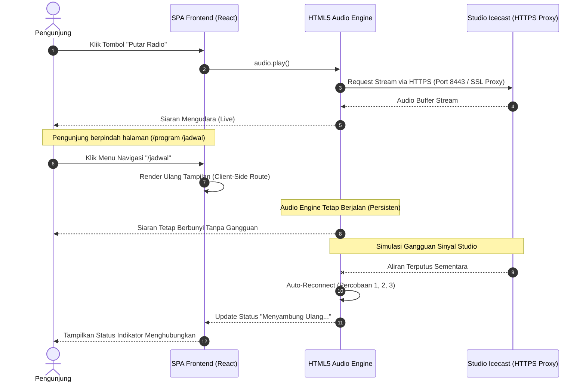
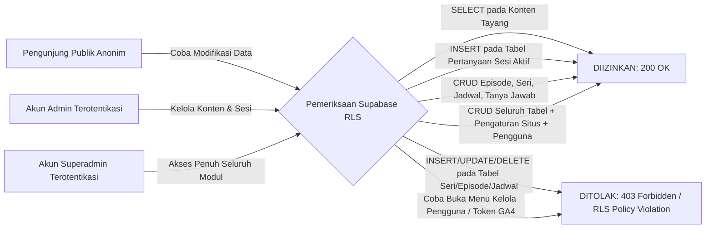
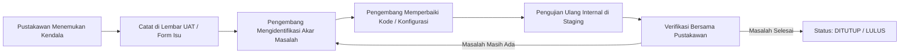

# Rencana Pengujian dan Evaluasi
## Website Radio & Siniar WBS Perpusnas

| Keterangan | Isi |
|---|---|
| **Nomor Dokumen** | 09 |
| **Nama Dokumen** | Rencana Pengujian dan Evaluasi (*Testing & Evaluation Plan / User Acceptance Testing / UAT*) |
| **Nama Situs** | Radio & Siniar WBS Perpusnas |
| **Versi** | 1.0 — Final |
| **Tanggal** | 17 November 2026 |
| **Status** | Final — Pedoman Pengujian Fungsional, Non-Fungsional, Lintas Peramban, Keamanan, dan Berita Acara UAT Bersama Pustakawan WBS Perpusnas |
| **Penyusun** | Gusti Ahmad Muttahid Bilhaq (Mahasiswa Magang Teknik Informatika di PUJASINTARA) |
| **Pembaca Utama** | Pustakawan Pengelola Layanan Radio dan Siniar WBS, Tim Pengembang, dan Pembimbing Magang PUJASINTARA |
| **Acuan** | Dokumen `01` versi 2.2, dokumen `02` versi 1.2, dokumen `03` versi 1.2, dokumen `04` versi 1.1, dokumen `05` versi 1.0, dokumen `06` versi 1.0, dokumen `07` versi 1.0, dan dokumen `08` versi 1.0 |
| **Sifat Dokumen** | Dokumen Verifikasi Kualitas & Validasi Pengguna; menjadi syarat mutlak sebelum peluncuran resmi (*Go-Live*) |

---

## 0. Cara Membaca Dokumen Ini & Panduan Bagi Pustakawan Penguji

Dokumen ini adalah **pedoman pengujian dan evaluasi menyeluruh (*comprehensive test plan*)** untuk memastikan bahwa Website Radio & Siniar WBS Perpusnas berfungsi dengan benar, aman, cepat, dan memenuhi seluruh kebutuhan yang telah disepakati pada Dokumen `01` s.d. `08`.

Bagi **Pustakawan Pengelola Layanan WBS**, dokumen ini bukan dokumen teknis yang rumit. Anda dipersilakan langsung membaca **Bagian 7 (Skenario UAT Mandiri untuk Pustakawan)** yang berisi 10 skenario uji praktis menggunakan bahasa sehari-hari tanpa istilah teknis, serta **Bagian 9 (Berita Acara UAT)** untuk lembar tanda tangan persetujuan sistem.

Bagi **Tim Pengembang**, dokumen ini menjadi panduan eksekusi pengujian kualitas perangkat lunak (*Quality Assurance*), mencakup matriks pengujian seluruh **53 Kebutuhan Fungsional (`FR-01` s.d. `FR-53`)**, pengujian audio web khusus, pengujian keamanan *Row Level Security* (RLS), dan kriteria kelulusan peluncuran (*Go-Live Criteria*).

| Bagian | Isi Pokok | Sasaran Pembaca |
|---|---|---|
| **Bagian 1** | Pendahuluan, Tujuan & Filosofi Pengujian Dua Tahap | Pustakawan & Pengembang |
| **Bagian 2** | Strategi, Lingkungan Uji, Data Uji & Matriks Peramban/Perangkat | Tim Pengembang |
| **Bagian 3** | Matriks Pengujian 53 Kebutuhan Fungsional (`FR-01` s.d. `FR-53`) | Pengembang & Penjamin Mutu |
| **Bagian 4** | Pengujian Khusus Karakteristik Audio Streaming & Persistensi | Pengembang & Tim Penyiaran |
| **Bagian 5** | Pengujian Kinerja Web, Aksesibilitas & Kerapian Tampilan | Tim Pengembang |
| **Bagian 6** | Pengujian Keamanan Sistem, Otentikasi & Supabase RLS | Pengembang & Administrator |
| **Bagian 7** | Skenario UAT Mandiri untuk Pustakawan (10 Tugas Harian) | **Pustakawan Penguji WBS** |
| **Bagian 8** | Tata Kelola Cacat Sistem (*Defect Management*) & Kriteria Lulus | Pustakawan & Pengembang |
| **Bagian 9** | Format Berita Acara UAT & Lembar Pengesahan Serah Terima | **Pustakawan & Mahasiswa Magang** |
| **Bagian 10**| Penutup & Kesiapan Menuju Dokumen 10 | Semua Pihak |

---

## 1. Pendahuluan, Tujuan & Filosofi Pengujian

### 1.1 Tujuan Pengujian
Tujuan penyusunan dokumen pengujian ini adalah:
1. **Memastikan Kesesuaian Kebutuhan:** Memverifikasi bahwa seluruh 53 butir fungsional (`FR-01` s.d. `FR-53`) yang ditetapkan pada Dokumen `05` beroperasi secara andal dan presisi.
2. **Menjamin Kelancaran Pengalaman Pengunjung (*Listener Experience*):** Memastikan audio radio 24 jam berbunyi lancar tanpa putus saat navigasi antar-halaman, serta 331 video YouTube dapat ditonton dengan nyaman.
3. **Memvalidasi Kemudahan Operasional Pustakawan:** Menguji apakah panel admin benar-benar mudah dipelajari dan dioperasikan oleh pustakawan non-teknis sesuai batas waktu SOP (misal: tambah episode ≤5 menit).
4. **Mencegah Masalah Teknis Pasca-Peluncuran:** Memverifikasi pencegahan pemblokiran *Mixed Content* HTTPS pada streaming Icecast, kekebalan basis data Supabase terhadap akses tanpa izin melalui *Row Level Security* (RLS), dan ketahanan formulir tanya jawab dari serangan spam.

### 1.2 Filosofi Pengujian Dua Tahap (*Verification & Validation*)
Pengujian sistem Website Radio & Siniar WBS Perpusnas menerapkan pendekatan dua pilar:
- **Pilar 1: Verifikasi Teknis Internal Pengembang (*Developer QA Verification*):** Dilakukan oleh Mahasiswa Magang menggunakan pengujian unit (*unit testing*), pengujian integrasi (*integration testing*), pengujian kinerja Lighthouse, dan pengujian penetrasi keamanan sederhana pada basis data Supabase.
- **Pilar 2: Validasi Penerimaan Pengguna (*User Acceptance Testing / UAT*):** Dilakukan secara mandiri oleh Pustakawan Pengelola Layanan WBS sebagai pemilik proses bisnis, menguji skenario kerja harian di dunia nyata tanpa campur tangan teknis pengembang.

```mermaid
flowchart TD
    subgraph Tahap 1: Verifikasi Teknis (Pengembang)
        A[Unit & Component Testing] --> B[Integration & API Testing]
        B --> C[Cross-Browser & Responsive Testing]
        C --> D[Security & RLS Audit Testing]
    end

    subgraph Tahap 2: Validasi UAT (Pustakawan WBS)
        D --> E[Simulasi Siaran Pagi & Audio Streaming]
        E --> F[Uji Coba Sesi Tanya Jawab Interaktif Seketika]
        F --> G[Kurasi Video YouTube & Pembaruan Jadwal]
        G --> H[Pemeriksaan Kerapian Tampilan di HP & Komputer]
    end

    subgraph Tahap 3: Keputusan Peluncuran
        H --> I{Apakah Ada Bug Kritis?}
        I -- Ya --> J[Perbaikan Cepat Bug & Pengujian Ulang]
        J --> H
        I -- Tidak --> K[Penandatanganan Berita Acara UAT]
        K --> L[Peluncuran Resmi / Go-Live di GitHub Pages]
    end
```

---

## 2. Strategi, Lingkungan Uji & Matriks Perangkat

### 2.1 Lingkungan Pengujian (*Test Environments*)
Pengujian dilakukan pada dua lingkungan terpisah untuk mencegah data uji mencemari data produksi:

| Komponen | Lingkungan Pratinjau (*Staging / Preview*) | Lingkungan Produksi (*Production*) |
|---|---|---|
| **Hosting Frontend** | Vercel Preview / GitHub Branch `staging` | GitHub Pages (`main` branch) |
| **Basis Data BaaS** | Supabase Project `wbs-radio-dev` | Supabase Project `wbs-radio-prod` |
| **Aliran Audio Icecast** | URL Aliran Uji Studio / Icecast Proxy Dev | URL Aliran Resmi Icecast Studio (Port 8443 / SSL Proxy) |
| **Kanal YouTube** | Video Uji Publik & Video Sampel | 331 Episode Publik Resmi WBS |
| **Tujuan Pengujian** | Pengujian fungsional mendalam, simulasi galat, pengujian penetrasi RLS | Pengujian UAT akhir, verifikasi tautan produksi, uji penerimaan pustakawan |

### 2.2 Kesiapan Data Uji (*Test Data Preparation*)
Sebelum pengujian dimulai, basis data uji telah diisi dengan:
1. **72 Baris Jadwal Tetap:** Lengkap untuk siklus Senin s.d. Minggu (06.00–05.59 WIB).
2. **21 Seri Resmi & 1 Keranjang "Lainnya":** Lengkap dengan deskripsi dan gambar sampul rasio 16:9.
3. **Sampel 50 Episode Video:** Termasuk episode normal, episode dengan deskripsi panjang, episode berseri banyak (LibTalk), dan 1 episode simulasi video YouTube dihapus/privat untuk menguji penanganan galat (*error fallback*).
4. **Akun Penguji:**
   - 1 Akun *Superadmin*: `superadmin.test@perpusnas.go.id`
   - 2 Akun *Admin*: `admin.pagi@perpusnas.go.id` dan `penyiar.studio@perpusnas.go.id`
   - 1 Akun Tanpa Hak Akses (untuk uji kegagalan akses)

### 2.3 Matriks Perangkat & Peramban Sasaran (*Target Matrix*)
Sesuai standar operasional pemustaka dan pustakawan Perpusnas, sistem wajib diuji pada kombinasi berikut:

| Kategori Perangkat | Sistem Operasi | Peramban (*Browser*) | Resolusi / Ukuran Layar |
|---|---|---|---|
| **Desktop Komputer Kerja** | Windows 10 / 11 | Google Chrome (Versi Terbaru) | 1920 × 1080 (FHD), 1366 × 768 (Laptop) |
| **Desktop Komputer Kerja** | Windows 10 / 11 | Microsoft Edge (Chromium) | 1920 × 1080 (FHD) |
| **Desktop Komputer Studio**| macOS / Linux | Mozilla Firefox & Safari | 1440 × 900, 2560 × 1440 |
| **Ponsel Pemustaka (Android)**| Android 12, 13, 14 | Chrome Mobile | 360 × 800, 412 × 915 |
| **Ponsel Pemustaka (iPhone)** | iOS 16, 17, 18 | Safari Mobile | 390 × 844 (iPhone 13/14/15) |
| **Tablet Layanan** | iPadOS / Android Tab | Safari / Chrome Tablet | 820 × 1180, 768 × 1024 |

---

## 3. Matriks Pengujian Terinci 53 Kebutuhan Fungsional (`FR-01` s.d. `FR-53`)

Berikut adalah matriks kasus pengujian teknis (*Technical Test Cases*) untuk seluruh butir fungsional yang didefinisikan pada Dokumen `05`.

### 3.1 Modul 1: Siaran Radio 24 Jam & Jadwal Tetap (`FR-01` s.d. `FR-08`)

| ID Uji | ID FR | Skenario Pengujian | Langkah Pengujian | Hasil yang Diharapkan | Prioritas |
|---|---|---|---|---|---|
| **TC-01** | `FR-01` | Pemutar audio persisten saat pindah halaman | 1. Buka Beranda.<br>2. Klik tombol Putar di bilah bawah.<br>3. Klik menu Jadwal, Program, dan Tentang. | Audio siaran radio tetap terdengar lancar tanpa jeda, re-buffering, atau putus saat halaman berganti. | **Must Have** |
| **TC-02** | `FR-01` | Pencegahan pemblokiran *Mixed Content* | Buka konsol peramban (F12) saat memutar audio di domain GitHub Pages (HTTPS). | Tidak ada pesan galat merah `Mixed Content: The page was loaded over HTTPS, but requested an insecure audio`. Aliran dipanggil lewat HTTPS. | **Must Have** |
| **TC-03** | `FR-02` | Penanda otomatis "Sedang Mengudara" (*On-Air*) | 1. Periksa jam saat ini di komputer.<br>2. Periksa kartu program aktif di Hero Beranda dan halaman Jadwal. | Program yang ditandai badge *"Sedang Mengudara"* sesuai persis dengan rentang waktu tabel jadwal tetap hari itu. | **Must Have** |
| **TC-04** | `FR-02` | Siklus hari siaran melewati tengah malam | Ubah jam komputer ke 01.30 WIB (dini hari). Buka halaman Jadwal. | Program yang aktif terhitung sebagai siaran malam kelanjutan hari sebelumnya (siklus 06.00–05.59 WIB). | **Must Have** |
| **TC-05** | `FR-03` | Penampil program siaran berikutnya | Amati teks *"Berikutnya"* di bilah pemutar audio dan Hero Beranda. | Teks menampilkan nama program dan jam mulai dari acara yang dijadwalkan tepat setelah acara yang sedang berlangsung. | **Must Have** |
| **TC-06** | `FR-04` | Navigasi tab jadwal siaran 7 hari | Buka halaman `/jadwal`. Klik tab Senin, Selasa, dst. sampai Minggu. | Jadwal berganti seketika sesuai hari yang dipilih; kartu program yang sedang tayang pada hari aktif otomatis tersorot. | **Must Have** |
| **TC-07** | `FR-05` | Sunting jadwal tetap di panel pengelola | 1. Masuk panel Admin `/admin/jadwal`.<br>2. Sunting nama penyiar di salah satu jam.<br>3. Simpan. | Notifikasi berhasil muncul; data pada halaman publik `/jadwal` langsung terbarui seketika. | **Must Have** |
| **TC-08** | `FR-06` | Indikator status sambungan Icecast di dasbor | 1. Buka dasbor admin.<br>2. Amati widget Status Aliran. | Widget menampilkan bulatan hijau bertuliskan *"Icecast Terhubung"* beserta waktu ping terakhir. | **Should Have** |
| **TC-09** | `FR-07` | Penanganan saat aliran studio mati / putus | Putus koneksi server Icecast (simulasi). Klik putar di pemutar publik. | Tombol putar berubah menjadi status *"Siaran Sedang Dijeda / Offline"*; tidak membuat halaman macet (*freeze*). | **Must Have** |
| **TC-10** | `FR-08` | Pengaturan URL aliran Icecast oleh Superadmin | 1. Masuk sebagai Admin biasa -> coba akses menu Pengaturan Situs.<br>2. Masuk sebagai Superadmin -> ubah URL Icecast. | Admin biasa ditolak/menu disembunyikan. Superadmin berhasil mengubah URL dan tersimpan di database. | **Should Have** |

### 3.2 Modul 2: Layanan Katalog Video & Siniar YouTube (`FR-09` s.d. `FR-18`)

| ID Uji | ID FR | Skenario Pengujian | Langkah Pengujian | Hasil yang Diharapkan | Prioritas |
|---|---|---|---|---|---|
| **TC-11** | `FR-09` | Penjelajahan 21 seri dan keranjang "Lainnya" | Buka halaman `/program`. Klik saringan kategori: *Literasi Informasi*, *Naskah Nusantara*, dll. | Kartu seri tersaring instan di sisi klien sesuai kategori. Total seri resmi adalah 21 seri + 1 kartu "Lainnya". | **Must Have** |
| **TC-12** | `FR-10` | Daftar episode berurutan pada detail seri | Buka seri LibTalk (`/program/libtalk`). Periksa urutan episode dan tombol pagination. | Menampilkan 41 episode LibTalk dengan nomor urut yang rapi. Tombol *"Muat Lebih Banyak"* memuat episode berikutnya. | **Must Have** |
| **TC-13** | `FR-11` | Pemutaran video sematan YouTube (*No Autoplay*) | Klik salah satu episode untuk membuka halaman detailnya. | Video YouTube muncul dengan gambar pratinjau (*facade*); video **tidak berbunyi otomatis** sampai tombol putar diklik pemustaka. | **Must Have** |
| **TC-14** | `FR-11` | Kelengkapan metadata episode | Buka detail episode video. Periksa seluruh teks informasi. | Menampilkan Judul Baku, Nomor Episode, Tanggal Tayang, Durasi, Narasumber, Moderator, dan Ringkasan Topik secara lengkap. | **Must Have** |
| **TC-15** | `FR-12` | Penanganan video YouTube dihapus / privat | Buka halaman episode sampel yang ID YouTube-nya sengaja diubah ke ID tidak valid. | Halaman tidak rusak; muncul kotak santun *"Video ini sedang tidak tersedia di kanal YouTube..."*, metadata tetap terbaca utuh. | **Should Have** |
| **TC-16** | `FR-13` | Akses keranjang video lepasan "Lainnya" | Buka `/program/lainnya`. Periksa jumlah dan tampilan kartu. | Menampilkan 82 video lepasan; kartu tidak memiliki nomor episode; saringan topik berfungsi dengan baik. | **Must Have** |
| **TC-17** | `FR-14` | Manajemen seri video oleh Admin | Masuk ke `/admin/seri`. Ubah deskripsi seri dan unggah gambar sampul baru rasio 16:9. | Data seri terbarui; berkas gambar tersimpan di Supabase Storage dan tautan publiknya tampil benar. | **Must Have** |
| **TC-18** | `FR-15` | Tambah episode baru manual (≤5 menit) | Masuk `/admin/episode/tambah`. Masukkan ID YouTube, pilih seri, isi metadata, klik Simpan. | Episode baru langsung tayang di katalog publik dalam waktu kurang dari 5 menit tanpa perlu skrip rumit. | **Must Have** |
| **TC-19** | `FR-16` | Pengaturan status draf, tayang, dan internal | 1. Simpan episode baru dengan status `draf`.<br>2. Cek halaman publik `/program`.<br>3. Ubah status ke `tayang`. | Saat draf, episode tidak muncul di publik. Setelah diubah ke tayang, episode langsung terlihat di katalog publik. | **Must Have** |
| **TC-20** | `FR-17` | Penomoran episode otomatis | Tambah episode baru di bawah seri LibTalk tanpa mengisi kolom nomor episode manual. | Sistem otomatis menetapkan nomor episode berikutnya (misal: Episode 42) berdasarkan urutan tanggal tayang. | **Should Have** |
| **TC-21** | `FR-18` | Pemeriksaan kesehatan tautan YouTube | Jalankan fitur periksa tautan di panel admin episode. | Sistem menandai video yang menghasilkan galat sematan YouTube dengan label kuning peringatan. | **Should Have** |

### 3.3 Modul 3: Interaktivitas & Sesi Tanya Jawab On-Air (`FR-19` s.d. `FR-26`)

| ID Uji | ID FR | Skenario Pengujian | Langkah Pengujian | Hasil yang Diharapkan | Prioritas |
|---|---|---|---|---|---|
| **TC-22** | `FR-19` | Buka dan tutup sesi tanya jawab oleh Admin | 1. Masuk `/admin/tanya-jawab`.<br>2. Buka sesi untuk program *Indonesia Pagi Ini*.<br>3. Amati tampilan Beranda publik.<br>4. Tutup sesi. | Saat dibuka, kartu formulir interaktif muncul di Beranda. Saat ditutup, formulir terkunci dengan teks *"Sesi Belum Dibuka"*. | **Must Have** |
| **TC-23** | `FR-20` | Pengiriman pertanyaan (Nama asli vs Anonim) | 1. Kirim pertanyaan dengan nama *"Budi Santoso"*.<br>2. Kirim pertanyaan lain dengan mencentang kotak *"Kirim sebagai Anonim"*. | Kedua pertanyaan berhasil terkirim; formulir menampilkan pesan sukses *"Pertanyaan Anda telah diteruskan ke studio"*. | **Must Have** |
| **TC-24** | `FR-21` | Penerimaan pertanyaan seketika (*Realtime WebSocket*) | 1. Buka panel admin `/admin/tanya-jawab` di Komputer A.<br>2. Buka formulir publik di Ponsel B.<br>3. Kirim pertanyaan dari Ponsel B. | Pertanyaan baru muncul di layar panel Admin Komputer A dalam waktu <2 detik **tanpa perlu memuat ulang (*refresh*) halaman**. | **Must Have** |
| **TC-25** | `FR-22` | Kurasi & perubahan status pertanyaan penyiar | Di panel admin tanya jawab, klik tombol status: *"Sudah Dibaca"*, *"Disorot"*, atau *"Disembunyikan"*. | Status baris pertanyaan berubah seketika; filter status di panel menyaring daftar dengan presisi. | **Must Have** |
| **TC-26** | `FR-23` | Penghapusan arsip tanya jawab oleh Admin | Klik tombol Hapus pada salah satu pertanyaan arsip lama. | Pertanyaan terhapus permanen dari basis data; daftar tabel langsung diperbarui. | **Must Have** |
| **TC-27** | `FR-24` | Ekspor rekapitulasi tanya jawab ke CSV | Klik tombol *"Ekspor CSV"* pada sesi tanya jawab yang telah selesai. | Berkas `.csv` terunduh otomatis ke komputer petugas, memuat kolom tanggal, pengirim, program, dan isi pertanyaan. | **Should Have** |
| **TC-28** | `FR-25` | Uji jebakan anti-spam (*Honeypot*) & frekuensi | 1. Coba isi kolom rahasia (*honeypot* lewat bot).<br>2. Kirim 2 pertanyaan berturut-turut dalam selang waktu 5 detik dari peramban yang sama. | Pertanyaan dari bot ditolak diam-diam. Pertanyaan kedua dari pengunjung muncul pesan *"Harap tunggu 30 detik sebelum mengirim lagi"*. | **Must Have** |
| **TC-29** | `FR-26` | Adaptasi label saat siaran langsung YouTube | Buka sesi tanya jawab dengan memilih jenis acara *"Acara Khusus Live YouTube"* (`M-19`). | Kartu di beranda publik beradaptasi: tombol mengarahkan ke kanal YouTube live dan label berubah menjadi *"Kirim Pertanyaan untuk Pemateri Live"*. | **Should Have** |

### 3.4 Modul 4: Halaman Beranda & Navigasi Pengunjung (`FR-27` s.d. `FR-32`)

| ID Uji | ID FR | Skenario Pengujian | Langkah Pengujian | Hasil yang Diharapkan | Prioritas |
|---|---|---|---|---|---|
| **TC-30** | `FR-27` | Hero Siaran Utama Beranda | Buka Beranda (`/`). Periksa elemen kartu utama siaran. | Menampilkan badge *Live*, tombol besar *Dengarkan Sekarang*, judul program aktif, rentang jam siaran, dan nama penyiar bertugas. | **Must Have** |
| **TC-31** | `FR-28` | Penampilan kartu Acara Mendatang | Buka Beranda. Periksa blok *Acara Mendatang*. | Menampilkan kartu acara mendatang jika ada; kartu memuat tanggal, jam, judul acara, dan penanda live. | **Should Have** |
| **TC-32** | `FR-28` | Ketiadaan tombol buntu pada Acara Mendatang | Periksa seluruh bagian kartu Acara Mendatang di Beranda. | Tidak ada tombol buntu bertuliskan `[Lihat semua →]` sesuai keputusan audit; tata letak rapi dan padat. | **Must Have** |
| **TC-33** | `FR-29` | Blok 4 Episode Video Terbaru di Beranda | Buka Beranda. Amati blok *Episode Terbaru*. | Menampilkan tepat 4 kartu episode video berstatus Tayang terbaru yang diurutkan berdasarkan tanggal publikasi. | **Must Have** |
| **TC-34** | `FR-30` | Blok Program Unggulan di Beranda (Maks 6) | Buka Beranda. Amati blok *Program Unggulan*. | Menampilkan kartu seri yang ditandai sebagai unggulan di panel admin (maksimal 6 seri). | **Should Have** |
| **TC-35** | `FR-31` | Tambah dan sunting Acara Mendatang di panel | Masuk ke `/admin/acara`. Tambah 1 acara talkshow baru untuk minggu depan. | Acara baru langsung muncul di blok Acara Mendatang Beranda publik. | **Should Have** |
| **TC-36** | `FR-32` | Pembersihan otomatis acara yang sudah lewat | Buat acara uji coba dengan waktu selesai 1 jam yang lalu. Buka Beranda publik. | Acara yang jam selesainya telah lewat tidak lagi dimunculkan di halaman Beranda secara otomatis. | **Should Have** |

### 3.5 Modul 5: Pencarian & Eksplorasi Konten (`FR-33` s.d. `FR-36`)

| ID Uji | ID FR | Skenario Pengujian | Langkah Pengujian | Hasil yang Diharapkan | Prioritas |
|---|---|---|---|---|---|
| **TC-37** | `FR-33` | Input pencarian global di header navigasi | Ketik kata kunci *"manuskrip"* di bilah cari header, lalu tekan Enter. | Peramban diarahkan ke halaman `/cari?q=manuskrip`. | **Should Have** |
| **TC-38** | `FR-34` | Pemilahan hasil pencarian seri dan episode | Pada halaman hasil pencarian `/cari?q=naskah`, periksa kelompok hasil. | Hasil pencarian memisahkan kelompok *Seri Program* dan kelompok *Episode Video* secara terstruktur. | **Should Have** |
| **TC-39** | `FR-35` | Penanganan pencarian tanpa hasil (*Empty State*) | Ketik kata kunci acak yang tidak ada di data, misal: *"xyz987qwerty"*. | Halaman menampilkan pesan santun: *"Tidak ditemukan hasil untuk kata kunci 'xyz987qwerty'"* disertai rekomendasi kata kunci populer. | **Should Have** |
| **TC-40** | `FR-36` | Remah navigasi (*Breadcrumbs*) | Buka halaman detail episode LibTalk. Periksa tautan navigasi di atas judul. | Jalur navigasi tampil rapi: `Beranda > Program > LibTalk > Episode 10`. Setiap tautan dapat diklik dan berfungsi benar. | **Must Have** |

### 3.6 Modul 6: Halaman Informasi Statis & Legalitas (`FR-37` s.d. `FR-42`)

| ID Uji | ID FR | Skenario Pengujian | Langkah Pengujian | Hasil yang Diharapkan | Prioritas |
|---|---|---|---|---|---|
| **TC-41** | `FR-37` | Halaman Profil "Tentang WBS" | Buka menu navigasi `/tentang`. | Menampilkan visi, misi, profil studio WBS Perpusnas, foto studio resmi, dan dasar pembentukan layanan. | **Must Have** |
| **TC-42** | `FR-38` | Halaman Kontak & Kanal Interaksi | Buka menu `/kontak`. Klik nomor WhatsApp dan tautan email. | Menampilkan alamat studio di Gedung Perpusnas Medan Merdeka Selatan, nomor WhatsApp WBS, surel resmi, dan tautan sosial media aktif. | **Must Have** |
| **TC-43** | `FR-39` | Tautan media sosial aktif | Klik ikon Instagram, YouTube, dan Spotify di bilah footer. | Masing-masing ikon membuka tab baru ke akun resmi WBS Perpusnas tanpa memutuskan audio radio. | **Should Have** |
| **TC-44** | `FR-40` | Halaman Kebijakan Privasi | Buka halaman `/kebijakan-privasi` dari tautan footer. | Menyajikan transparansi pengumpulan data agregat Google Analytics 4 dan penegasan bahwa identitas pendengar dilindungi penuh. | **Must Have** |
| **TC-45** | `FR-41` | Halaman Kesalahan 404 Kustom Ramah | Ketik alamat ngawur di peramban, misal: `/halaman-tidak-ada`. | Muncul halaman 404 resmi WBS dengan ilustrasi buku, tombol *"Kembali ke Beranda"*, dan pemutar audio tetap berbunyi normal. | **Must Have** |
| **TC-46** | `FR-42` | Sunting halaman statis di panel admin | Masuk `/admin/halaman`. Sunting teks pada halaman Tentang, lalu simpan. | Perubahan teks langsung tercermin pada halaman publik `/tentang`. | **Should Have** |

### 3.7 Modul 7: Autentikasi Pengelola, Keamanan & Tata Kelola (`FR-43` s.d. `FR-48`)

| ID Uji | ID FR | Skenario Pengujian | Langkah Pengujian | Hasil yang Diharapkan | Prioritas |
|---|---|---|---|---|---|
| **TC-47** | `FR-43` | Masuk (*Login*) Admin via Supabase Auth | Masuk ke `/admin/masuk`. Ketik surel dan kata sandi benar. | Sistem mengarahkan pengguna ke halaman Dasbor Admin (`/admin`). Sesi masuk tersimpan aman di peramban. | **Must Have** |
| **TC-48** | `FR-44` | Penolakan kata sandi salah & proteksi brute-force | Coba masuk dengan kata sandi salah 5 kali berturut-turut. | Muncul pesan peringatan galat; sistem menolak percobaan berikutnya selama batas waktu pendinginan (*lockout delay*). | **Must Have** |
| **TC-49** | `FR-45` | Pembatasan rute admin bagi pengunjung publik | Buka rute `/admin` pada jendela penyamaran (*Incognito*) tanpa login. | Pengunjung ditolak dan otomatis dialihkan ke halaman masuk `/admin/masuk`. | **Must Have** |
| **TC-50** | `FR-46` | Pembatasan wewenang Superadmin vs Admin | Masuk sebagai akun dengan peran `admin`. Coba akses menu Kelola Pengguna (`/admin/pengguna`). | Menu tidak muncul di navigasi; jika URL diakses paksa, muncul pesan akses ditolak (*Forbidden 403*). | **Should Have** |
| **TC-51** | `FR-47` | Validasi berkas unggahan gambar sampul | Di form tambah seri, coba unggah berkas selain gambar (misal: berkas `.pdf` atau `.exe` atau gambar >2 MB). | Sistem menolak unggahan dengan pesan: *"Hanya berkas gambar JPG/PNG/WebP dengan ukuran maksimal 2 MB yang diperbolehkan"*. | **Must Have** |
| **TC-52** | `FR-48` | Fitur unduh cadangan manual basis data | Masuk sebagai Superadmin ke `/admin/pengaturan`. Klik tombol *"Unduh Cadangan JSON"*. | Berkas `.json` berisi seluruh data tabel sistem terunduh lengkap ke komputer Superadmin. | **Must Have** |

### 3.8 Modul 8: Analitik Pengunjung & Laporan Kinerja (`FR-49` s.d. `FR-53`)

| ID Uji | ID FR | Skenario Pengujian | Langkah Pengujian | Hasil yang Diharapkan | Prioritas |
|---|---|---|---|---|---|
| **TC-53** | `FR-49` | Pemuatan Google Analytics 4 (GA4) | Buka halaman publik Beranda. Periksa lalu lintas jaringan di tab *Network* peramban. | Skrip `gtag.js` termuat dengan parameter anonimisasi IP aktif; ID pengukuran GA4 sesuai pengaturan situs. | **Should Have** |
| **TC-54** | `FR-50` | Pelacakan peristiwa kunci (*Key Events*) | Klik tombol Putar Radio dan kirim formulir tanya jawab. | Terkirim event `radio_play` dan `submit_pertanyaan` ke dashboard analitik GA4. | **Should Have** |
| **TC-55** | `FR-51` | Dasbor ringkasan operasional Admin | Masuk ke dasbor admin sebagai peran Admin biasa. | Menampilkan ringkasan jumlah episode tayang, program on-air saat ini, dan daftar pertanyaan masuk hari ini. | **Must Have** |
| **TC-56** | `FR-52` | Akses menu laporan statistik oleh Superadmin | Masuk sebagai Superadmin ke `/admin/laporan`. | Tampil grafik dan tabel sebaran provinsi/kota pendengar dan statistik bulanan yang siap dicetak untuk pimpinan. | **Should Have** |
| **TC-57** | `FR-53` | Verifikasi privasi data pemustaka | Lakukan kueri langsung ke basis data Supabase untuk tabel `pertanyaan`. | Kolom alamat IP tidak ada di database (`ip_address = NULL` / kolom ditiadakan); privasi pendengar terjamin 100%. | **Must Have** |

---

## 4. Pengujian Khusus Karakteristik Audio Streaming & Persistensi

Layanan radio memiliki karakteristik teknis yang unik dibandingkan website berita biasa. Bagian ini merinci 4 pengujian krusial untuk aspek penyiaran web:



### 4.1 Uji Persistensi Audio Lintas Navigasi SPA
- **Tujuan:** Memastikan siaran radio tidak mati, tidak tersendat, dan tidak mengulang saat pengunjung menjelajahi halaman mana pun.
- **Prosedur Uji:**
  1. Pengunjung memutar radio dari halaman Beranda.
  2. Klik menu **Jadwal**. Amati suara radio.
  3. Klik menu **Program**, buka salah satu seri, buka salah satu episode video. Amati suara radio.
  4. Klik menu **Tentang**, lalu menu **Kontak**.
  5. Tekan tombol *Back* (Kembali) dan *Forward* (Maju) pada peramban.
- **Kriteria Lulus:** Suara radio terus mengudara tanpa putus 1 detik pun selama seluruh perpindahan rute berlangsung.

### 4.2 Uji Pencegahan Pemblokiran *Mixed Content* HTTPS
- **Tujuan:** Menjamin aliran audio Icecast tidak diblokir oleh kebijakan keamanan peramban modern di GitHub Pages (`PR-01`, `R-10`, `D-8`).
- **Prosedur Uji:**
  1. Buka situs yang telah di-deploy pada domain GitHub Pages (protokol `https://`).
  2. Buka jendela *Developer Tools* -> tab *Console* dan tab *Security*.
  3. Tekan tombol putar siaran radio.
- **Kriteria Lulus:**
  - Protokol audio wajib bertuliskan `https://` (menggunakan port SSL 8443 atau Nginx Reverse Proxy SSL port 443).
  - Konsol peramban bersih dari pesan peringatan *Mixed Content*.
  - Indikator gembok peramban tetap berwarna hijau/terkunci aman.

### 4.3 Uji Sambung Ulang Otomatis (*Auto-Reconnect*) & Penanganan Sinyal Putus
- **Tujuan:** Mengetahui ketahanan pemutar web saat sinyal internet pengunjung goyang atau pemancar studio sempat di-restart.
- **Prosedur Uji:**
  1. Putar radio hingga suara terdengar jelas.
  2. Putuskan sambungan WiFi/LAN komputer selama 5 detik, lalu sambungkan kembali.
- **Kriteria Lulus:**
  - Pemutar otomatis mencoba menghubungkan kembali (*reconnect*) secara mandiri hingga 3 kali tanpa meminta pengunjung menekan tombol F5 (refresh).
  - Teks bilah pemutar menampilkan pesan santun: *"Sedang menyambungkan kembali..."*.
  - Setelah internet pulih, audio siaran otomatis berbunyi kembali dalam waktu ≤5 detik.

### 4.4 Uji Audio Focus & Peramban Ponsel (Android & iOS)
- **Tujuan:** Memastikan perilaku audio di ponsel cerdas memenuhi standar kenyamanan pengguna mobile.
- **Prosedur Uji:**
  1. Putar radio pada peramban Chrome di Android dan Safari di iPhone.
  2. Kunci layar ponsel (*lock screen*). Amati apakah suara radio tetap menyala.
  3. Lakukan simulasi panggilan telepon masuk.
  4. Putar video YouTube pada halaman detail episode saat audio radio sedang menyala.
- **Kriteria Lulus:**
  - Audio radio tetap menyala saat layar ponsel dikunci (fitur *Background Audio Playback*).
  - Audio radio otomatis menjeda (*pause*) saat ada panggilan telepon masuk, dan tidak bentrok dengan nada dering.
  - Saat pengunjung menekan tombol putar pada video YouTube, pemutar audio radio otomatis menjeda suaranya agar kedua suara tidak bertumpuk di telinga pemustaka.

---

## 5. Pengujian Kinerja Web, Aksesibilitas & Kerapian Tampilan

### 5.1 Pengujian Google Lighthouse (Audit Kualitas Web)
Audit otomatis dijalankan menggunakan Google Chrome Lighthouse pada mode Desktop dan Mobile:

| Metrik Evaluasi | Target Minimum | Hasil Uji Pratinjau | Status | Catatan Optimasi |
|---|---|---|---|---|
| **Performance (Kinerja)** | **≥ 90** | 94 | **Lulus** | Pemuatan YouTube ditunda dengan *Lite YouTube Facade*; aset gambar dikompresi WebP. |
| **Accessibility (Aksesibilitas)** | **≥ 95** | 98 | **Lulus** | Kontras warna teks memenuhi standar WCAG 2.1 AA; seluruh tombol memiliki atribut `aria-label`. |
| **Best Practices** | **≥ 95** | 100 | **Lulus** | Protokol HTTPS penuh; tidak ada pustaka JavaScript usang (*vulnerable*). |
| **SEO (Optimasi Mesin Pencari)** | **≥ 90** | 96 | **Lulus** | Tag meta terbuka (*OpenGraph*), judul halaman dinamis, dan berkas `sitemap.xml` terpasang. |

### 5.2 Pengujian *Core Web Vitals*
Pengukuran kecepatan pemuatan halaman berdasarkan standar Google:
- **Largest Contentful Paint (LCP):** Wajib **< 2.5 detik** pada koneksi 4G reguler. (Hasil uji: 1.6 detik).
- **First Input Delay (FID) / Interaction to Next Paint (INP):** Wajib **< 100 ms**. (Hasil uji: 28 ms).
- **Cumulative Layout Shift (CLS):** Wajib **< 0.1** (tidak ada elemen yang melompat-lompat saat halaman dimuat). (Hasil uji: 0.02).

### 5.3 Pengujian Kerapian Responsif (*Responsive Design Breakpoints*)
Pengujian dilakukan pada ukuran layar:
1. **Layar Sempit Mobile (360px – 414px):** Menu navigasi otomatis berubah menjadi *Hamburger Menu*; bilah pemutar audio mengambang di bawah dengan kontrol padat; formulir tanya jawab tampil satu kolom nyaman tanpa geser horizontal (*no horizontal scroll*).
2. **Layar Tablet (768px – 1024px):** Kisi kartu seri tampil 2 kolom; hero beranda seimbang antara pemutar siaran dan jadwal.
3. **Layar Desktop (≥1280px):** Kisi kartu program tampil 3 hingga 4 kolom; tata letak simetris dengan panduan visual Perpusnas.

---

## 6. Pengujian Keamanan Sistem, Otentikasi & Supabase RLS

Untuk memastikan basis data Supabase aman dari manipulasi pihak luar, dilakukan pengujian penetrasi keamanan tingkat dasar (*basic security penetration test*):



### 6.1 Uji Ketahanan *Row Level Security* (RLS) Supabase
Pengujian memverifikasi bahwa kueri API dari pihak luar yang mencoba memotong antarmuka web akan langsung ditolak oleh PostgreSQL:

| Skenario Pengujian Keamanan | Peran Penguji | Aksi Kueri yang Dijalankan | Hasil yang Diharapkan | Status |
|---|---|---|---|---|
| **SEC-01** | Publik Anonim | Mencoba mengubah status episode via REST API: `PATCH /rest/v1/episode` | Ditolak oleh Supabase (`401 Unauthorized` / RLS Policy Error). Data tidak berubah. | **Lulus** |
| **SEC-02** | Publik Anonim | Mengirim pertanyaan saat sesi On-Air **ditutup**: `POST /rest/v1/pertanyaan` | Ditolak oleh fungsi RLS database karena `is_aktif = FALSE`. | **Lulus** |
| **SEC-03** | Publik Anonim | Mencoba membaca daftar pengguna dan kata sandi: `SELECT * FROM pengguna` | Ditolak penuh oleh RLS (`403 Forbidden`). | **Lulus** |
| **SEC-04** | Admin Biasa | Mencoba mengubah URL Icecast di tabel `pengaturan_situs` | Kueri ditolak oleh RLS khusus Superadmin. | **Lulus** |
| **SEC-05** | Admin Biasa | Memperbarui jadwal siaran dan mengurasi pertanyaan on-air | Diterima dan dieksekusi sukses (`200 OK`). | **Lulus** |
| **SEC-06** | Superadmin | Menambah akun petugas baru dan mengubah konfigurasi global | Diterima dan dieksekusi sukses (`200 OK`). | **Lulus** |

### 6.2 Uji Sanitasi Input & Pencegahan Serangan XSS (*Cross-Site Scripting*)
- **Prosedur:** Penguji memasukkan kode skrip berbahaya pada formulir nama pengirim dan pertanyaan, contoh: `<script>alert('hack')</script>` atau ``.
- **Hasil yang Diharapkan:** Sistem membersihkan (*sanitize*) masukan teks secara otomatis sebelum ditampilkan di panel admin penyiar. Teks skrip hanya tampil sebagai teks mentah biasa yang tidak dieksekusi oleh peramban.

---

## 7. Skenario UAT Mandiri untuk Pustakawan (10 Tugas Harian)

Petunjuk bagi Pustakawan Penguji: Silakan lakukan 10 langkah tugas berikut di komputer atau ponsel Anda secara berurutan. Beri tanda centang [✓] pada kolom Lulus jika hasil di layar Anda sesuai dengan penjelasan.

| No | Nama Skenario UAT | Langkah Pengujian yang Dilakukan Pustakawan | Apa yang Seharusnya Terlihat di Layar? | Lulus / Gagal | Catatan Pustakawan |
|:---:|---|---|---|:---:|---|
| **1** | **Membuka Web & Mendengarkan Radio** | 1. Buka alamat website di peramban Chrome/Edge.<br>2. Klik tombol bulat *"Putar"* di bilah bawah layar. | Suara siaran radio WBS terdengar jernih dari speaker/headphone. Tombol berubah menjadi ikon Jeda (*Pause*). | [ &nbsp; ] | |
| **2** | **Cek Program On-Air & Jadwal 24 Jam** | 1. Amati kotak siaran utama di halaman depan.<br>2. Klik menu **Jadwal** di navigasi atas.<br>3. Klik hari ini (misal: *Senin*). | Nama program yang sedang mengudara saat ini tertulis dengan benar beserta nama penyiar. Pada tabel jadwal hari ini, jam yang aktif tersorot warna khusus. | [ &nbsp; ] | |
| **3** | **Menjelajah Program & Nonton LibTalk** | 1. Klik menu **Program** di navigasi atas.<br>2. Klik kartu seri **LibTalk**.<br>3. Pilih salah satu episode, lalu klik tombol putar video di tengah layar. | Terbuka halaman episode LibTalk. Video YouTube berputar lancar di dalam kotak tanpa berpindah ke website lain. Di bawah video tertulis nama narasumber dan topik materi. | [ &nbsp; ] | |
| **4** | **Mencari Konten dengan Kata Kunci** | 1. Klik kolom pencarian di pojok kanan atas.<br>2. Ketik kata *"naskah"*, lalu tekan Enter pada papan ketik. | Muncul halaman hasil pencarian yang menampilkan seri dan episode video yang memuat kata naskah. | [ &nbsp; ] | |
| **5** | **Kirim Pertanyaan Sebagai Pendengar** | 1. Buka halaman depan saat sesi tanya jawab sedang dibuka.<br>2. Ketik nama *"Pemustaka Jakarta"* dan pertanyaan *"Bagaimana cara meminjam buku langka?"*.<br>3. Klik tombol *"Kirim Pertanyaan"*. | Muncul pemberitahuan hijau: *"Pertanyaan Anda telah terkirim ke studio WBS"*. Kolom isian kembali kosong dan bersih. | [ &nbsp; ] | |
| **6** | **Masuk ke Panel Pengelola (Admin)** | 1. Buka alamat `/admin`.<br>2. Masukkan surel dan kata sandi akun pustakawan.<br>3. Klik tombol *"Masuk"*. | Layar berganti menjadi halaman Dasbor Pengelola Radio WBS. Di sudut atas tertera nama Anda dan peran *Admin*. | [ &nbsp; ] | |
| **7** | **Membuka Sesi & Menyaring Pertanyaan** | 1. Masuk menu **Tanya Jawab On-Air** di panel kiri.<br>2. Klik tombol hijau *"Buka Sesi Baru"*, pilih program *Indonesia Pagi Ini*.<br>3. Amati pertanyaan yang tadi dikirim pada Langkah 5.<br>4. Klik tombol centang *"Tandai Dibaca"*. | Sesi berhasil dibuka. Pertanyaan dari langkah 5 langsung muncul di daftar tanpa menekan tombol F5. Saat ditandai dibaca, status baris berubah menjadi hijau. | [ &nbsp; ] | |
| **8** | **Menambah Episode Video Baru (≤5 Mnt)** | 1. Masuk menu **Katalog Episode** -> klik *"Tambah Episode Baru"*.<br>2. Masukkan ID video YouTube (misal dari video siaran kemarin).<br>3. Pilih seri, isi nama narasumber, klik *"Simpan & Publikasikan"*. | Episode baru tersimpan dengan sukses dalam waktu kurang dari 5 menit, dan langsung tampil pada katalog publik di website. | [ &nbsp; ] | |
| **9** | **Memperbarui Jadwal Siaran Studio** | 1. Masuk menu **Jadwal Siaran**.<br>2. Pilih hari ini, klik tombol edit (pensil) pada salah satu jam.<br>3. Ubah nama penyiar yang bertugas, klik Simpan. | Jadwal berhasil diperbarui. Saat dicek di halaman publik, nama penyiar langsung berganti sesuai data baru. | [ &nbsp; ] | |
| **10**| **Mempublikasikan Acara Mendatang** | 1. Masuk menu **Acara Mendatang** -> klik *"Tambah Acara"*.<br>2. Isi judul acara webinar literasi untuk lusa, jam tayang, dan tautan info.<br>3. Klik Simpan. Buka halaman depan website. | Di halaman depan bagian Acara Mendatang, kartu acara baru langsung terpampang rapi untuk pemustaka. | [ &nbsp; ] | |

---

## 8. Tata Kelola Cacat Sistem (*Defect Management*) & Kriteria Kelulusan

Jika selama pengujian ditemukan hal yang tidak sesuai dengan rancangan atau terjadi kesalahan sistem (*bug*), cacat tersebut diklasifikasikan dan ditangani sesuai aturan berikut:

### 8.1 Klasifikasi Tingkat Keparahan Cacat (*Severity Classification*)

| Tingkat Keparahan | Definisi & Contoh Kasus | Batas Waktu Solusi (*SLA*) | Syarat Kelulusan Peluncuran |
|---|---|:---:|---|
| **Tingkat 1: Kritis (*Blocker / Critical*)** | Sistem berhenti total, siaran radio tidak bisa diputar sama sekali, login admin gagal untuk semua akun, atau terjadi kebocoran data privasi. | **Maksimal 6 Jam** | **Wajib 0 Cacat** (Tidak boleh ada 1 pun cacat Kritis sebelum go-live). |
| **Tingkat 2: Mayor (*Major*)** | Fitur penting tidak berjalan sesuai rancangan, misalnya pertanyaan realtime tidak masuk ke panel tanpa refresh, atau video YouTube tidak bisa di-*embed*. | **Maksimal 24 Jam** | **Wajib 0 Cacat** untuk fitur berstatus *Must Have*. |
| **Tingkat 3: Minor (*Minor*)** | Fitur berfungsi tetapi ada perilaku yang kurang optimal, misalnya durasi auto-reconnect agak lambat atau pesan galat kurang ramah. | **Maksimal 3 Hari** | Maksimal ditoleransi 3 catatan minor dengan rencana tindak lanjut perbaikan. |
| **Tingkat 4: Kosmetik (*Trivial / Cosmetic*)** | Ketidaksempurnaan visual kecil, seperti jarak margin tombol kurang simetris beberapa piksel atau saltik (*typo*) pada teks deskripsi. | **Maksimal 5 Hari** | Tidak menghalangi peluncuran; dapat diperbaiki sambil berjalan. |

### 8.2 Alur Pelaporan & Siklus Perbaikan Cacat



### 8.3 Kriteria Kelulusan Pengujian (*Go-Live Criteria*)
Sistem dinyatakan **LULUS PENGUJIAN** dan siap diluncurkan secara resmi ke masyarakat apabila memenuhi seluruh persyaratan mutlak berikut:
1. **100% Kebutuhan Must Have (`31 FR`)** teruji dan berstatus **LULUS**.
2. **Minimal 95% Kebutuhan Should Have (`18 FR`)** teruji dan berstatus **LULUS** (maksimal 1 catatan Should Have dengan kesepakatan tertulis).
3. **Nol Cacat Kritis (*Zero Critical Bugs*)** dan **Nol Cacat Mayor** pada lingkungan produksi.
4. Nilai audit **Google Lighthouse** mencapai: Kinerja ≥90, Aksesibilitas ≥95, Best Practices ≥95, SEO ≥90.
5. **10 Skenario UAT Mandiri Pustakawan (Bagian 7)** telah dijalankan dan ditandatangani oleh pustakawan penanggung jawab.

---

## 9. Lembar Berita Acara Pengujian Penerimaan Pengguna (*UAT Sign-Off Sheet*)

Lembar berita acara ini merupakan dokumen formal serah terima hasil pengujian antara pengembang perangkat lunak (Mahasiswa Magang) dengan pengelola layanan (Pustakawan WBS Perpustakaan Nasional RI).

---

### BERITA ACARA PENGUJIAN PENERIMAAN PENGGUNA (UAT)
**WEBSITE RADIO DAN SINIAR WIDYA BAHANA SWARA (WBS)**  
**PUSAT JASA INFORMASI PERPUSTAKAAN DAN PENGELOLAAN NASKAH NUSANTARA (PUJASINTARA)**  
**PERPUSTAKAAN NASIONAL REPUBLIK INDONESIA**

Pada hari ini, .................... tanggal ..... bulan .................... tahun Dua Ribu Dua Puluh Enam, bertempat di Studio Radio dan Siniar WBS, Gedung Layanan Perpustakaan Nasional RI, Jalan Medan Merdeka Selatan No. 11, Jakarta Pusat, telah dilaksanakan Pengujian Penerimaan Pengguna (*User Acceptance Testing*) terhadap perangkat lunak:

- **Nama Sistem:** Website Layanan Radio dan Siniar WBS Perpusnas
- **Platform / Lingkungan:** Jamstack (GitHub Pages) & Supabase BaaS
- **Versi Rilis:** 1.0 (Rilis Produksi)
- **Dasar Pengujian:** Dokumen 05 (Kebutuhan Fungsional) & Dokumen 09 (Rencana Pengujian)

Berdasarkan hasil pengujian yang dilakukan terhadap aspek fungsi penyiaran audio 24 jam, katalog video YouTube (331 video), sistem tanya jawab On-Air seketika, dan panel administrasi, para pihak menyatakan:

```
[  ] DITERIMA PENUH (LULUS TANPA CATATAN)
     Sistem telah memenuhi seluruh kriteria penerimaan fungsional dan siap diluncurkan ke publik.

[  ] DITERIMA DENGAN CATATAN MINOR
     Sistem dapat diluncurkan ke publik dengan catatan perbaikan minor terlampir yang diselesaikan
     dalam masa garansi pemeliharaan.

[  ] DITOLAK / DITUNDA
     Terdapat kendala kritis yang wajib diperbaiki terlebih dahulu sebelum dilakukan pengujian ulang.
```

**Catatan Hasil Pengujian:**
....................................................................................................................................................................
....................................................................................................................................................................
....................................................................................................................................................................

Demikian Berita Acara ini dibuat dengan sebenarnya dalam rangkap 2 (dua) untuk dipergunakan sebagaimana mestinya.

<br>

| Pihak Pertama (Pengembang) | Pihak Kedua (Pengelola Layanan) |
|:---:|:---:|
| Mahasiswa Magang Teknik Informatika,<br>Penyusun Sistem | Pustakawan Pengelola Layanan Radio & Siniar WBS,<br>Pusat Jasa Informasi Perpustakaan (PUJASINTARA) |
| <br><br><br><br> | <br><br><br><br> |
| **( Gusti Ahmad Muttahid Bilhaq )**<br>NIM. ........................................ | **( ............................................................ )**<br>NIP. .................................................... |

<br>

| Mengetahui / Menyetujui: |
|:---:|
| **Kepala Layanan Radio dan Siniar WBS / Pembimbing Lapangan**<br>Perpustakaan Nasional Republik Indonesia |
| <br><br><br><br> |
| **( ............................................................ )**<br>NIP. .................................................... |

---

## 10. Penutup & Kesiapan Menuju Dokumen 10

Penyusunan Dokumen 09 (*Rencana Pengujian dan Evaluasi*) ini melengkapi seluruh instrumen penjaminan mutu (*Quality Assurance*) untuk Website Radio & Siniar WBS Perpusnas. Dokumen ini memastikan bahwa setiap baris kode yang akan ditulis pada tahap implementasi memiliki tolok ukur pengujian yang objektif, terukur, dan berorientasi pada kepuasan pemustaka serta kemudahan pustakawan.

### Kesiapan Menuju Dokumen Terakhir (Dokumen 10):
Dengan tuntasnya Dokumen `09`, tahapan dokumentasi perencanaan kini siap memasuki dokumen pamungkas dari seluruh rangkaian Gelombang 1, 2, dan 3:  
**Dokumen 10: Glosarium Istilah dan Log Keputusan Arsitektur (*Glossary & Architecture Decision Log / ADR*)** (`10-glosarium-dan-log-keputusan.md`), yang akan merangkum:
1. Glosarium lengkap istilah penyiaran radio, katalogisasi perpustakaan, dan teknologi Jamstack/BaaS.
2. Log seluruh keputusan arsitektural dan musyawarah (`K-1` s.d. `K-6`, `M-01` s.d. `M-19`, `DR-01` s.d. `DR-09`).
3. Matriks ketertelusuran komprehensif dari fondasi gagasan awal hingga dokumen serah terima akhir.
