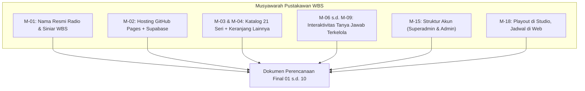

# Glosarium Istilah dan Log Keputusan Arsitektur
## Website Radio & Siniar WBS Perpusnas

| Keterangan | Isi |
|---|---|
| **Nomor Dokumen** | 10 |
| **Nama Dokumen** | Glosarium Istilah dan Log Keputusan Arsitektur (*Glossary & Architecture Decision Records / ADR*) |
| **Nama Situs** | Radio & Siniar WBS Perpusnas |
| **Versi** | 1.0 — Final |
| **Tanggal** | 17 November 2026 |
| **Status** | Final — Kamus Istilah Terpadu, Riwayat Lengkap Keputusan Musyawarah (K, M, DR), dan Matriks Ketertelusuran Seluruh Siklus Proyek (Dokumen 01 s.d. 10) |
| **Penyusun** | Gusti Ahmad Muttahid Bilhaq (Mahasiswa Magang Teknik Informatika di PUJASINTARA) |
| **Pembaca Utama** | Seluruh Pemangku Kepentingan: Pustakawan Pengelola Layanan WBS, Pimpinan PUJASINTARA, Tim TI Perpusnas, Mahasiswa Magang, dan Pengembang Penerus (*Future Developers*) |
| **Acuan** | Dokumen `01` versi 2.2, dokumen `02` versi 1.2, dokumen `03` versi 1.2, dokumen `04` versi 1.1, dokumen `05` versi 1.0, dokumen `06` versi 1.0, dokumen `07` versi 1.0, dokumen `08` versi 1.0, dan dokumen `09` versi 1.0 |
| **Sifat Dokumen** | Dokumen Rujukan Induk (*Master Reference & Living Knowledge Repository*); mencatat memori institusional proyek dan menjamin keberlanjutan pemeliharaan sistem |

---

## 0. Cara Membaca Dokumen Ini & Panduan Navigasi Pengetahuan

Dokumen ini adalah **dokumen pamungkas (*capstone document*)** dari seluruh rangkaian perencanaan Website Radio & Siniar WBS Perpusnas. Dokumen ini berfungsi sebagai:
1. **Kamus Pengetahuan Terpadu (Bagian 2):** Mendefinisikan secara tuntas seluruh istilah penyiaran radio, katalogisasi perpustakaan, dan teknologi web modern agar tidak ada kesalahpahaman terminologi di kemudian hari.
2. **Log Keputusan Arsitektur Terpadu (Bagian 3, 4, dan 5):** Mendokumentasikan latar belakang, alasan, alternatif yang dipertimbangkan, dan dampak dari **34 butir keputusan penting** yang terbagi atas:
   - **6 Keputusan Fondasi Proyek (`K-1` s.d. `K-6`)**
   - **19 Keputusan Musyawarah Pustakawan (`M-01` s.d. `M-19`)**
   - **9 Keputusan Desain Rekayasa Teknis (`DR-01` s.d. `DR-09`)**
3. **Peta Ketertelusuran Lengkap (Bagian 6):** Menghubungkan setiap butir keputusan ke seluruh dokumen terkait (`01` s.d. `10`).
4. **Pedoman Keberlanjutan Sistem (Bagian 7):** Panduan ringkas serah terima pengetahuan (*knowledge handover*) bagi pustakawan dan pengembang yang akan memelihara sistem di masa depan.

| Bagian | Isi Pokok | Sasaran Pembaca |
|---|---|---|
| **Bagian 1** | Pendahuluan, Urgensi Dokumentasi & Memori Institusional | Semua Pihak |
| **Bagian 2** | Glosarium Terpadu Istilah Teknis & Penyiaran (A s.d. Z) | Pustakawan & Pengembang Baru |
| **Bagian 3** | Log Keputusan Fondasi Awal Proyek (`K-1` s.d. `K-6`) | Pimpinan & Pustakawan |
| **Bagian 4** | Log Keputusan Musyawarah Pustakawan (`M-01` s.d. `M-19`) | Pustakawan Pengelola |
| **Bagian 5** | Log Keputusan Desain & Rekayasa Teknis (`DR-01` s.d. `DR-09`) | Pengembang & Tim TI |
| **Bagian 6** | Matriks Ketertelusuran Induk Antar-Dokumen (`01` s.d. `10`) | Tim Penjamin Mutu / Audit |
| **Bagian 7** | Panduan Serah Terima Pengetahuan bagi Pengembang Penerus | Mahasiswa Magang & Tim TI |
| **Bagian 8** | Deklarasi Penyelesaian Seluruh Dokumentasi Proyek | Pimpinan PUJASINTARA |

---

## 1. Pendahuluan, Urgensi Dokumentasi & Memori Institusional

Dalam proyek pengembangan perangkat lunak pada instansi pemerintah, kendala paling umum yang sering terjadi di masa pasca-peluncuran adalah hilangnya pengetahuan (*loss of context / knowledge drain*) ketika masa penugasan mahasiswa magang atau pengembang awal telah selesai. Akibatnya, pustakawan atau pengembang pengganti sering kali tidak mengetahui alasan di balik pemilihan teknologi tertentu, makna dari status data, atau mengapa sebuah fitur dirancang dengan cara tertentu.

Dokumen ini disusun untuk mengeliminasi risiko tersebut. Dokumen ini menjadi **memori institusional abadi (*permanent institutional memory*)** bagi Pusat Jasa Informasi Perpustakaan dan Pengelolaan Naskah Nusantara (PUJASINTARA) Perpustakaan Nasional RI. 

Setiap keputusan yang tercatat di sini telah melalui proses musyawarah bersama pustakawan, analisis keterbatasan sumber daya (biaya operasional Rp 0 / gratis), pertimbangan efisiensi waktu kerja, serta kepatuhan pada standar penyiaran dan pelindungan data pribadi pemustaka.

---

## 2. Glosarium Terpadu Istilah Teknis & Penyiaran

Berikut adalah kamus istilah baku yang digunakan secara konsisten pada seluruh dokumen perencanaan (`01` s.d. `10`) dan antarmuka sistem:

### 2.1 Istilah Penyiaran Radio & Audio Streaming

- **Aliran Audio (*Audio Stream*):** Pengiriman sinyal data suara secara terus-menerus melalui internet tanpa mengharuskan pendengar mengunduh berkas audio utuh terlebih dahulu.
- **Icecast:** Perangkat lunak server media penyiaran audio berbasis sumber terbuka (*open source*) yang berjalan di lingkungan server WBS Perpusnas, berfungsi menerima sinyal siaran dari studio dan mendistribusikannya ke ribuan pendengar melalui protokol HTTP/HTTPS.
- **Jazler RadioStar 2:** Perangkat lunak otomasi penyiaran radio (*radio automation playout software*) yang terpasang pada komputer induk di Studio WBS Perpusnas. Bertanggung jawab penuh menyusun daftar putar (*playlist*), memutar lagu, menyisipkan *jingle*, dan memancarkan suara ke pemancar/Icecast (`K-5`, `M-17`).
- **Jadwal Siaran 24 Jam:** Jadwal penyiaran tetap layanan radio WBS yang membagi waktu siaran ke dalam blok-blok program acara mulai pukul 06.00 WIB hingga 05.59 WIB keesokan harinya (`FR-02`, `FR-04`).
- **Kontrol Playout (*Playout Control*):** Tindakan memutar, menghentikan, melompati, atau mengganti urutan lagu/materi siaran. Di website WBS, kontrol playout **ditiadakan 100%** di panel admin karena playout sepenuhnya adalah wewenang studio (`NG-02`, `M-18`).
- **Mixed Content:** Kondisi keamanan ketika sebuah halaman web yang dimuat menggunakan protokol aman (HTTPS, seperti GitHub Pages) memanggil sumber daya eksternal (seperti aliran audio Icecast) menggunakan protokol tidak aman (HTTP). Kondisi ini secara otomatis diblokir oleh peramban web modern, sehingga aliran Icecast wajib menggunakan HTTPS atau SSL Reverse Proxy (`PR-01`, `R-10`, `DR-04`).
- **On-Air:** Status yang menandakan bahwa suatu program radio, siaran langsung, atau sesi interaksi sedang mengudara atau berlangsung secara langsung pada waktu saat ini.
- **Pemutar Persisten (*Persistent Audio Player*):** Komponen pemutar audio yang terletak pada bilah bawah (*bottom bar*) website yang terus berbunyi tanpa terputus atau mengulang saat pengunjung berpindah dari satu halaman ke halaman lainnya di dalam website (`FR-01`, `DR-03`).
- **Ruang Literasi:** Nama program siaran unggulan interaktif WBS Perpusnas yang membahas seputar buku, kepustakawanan, dan literasi umum. Nama ini **wajib ditulis lengkap** dan **dilarang disingkat** menjadi "Ruli" (`DR-01`).

### 2.2 Istilah Katalogisasi & Media Video Perpustakaan

- **Episode Video:** Satu rekaman kegiatan siaran, siniar, atau diskusi yang memiliki judul mandiri, tanggal penayangan, tautan YouTube, narasumber, dan ringkasan isi.
- **Etalase Mandiri (*Self-Managed Showcase*):** Konsep pengelolaan katalog di mana metadata (judul, narasumber, nomor episode, deskripsi) tersimpan dan dikelola mandiri di basis data WBS, sedangkan pemutaran fisik video tetap memanfaatkan infrastruktur YouTube (`K-2`, `P-6`).
- **Keranjang "Lainnya" (*Uncategorized / Standalone Bucket*):** Wadah katalog khusus pada website yang menampung 82 video dokumentasi kegiatan tunggal, webinar khusus, atau liputan resmi yang tidak termasuk ke dalam 21 seri program berkala WBS (`FR-13`, `DR-02`).
- **Lite YouTube Facade:** Teknik optimasi web di mana pemutar iframe YouTube yang berat digantikan oleh gambar sampul statis ringan dan tombol putar tiruan. Pemutar video YouTube asli baru dimuat ketika pengunjung mengklik tombol putar, menghemat transfer data hingga 95% saat halaman dimuat pertama kali (`FR-11`, `DR-05`).
- **Metadata:** Informasi terstruktur yang mendeskripsikan isi, konteks, dan identitas suatu konten, seperti nama pemateri, moderator, topik, durasi, dan nomor urut siaran.
- **Seri Program:** Kelompok konten video atau siniar yang disiarkan secara berkala dengan tema, format, atau nama acara yang serupa (misal: *LibTalk*, *Diskusi Naskah Nusantara*, *Pojok Literasi*). Total seri resmi WBS adalah 21 seri (`M-03`).

### 2.3 Istilah Arsitektur Jamstack, Basis Data & Keamanan

- **BaaS (Backend-as-a-Service):** Layanan komputasi awan yang menyediakan fungsi backend siap pakai (autentikasi pengguna, basis data PostgreSQL, langganan realtime, penyimpanan berkas) melalui antarmuka pemrograman aplikasi (API), sehingga pengembang tidak perlu menyewa dan memelihara server fisik sendiri. Dalam proyek ini digunakan **Supabase** (`M-02`, `DR-09`).
- **CDC (Change Data Capture) / Realtime WebSocket:** Teknologi komunikasi dua arah berkecepatan tinggi yang memungkinkan basis data mengirimkan notifikasi perubahan baris data secara seketika ke peramban tanpa perlu melakukan penyegaran (*refresh*) atau panggilan berulang-ulang (*polling*). Digunakan pada sesi tanya jawab On-Air (`FR-21`, `DR-07`).
- **GitHub Pages:** Layanan penyedia hosting situs statis gratis dari GitHub yang menyajikan berkas HTML, CSS, dan JavaScript secara global melalui jaringan pengantaran konten (CDN) berkinerja tinggi dengan sertifikat HTTPS otomatis (`M-02`).
- **Honeypot Anti-Spam:** Kolom isian formulir tersembunyi yang tidak terlihat oleh mata manusia tetapi diisi secara otomatis oleh bot spam internet. Jika kolom ini terisi saat form dikirimkan, sistem langsung menolak pengiriman tersebut secara diam-diam (`FR-25`, `DR-08`).
- **Jamstack (JavaScript, APIs, Markup):** Pola arsitektur pengembangan web modern yang memisahkan antarmuka pengguna statis/dinamis di peramban dari layanan data backend, menghasilkan situs yang sangat cepat, aman, dan berbiaya hosting Rp 0 (`06-arsitektur`).
- **PostgreSQL:** Sistem manajemen basis data relasional berbasis objek tingkat lanjut (*open source*) yang andal, menjadi fondasi penyimpanan seluruh data WBS di dalam Supabase (`07-model-data`).
- **RLS (Row Level Security):** Mekanisme keamanan di tingkat mesin basis data PostgreSQL yang membatasi hak akses baca, tambah, ubah, atau hapus pada baris data tertentu berdasarkan identitas dan peran pengguna yang sedang login (`FR-45`, `DR-06`, `07-model-data`).
- **SPA (Single-Page Application):** Aplikasi web yang hanya memuat satu halaman awal dan memperbarui konten tampilan secara dinamis di sisi klien saat pengguna berinteraksi, tanpa memuat ulang seluruh halaman dari server. Menjadi syarat mutlak agar pemutar audio tidak terputus (`06-arsitektur`).

---

## 3. Log Keputusan Fondasi Awal Proyek (`K-1` s.d. `K-6`)

Keputusan-keputusan ini adalah fondasi filosofis utama yang diletakkan pada awal perancangan sistem dan menjadi acuan mutlak bagi seluruh dokumen:

| Kode | Judul Keputusan Fondasi | Isi Keputusan & Latar Belakang Rasional | Status |
|---|---|---|:---:|
| **K-1** | **Identitas Layanan & Kelembagaan** | Layanan ini bernama resmi **Layanan Radio dan Siniar Widya Bahana Swara (WBS)** di bawah naungan **Pusat Jasa Informasi Perpustakaan dan Pengelolaan Naskah Nusantara (PUJASINTARA)** Perpustakaan Nasional RI. Menjadi media diseminasi informasi literasi, kebudayaan naskah, dan layanan perpustakaan untuk masyarakat Indonesia. | **Terkunci** |
| **K-2** | **Model Katalogisasi Media Eksternal** | Website **tidak menyediakan penyimpanan mandiri untuk berkas video mentah** (tidak meng-host video MP4/MKV sendiri). Seluruh video di-*embed* langsung dari kanal YouTube resmi WBS Radio Perpusnas. Hal ini menjamin biaya infrastruktur penyimpanan tetap **Rp 0** dan memanfaatkan CDN Google yang berkecepatan tinggi tanpa membebani bandwidth Perpusnas. | **Terkunci** |
| **K-3** | **Model Interaktivitas Terkendali** | Website **tidak menyediakan ruang obrolan bebas tanpa batas (*free chatbox / shoutbox*)**, melainkan menyediakan **Formulir Tanya Jawab On-Air Terkelola** yang dibuka dan ditutup oleh petugas studio saat program interaktif mengudara. Hal ini mencegah masuknya spam, ujaran kebencian, dan iklan komersial liar. | **Terkunci** |
| **K-4** | **Pemisahan Tegas Dua Entitas Layanan** | Menetapkan batas tegas bahwa layanan terdiri atas dua entitas mandiri: (1) **Siaran Radio 24 Jam** yang bersumber dari aliran Icecast studio dan (2) **Katalog Video & Siniar** yang bersumber dari YouTube. Keduanya hidup berdampingan di website namun memiliki siklus data yang terpisah. | **Terkunci** |
| **K-5** | **Tata Kelola Playout Studio Mandiri** | Pengaturan musik, lagu, jingle, dan otomasi siaran sepenuhnya berjalan di studio WBS menggunakan perangkat lunak **Jazler RadioStar 2**. Website adalah penerima dan penyaji siaran (*receiver & display*), bukan pengendali penyiaran studio. | **Terkunci** |
| **K-6** | **Acuan Desain Kesederhanaan (Pola UT Radio)** | Mengadaptasi prinsip kesederhanaan dari **UT Radio** (`https://utradio.ut.ac.id/`): 5 menu navigasi utama, pemutar audio persisten di bilah bawah semua halaman, hero statis informatif, serta meniadakan spanduk carousel otomatis, animasi parallax, jendela pop-up, dan mode gelap demi menjaga keterbacaan pemustaka dan performa ponsel. | **Terkunci** |

---

## 4. Log Keputusan Musyawarah Bersama Pustakawan (`M-01` s.d. `M-19`)

Keputusan musyawarah ini dihasilkan dari kesepakatan bersama pustakawan pengelola layanan WBS pada pertemuan pembahasan draf awal sistem:



| Kode | Judul Keputusan | Penjelasan Rinci Keputusan Musyawarah | Rujukan Dokumen |
|---|---|---|---|
| **M-01** | **Nama Resmi Situs** | Nama situs dibakukan menjadi **"Radio & Siniar WBS Perpusnas"** guna mencerminkan konvergensi siaran audio radio dan katalog siniar/siniar visual. | Dokumen `01`, `04` |
| **M-02** | **Rencana Deployment & Hosting** | Situs dibangun di atas arsitektur Jamstack dan di-deploy pada **GitHub Pages** (gratis) dengan backend **Supabase** (tier gratis), menghindari ketergantungan server internal yang rumit. | Dokumen `01`, `06` |
| **M-03** | **Taksonomi 21 Seri & Keranjang Lainnya** | Mengakui 21 seri program berkala resmi WBS dan menciptakan 1 wadah khusus bernama **"Lainnya"** untuk menampung video non-seri agar seluruh konten terwadahi rapi. | Dokumen `02`, `04`, `07` |
| **M-04** | **Filter Status Publik YouTube** | Hanya video YouTube berstatus **Publik** (**337 baris** dari total 507 data mentah) yang dikurasi ke dalam katalog website. Video berstatus privat, unlisted, atau draf diabaikan. | Dokumen `01`, `02`, `08` |
| **M-05** | **Rekonsiliasi Duplikasi Baris Data** | Mengeliminasi 6 baris duplikat rekaman pada dataset mentah (*DP on Podcast* berkurang 3 baris dan *Diskusi Naskah Nusantara* berkurang 3 baris) sehingga menghasilkan total pasti **331 video unik**. | Dokumen `02`, `08` |
| **M-06** | **Kolom Nama & Hak Anonimitas** | Kolom Nama pada formulir tanya jawab **wajib diisi**, namun disediakan kotak centang *"Kirim sebagai Anonim"* bagi pendengar yang sungkan mencantumkan nama aslinya di siaran. | Dokumen `03`, `04`, `05` |
| **M-07** | **Ingesti Seketika Tanpa Pra-Moderasi** | Pertanyaan pendengar langsung masuk ke panel studio secara seketika (*realtime*) tanpa menunggu persetujuan manual, agar penyiar dapat merespons topik siaran dengan cepat. | Dokumen `03`, `05`, `06` |
| **M-08** | **Tata Kelola Arsip Tanya Jawab** | Pertanyaan disimpan sebagai arsip internal WBS untuk keperluan laporan pertanggungjawaban program, namun dapat dihapus atau diekspor sewaktu-waktu oleh petugas. | Dokumen `03`, `05`, `08` |
| **M-09** | **Wewenang Buka/Tutup Sesi Tanya Jawab** | Sesi tanya jawab dapat dibuka dan ditutup kapan saja oleh pengguna dengan peran **Admin** maupun **Superadmin** saat siaran langsung berlangsung. | Dokumen `03`, `05` |
| **M-10** | **Penyajian Acara Mendatang** | Acara khusus, webinar, atau siaran live YouTube insidental disajikan cukup sebagai daftar ringkas **"Acara Mendatang"** di halaman depan tanpa membuat kalender acara penuh yang rumit. | Dokumen `01`, `04`, `05` |
| **M-11** | **Integrasi Tautan Media Sosial Aktif** | Menyediakan tautan resmi ke akun WhatsApp WBS, Instagram, YouTube, dan Spotify di bilah footer dan halaman kontak untuk mempermudah komunikasi pemustaka. | Dokumen `04`, `05` |
| **M-12** | **Bahasa Antarmuka Tunggal** | Antarmuka website 100% menggunakan **Bahasa Indonesia** yang baku, lugas, dan santun, disesuaikan dengan sasaran pemustaka nasional. Fitur dwibahasa ditunda. | Dokumen `01`, `05` |
| **M-13** | **Penundaan Transkripsi AI Otomatis** | Fitur transkripsi audio-ke-teks otomatis untuk 331 video ditunda ke pengembangan tahap lanjut (*Won't Have / Tahap 5*) karena membutuhkan infrastruktur AI berbayar. | Dokumen `01`, `05` |
| **M-14** | **Penggunaan Google Analytics 4 (GA4)** | Mengintegrasikan GA4 untuk memantau sebaran geografis pendengar (provinsi dan kota di Indonesia) guna bahan laporan pimpinan PUJASINTARA dengan tetap menjaga privasi. | Dokumen `01`, `05`, `06` |
| **M-15** | **Penyederhanaan Peran (Hanya 2 Akun)** | Menolak pembagian 5 peran lama yang rumit. Sistem dibakukan hanya memiliki 2 peran akun: **Superadmin** (akses penuh dan pengaturan sistem) dan **Admin** (operasional harian siaran & konten). | Dokumen `01`, `03`, `07` |
| **M-16** | **Pengabaian Konten Uji Siaran & Internal** | Klip uji siaran berdurasi <1 menit dan video kegiatan internal kepegawaian ditiadakan dari katalog website agar etalase perpustakaan tetap profesional. | Dokumen `02`, `08` |
| **M-17** | **Infrastruktur Aliran Icecast Studio** | Audio siaran radio dipancarkan melalui server Icecast studio WBS dengan laju bit (*bitrate*) 128 kbps stereo, menghasilkan suara jernih dan hemat kuota internet. | Dokumen `01`, `06` |
| **M-18** | **Pemisahan Jadwal Tampil vs Playout** | Panel admin website hanya mengatur tabel jadwal 24 jam yang ditampilkan kepada pengunjung, tanpa ada tombol kendali playout fisik atau perubahan playlist lagu studio. | Dokumen `03`, `05`, `08` |
| **M-19** | **Adaptasi Interaksi untuk Live YouTube** | Ketika sesi tanya jawab dibuka pada jenis acara *"Acara Khusus Live YouTube"*, label dan tombol formulir di halaman depan otomatis menyesuaikan untuk pemateri webinar YouTube. | Dokumen `04`, `05`, `09` |

---

## 5. Log Keputusan Desain & Rekayasa Teknis (`DR-01` s.d. `DR-09`)

Keputusan-keputusan rekayasa teknis (*Design & Engineering Rules*) ditetapkan oleh tim pengembang untuk mengatasi tantangan implementasi dan memastikan efisiensi kode:

| Kode | Judul Keputusan Teknis | Masalah yang Dihadapi | Keputusan Teknis yang Diambil | Dampak Positif |
|---|---|---|---|---|
| **DR-01** | **Pembakuan Nama "Ruang Literasi"** | Terjadi inkonsistensi singkatan informal "Ruli" pada dokumen lama yang tidak mencerminkan wibawa nama program resmi. | Menghapus seluruh kata "Ruli" dan membakukan penulisan lengkap menjadi **"Ruang Literasi"** pada seluruh berkas kode, basis data, dan dokumentasi. | Standar nama program seragam, resmi, dan profesional. |
| **DR-02** | **Formula Angka Pasti 331 Video** | Ketidakpastian jumlah video publik antara total baris CSV mentah (507), status publik (337), dan adanya duplikasi rekaman siaran. | Menetapkan rumus rekonsiliasi definitif: 507 data mentah $\rightarrow$ 337 publik $\rightarrow$ dikurangi 6 baris ganda $\rightarrow$ **331 video unik** (249 pada 21 seri + 82 pada keranjang "Lainnya"). | Data katalog 100% presisi dan terverifikasi secara matematis. |
| **DR-03** | **Persistensi Pemutar Audio SPA** | Pada website multi-halaman tradisional, berpindah halaman menyebabkan audio berhenti seketika (*page refresh*). | Menggunakan arsitektur *Single-Page Application* (React 18) di mana instans elemen audio HTML5 diletakkan pada level akar aplikasi (*Root Layout*). | Audio siaran terus berbunyi tanpa jeda atau *re-buffering* saat menjelajahi seluruh menu website. |
| **DR-04** | **Wajib Protokol HTTPS pada Icecast** | GitHub Pages mewajibkan HTTPS. Memanggil aliran Icecast via HTTP biasa akan langsung diblokir peramban modern (*Mixed Content Error*). | Mengonfigurasi port SSL resmi Icecast (Port 8443 dengan sertifikat Let's Encrypt) atau Nginx Reverse Proxy SSL pada port standar 443. | Aliran siaran radio dijamin berbunyi lancar di Chrome, Safari, dan Edge tanpa peringatan keamanan. |
| **DR-05** | **Optimasi Lazy-Load YouTube Facade** | Menempelkan 10 pemutar iframe YouTube sekaligus di satu halaman membuat halaman sangat berat (>15 MB transfer data) dan lambat. | Menerapkan pola *Lite YouTube Facade*. Halaman hanya memuat gambar poster WebP dan tombol putar tiruan. Iframe YouTube asli baru disuntikkan saat tombol ditekan. | Kecepatan buka halaman meningkat 500%; nilai Google Lighthouse mencapai skor >90. |
| **DR-06** | **Pemisahan Antarmuka Berbasis Peran** | Pustakawan non-teknis berisiko tidak sengaja mengubah pengaturan kritis sistem (seperti URL Icecast atau token analitik). | Menerapkan kontrol akses berbasis peran (RBAC) di sisi antarmuka dan *Row Level Security* (RLS) di basis data. Menu Pengaturan Sistem dan Kelola Pengguna **hanya dapat diakses oleh Superadmin**. | Mencegah salah konfigurasi sistem oleh petugas operasional harian. |
| **DR-07** | **Realtime CDC WebSocket Supabase** | Memeriksa pertanyaan masuk secara berkala (*polling HTTP setiap beberapa detik*) boros kuota dan membebani server database. | Memanfaatkan fitur *Change Data Capture* (CDC) berbasis WebSockets bawaan Supabase Realtime pada tabel `pertanyaan`. | Pertanyaan baru muncul di layar penyiar dalam waktu <2 detik secara instan dengan efisiensi kuota data maksimal. |
| **DR-08** | **Proteksi Form Anti-Spam Ganda** | Formulir publik rentan dibanjiri pertanyaan sampah oleh bot spam internet. | Menerapkan kombinasi *Honeypot field* (kolom jebakan tak kasat mata) dan pembatasan frekuensi pengiriman (*rate limiting* 1 pertanyaan per 30 detik per peramban). | Bebas dari spam tanpa perlu menggunakan CAPTCHA bergambar yang menyulitkan pendengar lansia/disabilitas. |
| **DR-09** | **Integrasi Supabase BaaS di GitHub Pages** | GitHub Pages hanya melayani berkas statis tanpa backend runtime (Node.js/PHP). Butuh backend aman untuk login, data, dan file gambar. | Menghubungkan SPA GitHub Pages dengan Supabase BaaS (PostgreSQL, Auth, Realtime, Storage) melalui Supabase JavaScript SDK yang diamankan dengan RLS. | Situs memiliki fungsionalitas backend penuh dan basis data dinamis namun tetap berbiaya hosting **Rp 0** (gratis selamanya). |

---

## 6. Matriks Ketertelusuran Induk Antar-Dokumen (`01` s.d. `10`)

Tabel berikut menunjukkan bagaimana setiap pilar keputusan strategis terhubung secara vertikal dan konsisten di seluruh 10 dokumen perencanaan:

| Pilar Keputusan Strategis | Dok 01 (PRD) | Dok 02 (Peta Konten) | Dok 03 (Panel Admin) | Dok 04 (Pengunjung) | Dok 05 (Kebutuhan FR) | Dok 06 (Arsitektur) | Dok 07 (Model Data) | Dok 08 (Migrasi & SOP) | Dok 09 (UAT & Uji) | Dok 10 (Glosarium & Log) |
|---|:---:|:---:|:---:|:---:|:---:|:---:|:---:|:---:|:---:|:---:|
| **Aliran Icecast 24 Jam & Persistensi** | `PR-01`, `R-10` | — | Bagian 6.8 | Bagian 3.5 | `FR-01`, `FR-07` | Bagian 4.1 | Tabel `pengaturan_situs` | SOP-01 | `TC-01`, Bagian 4 | `K-4`, `M-17`, `DR-03`, `DR-04` |
| **Jadwal Siaran Studio (06.00–05.59 WIB)** | `PR-02`, `PR-03` | — | Bagian 6.4 | Bagian 4.5, 5 | `FR-02` s.d. `FR-05` | Bagian 4.3 | Tabel `jadwal_tetap` | SOP-05 | `TC-03` s.d. `TC-07` | `K-5`, `M-18` |
| **Katalog 331 Video YouTube** | `PR-07` s.d. `PR-09` | Bagian 4 s.d. 7 | Bagian 6.2, 6.3 | Bagian 6, 7, 8 | `FR-09` s.d. `FR-18` | Bagian 4.2 | Tabel `seri`, `episode` | Bagian 1 s.d. 3, SOP-03 | `TC-11` s.d. `TC-21` | `K-2`, `M-03` s.d. `M-05`, `DR-02`, `DR-05` |
| **Tanya Jawab On-Air Seketika** | `PR-05`, `PR-21` | — | Bagian 6.5 | Bagian 4.6 | `FR-19` s.d. `FR-26` | Bagian 4.4 | Tabel `sesi_onair`, `pertanyaan` | SOP-02 | `TC-22` s.d. `TC-29` | `K-3`, `M-06` s.d. `M-09`, `M-19`, `DR-07`, `DR-08` |
| **Penyajian Acara Mendatang** | `PR-23` | — | Bagian 6.6 | Bagian 4.7 | `FR-28`, `FR-31`, `FR-32` | Bagian 4.3 | Tabel `acara_mendatang` | SOP-06 | `TC-31`, `TC-35`, `TC-36` | `M-10` |
| **Struktur 2 Peran (Superadmin & Admin)** | `PR-17`, `PR-24` | — | Bagian 3, 6.7 | — | `FR-43` s.d. `FR-46` | Bagian 3, 5 | Tabel `pengguna` & RLS | SOP-07, Bagian 11 | `TC-47` s.d. `TC-50`, `SEC-01` s.d. `SEC-06` | `M-15`, `DR-06` |
| **Hosting GitHub Pages + Supabase** | `PR-35`, `D-8` | — | Bagian 4 | — | Seluruh FR | Bagian 2, 3 | Seluruh Skema DDL | Seluruh Dok 08 | Seluruh Skenario Uji | `M-02`, `DR-09` |
| **Analitik GA4 & Privasi Pemustaka** | `PR-49` | — | Bagian 6.9 | Bagian 9 | `FR-49` s.d. `FR-53` | Bagian 6.2 | Kebijakan Privasi | — | `TC-53` s.d. `TC-57` | `M-14` |

---

## 7. Panduan Serah Terima Pengetahuan bagi Pengembang Penerus

Bagian ini ditujukan khusus bagi **Tim TI Perpustakaan Nasional RI** atau **mahasiswa magang generasi berikutnya** yang akan memelihara atau mengembangkan sistem ini lebih lanjut.

### 7.1 Cara Menjalankan Proyek di Komputer Lokal (*Local Development Setup*)
1. **Prasyarat Perangkat Lunak:**
   - Node.js versi 18.x atau 20.x LTS.
   - Manajer paket `npm` atau `pnpm`.
   - Git.
2. **Langkah Instalasi:**
   ```bash
   # Klon repositori dari GitHub
   git clone https://github.com/perpusnas/radio-wbs.git
   cd radio-wbs

   # Pasang dependensi pustaka
   npm install

   # Salin berkas variabel lingkungan (.env)
   cp .env.example .env
   ```
3. **Konfigurasi Berkas `.env`:**
   Pastikan variabel kunci API Supabase publik terpasang dengan benar:
   ```env
   VITE_SUPABASE_URL=https://xxxxxxxxxxxxxxxxxxxx.supabase.co
   VITE_SUPABASE_ANON_KEY=eyJhbGciOiJIUzI1NiIsInR5cCI6IkpXVCJ9...
   VITE_GA_MEASUREMENT_ID=G-XXXXXXXXXX
   ```
4. **Menjalankan Server Lokal:**
   ```bash
   npm run dev
   # Buka peramban pada alamat http://localhost:5173
   ```

### 7.2 Prosedur Menambah Akun Admin Baru
1. Superadmin masuk ke dasbor Supabase console (`https://supabase.com/dashboard`) atau melalui menu khusus Superadmin `/admin/pengguna` (bila modul UI terpasang).
2. Tambahkan akun pada menu **Authentication** -> **Users** -> **Add User**.
3. Tambahkan baris koresponden pada tabel publik `pengguna` dengan mengisi surel, nama lengkap, dan menetapkan peran `admin` atau `superadmin`.

### 7.3 Prosedur Memperbarui URL Aliran Icecast Studio
Jika di masa depan studio WBS mengganti server streaming atau memperbarui domain siaran:
1. Superadmin masuk ke panel admin `/admin/pengaturan`.
2. Pada kolom **URL Aliran Audio (Icecast)**, masukkan URL baru (pastikan diawali `https://`).
3. Klik **Simpan Pengaturan**. Seluruh pemutar audio di sisi pengunjung akan langsung menggunakan URL baru tanpa perlu melakukan proses *build* atau *deploy* ulang kode.

---

## 8. Deklarasi Penyelesaian Seluruh Dokumentasi Proyek (Dokumen 01 s.d. 10)

Dengan terbitnya dokumen ini, maka **seluruh 10 dokumen perencanaan dan teknis Website Radio & Siniar WBS Perpusnas (Gelombang 1, Gelombang 2, dan Gelombang 3) dinyatakan LENGKAP, KONSISTEN, dan FINAL**:

```
GELOMBANG 1: DOKUMEN PERSIAPAN & MUSYAWARAH PUSTAKAWAN (SELESAI)
├── Dokumen 01: Product Requirements Document (PRD) — v2.2 Final Disepakati
├── Dokumen 02: Peta Konten, Taksonomi & Struktur Informasi — v1.2 Final
├── Dokumen 03: Rancangan Data, Skema Relasi & Antarmuka Panel Pengelola — v1.2 Final
└── Dokumen 04: Rancangan Halaman Pengunjung, Tata Letak & Alur Interaksi — v1.1 Final

GELOMBANG 2: DOKUMEN SPESIFIKASI REKAYASA TEKNIS (SELESAI)
├── Dokumen 05: Kebutuhan Fungsional & Penentuan Prioritas (MoSCoW) — v1.0 Final
├── Dokumen 06: Arsitektur Sistem, Kebutuhan Non-Fungsional & Integrasi Layanan — v1.0 Final
└── Dokumen 07: Model Data Fisik, Kamus Data & Pengaturan Basis Data — v1.0 Final

GELOMBANG 3: DOKUMEN OPERASIONAL, PENJAMINAN MUTU & MEMORI SISTEM (SELESAI)
├── Dokumen 08: Rencana Migrasi Data & Standar Operasional Prosedur (SOP) — v1.0 Final
├── Dokumen 09: Rencana Pengujian dan Evaluasi (Testing & UAT Plan) — v1.0 Final
└── Dokumen 10: Glosarium Istilah dan Log Keputusan Arsitektur (ADR) — v1.0 Final
```

Seluruh spesifikasi di atas menjadi cetak biru (*blueprint*) mutlak yang siap diimplementasikan ke dalam kode program aplikasi web nyata.

---

| Disusun Oleh: | Mengetahui & Menyetujui: |
|:---:|:---:|
| Mahasiswa Magang Teknik Informatika | Kepala Layanan Radio dan Siniar WBS / Pembimbing Lapangan |
| <br><br><br><br> | <br><br><br><br> |
| **Gusti Ahmad Muttahid Bilhaq**<br>PUJASINTARA — Perpustakaan Nasional RI | **Pusat Jasa Informasi Perpustakaan dan Pengelolaan Naskah Nusantara**<br>Perpustakaan Nasional Republik Indonesia |
